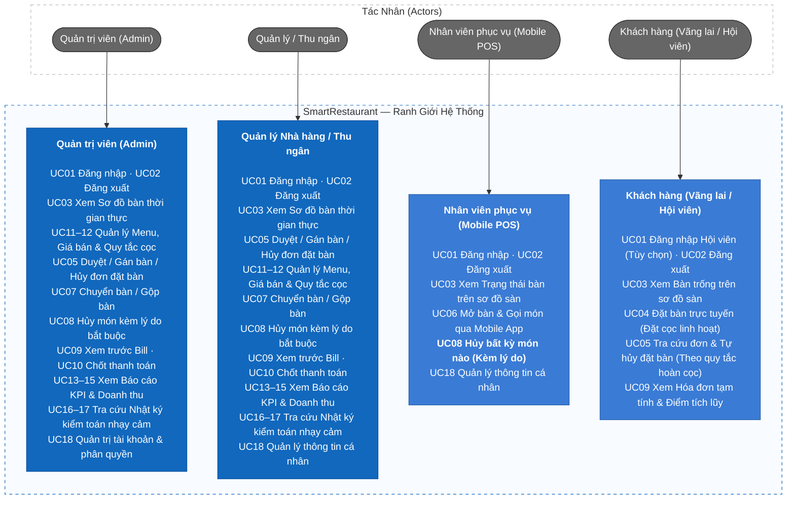
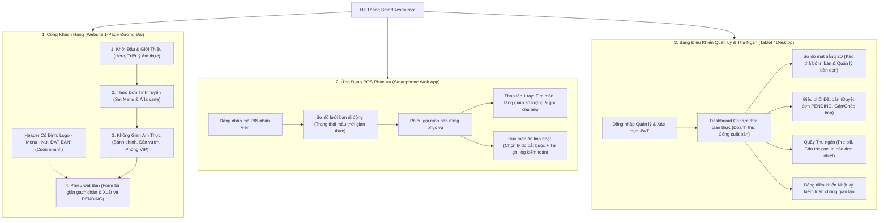
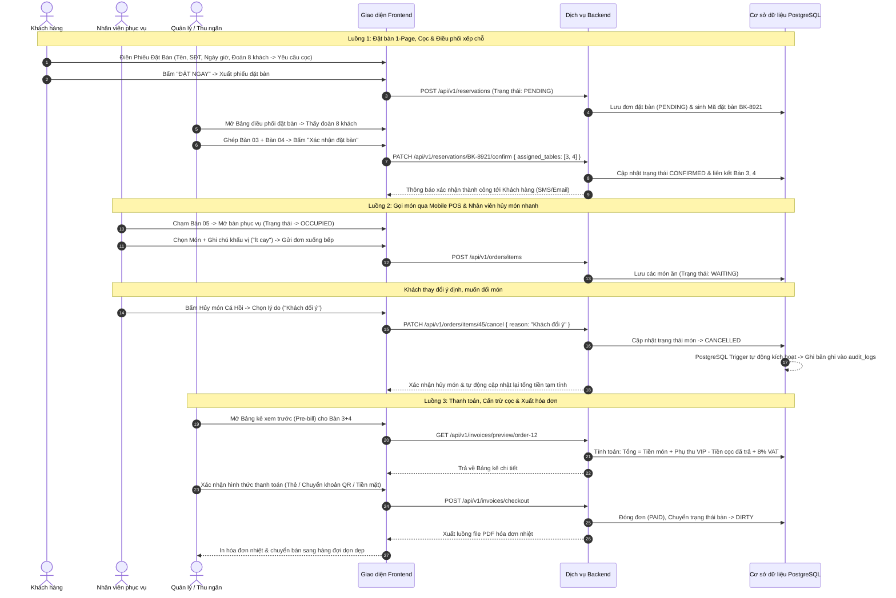
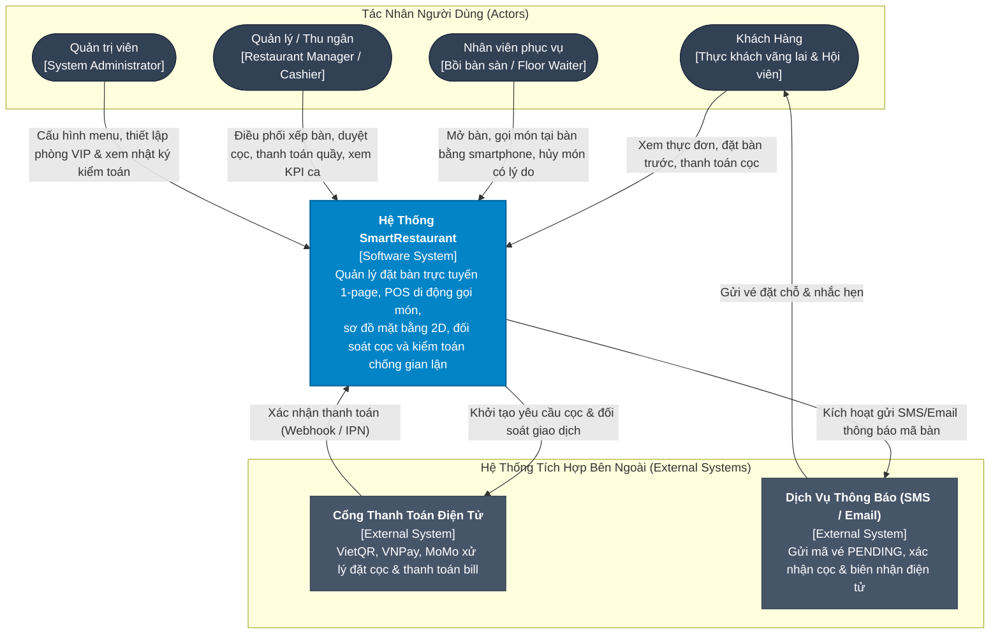
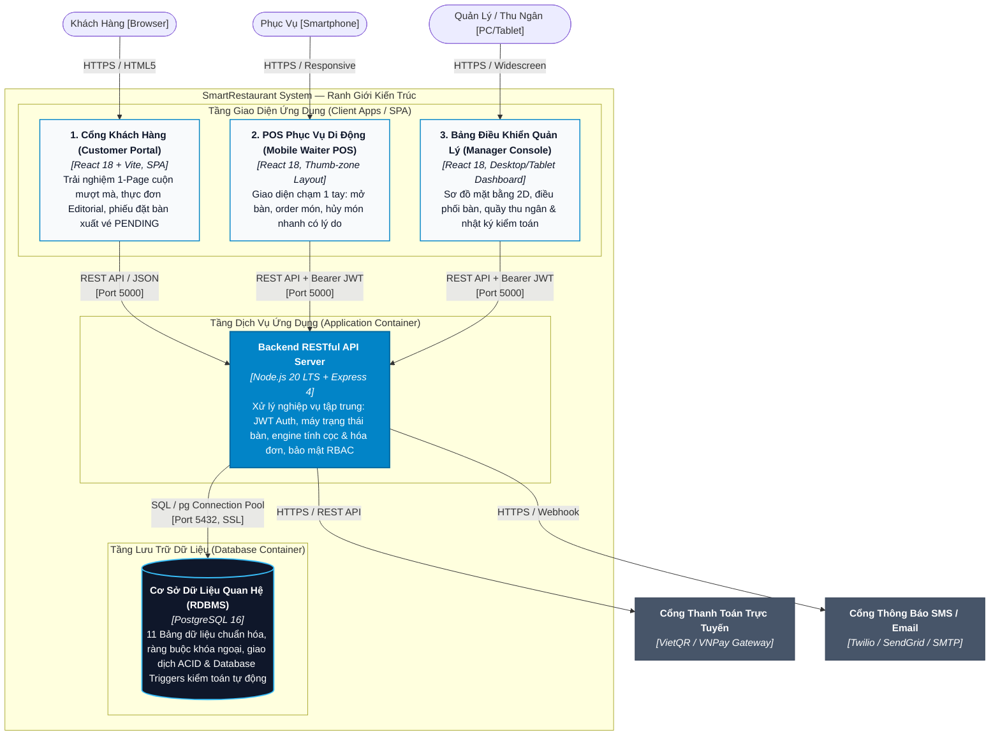
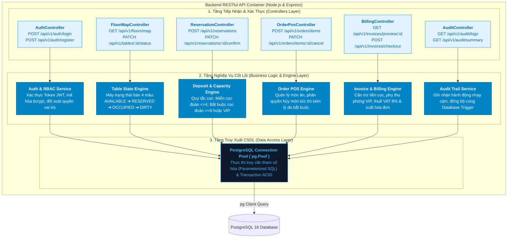
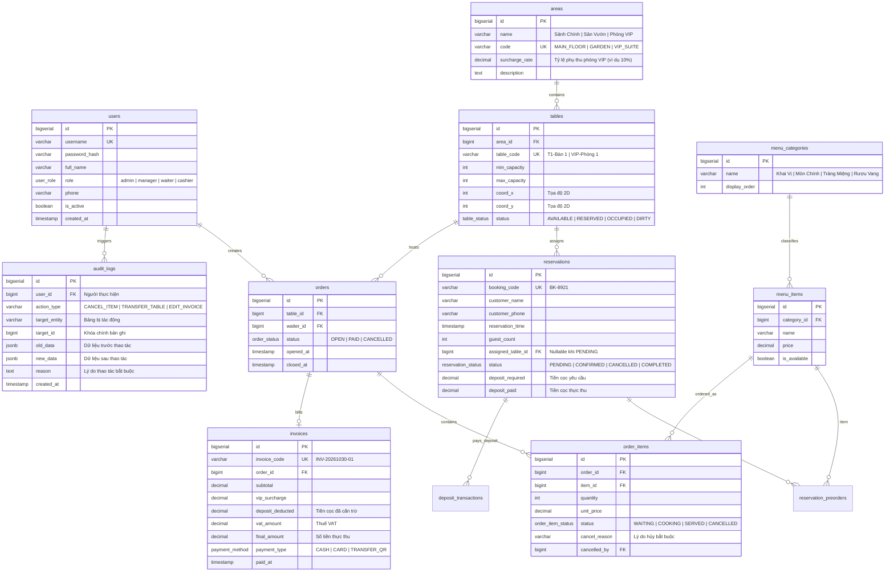
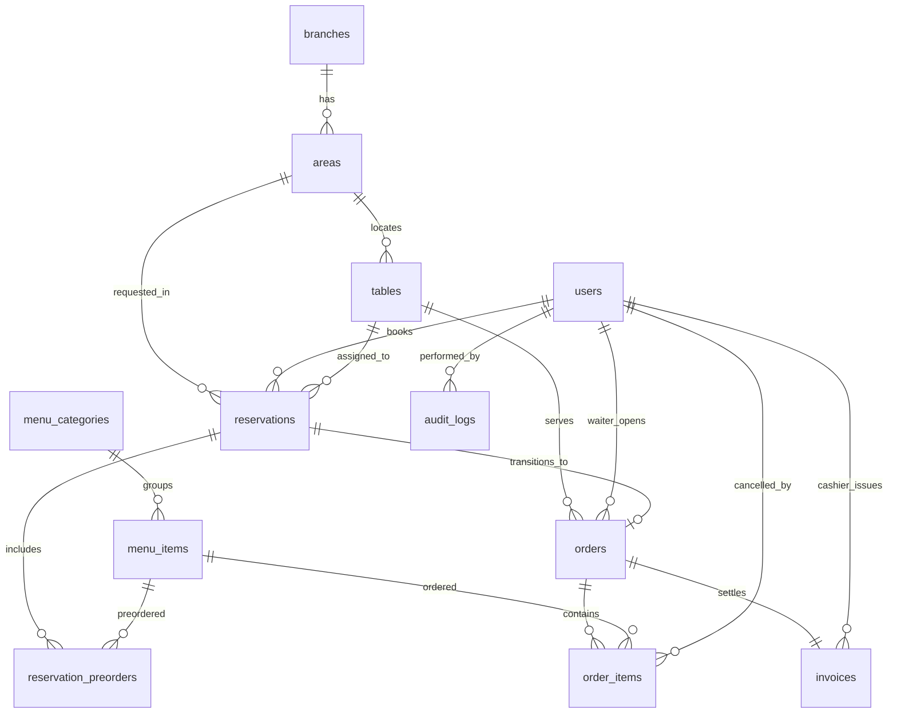

# SmartRestaurant — Hệ Thống Quản Lý Đặt Bàn & POS Gọi Món Di Động

SmartRestaurant là hệ thống đặt bàn linh hoạt và POS gọi món di động dành cho các nhà hàng hiện đại, giúp tinh gọn quy trình vận hành hàng ngày, tối ưu hóa công suất phục vụ và mang lại trải nghiệm ẩm thực vượt trội cho thực khách. Hệ thống tích hợp liền mạch giữa sơ đồ mặt bằng thời gian thực, cơ chế đặt bàn linh hoạt (Khách vãng lai & Hội viên tích điểm), bảng điều phối và xác nhận chỗ ngồi của quản lý, quy tắc đặt cọc thông minh cho nhóm đông/phòng VIP, gọi món cơ động trên smartphone kèm quyền hủy món nhanh cho nhân viên, hóa đơn đối soát cọc chống gian lận và cơ chế ghi log kiểm toán tự động trong cơ sở dữ liệu.

---

## 1. Yêu Cầu Nghiệp Vụ — Use Cases, INVEST Stories và Tiêu Chí Chấp Nhận (Acceptance Criteria)

Tập yêu cầu định nghĩa các mục tiêu SmartRestaurant cần đạt được, giá trị vận hành mang lại và các tiêu chí nghiệm thu có thể kiểm chứng được trong dịch vụ hàng ngày. Toàn bộ yêu cầu chức năng được cấu trúc thành các ca sử dụng (Use Cases), kiểm chứng theo tiêu chí INVEST và phân định ranh giới theo ma trận phân quyền dựa trên vai trò (RBAC).

### 1.1 Sơ Đồ Tư Duy Sản Phẩm (Product Mind Map)


---

### 1.2 Ca Sử Dụng (Use Cases)

#### 1.2.1 Danh Mục Ca Sử Dụng (Use Case Catalog)

Phạm vi hệ thống được cụ thể hóa thành 18 ca sử dụng thuộc 8 miền chức năng, bám sát các nghiệp vụ thực tế trong nhà hàng:

| Mã UC | Tên Ca Sử Dụng | Miền Chức Năng | Tác Nhân Chính | Quy Tắc Vận Hành Trọng Yếu |
| :--- | :--- | :--- | :--- | :--- |
| **UC01** | Đăng nhập & Phiên làm việc | Xác thực & Phân quyền | Nhân viên & Khách hội viên | Hỗ trợ phân quyền nhân viên qua token và tài khoản hội viên tích điểm. |
| **UC02** | Đăng xuất & Kết thúc phiên | Xác thực & Phân quyền | Nhân viên & Khách hội viên | Xóa phiên làm việc phía client trên cả desktop, tablet và mobile. |
| **UC03** | Xem Sơ đồ bàn & Trạng thái sàn | Đặt bàn & Trạng thái sàn | Khách hàng, Phục vụ, Quản lý, Admin | Theo dõi trực tiếp 4 trạng thái màu (`AVAILABLE`, `RESERVED`, `OCCUPIED`, `DIRTY`). |
| **UC04** | Tìm kiếm & Gửi yêu cầu đặt bàn | Đặt bàn & Trạng thái sàn | Khách hàng (Vãng lai/Hội viên), Quản lý | Cho phép đặt nhanh không cần đăng nhập; giới hạn thời gian dùng bữa; cọc linh hoạt cho đoàn đông ($\ge 6$ người) hoặc phòng VIP. |
| **UC05** | Duyệt, Gán lại bàn & Hủy đặt bàn | Đặt bàn & Trạng thái sàn | Quản lý, Khách hàng | Quản lý kiểm tra và ghép/chuyển bàn để xếp chỗ đoàn đông trước khi xác nhận; khách có thể tự hủy theo chính sách hoàn cọc. |
| **UC06** | Gọi món qua Ứng dụng di động | POS Phục vụ di động | Nhân viên phục vụ | Tìm kiếm món chạm tối ưu, bộ tăng giảm số lượng và ghi chú gửi bếp (`Không hành`, `Ít cay`). |
| **UC07** | Chuyển bàn & Gộp bàn | POS Phục vụ di động | Quản lý, Admin | Điều chuyển đơn bàn đang ăn theo nhu cầu thay đổi chỗ ngồi của khách. |
| **UC08** | Hủy món kèm chính sách kiểm toán | POS Phục vụ di động | Bất kỳ nhân viên nào | **Hủy món linh hoạt:** Nhân viên có thể hủy món ngay; bắt buộc chọn lý do hủy và hệ thống tự động ghi nhật ký kiểm toán. |
| **UC09** | Xem trước Bảng kê thanh toán | Hóa đơn & Thu ngân | Thu ngân, Quản lý, Khách hàng | Bảng kê chi tiết gồm tiền món, phụ thu VIP, trừ tiền cọc đã trả, điểm tích lũy và thuế VAT. |
| **UC10** | Chốt thanh toán & In hóa đơn | Hóa đơn & Thu ngân | Thu ngân, Quản lý | Đóng phiên order, chuyển bàn sang trạng thái chờ dọn (`DIRTY`), cộng điểm hội viên và in hóa đơn nhiệt dạng PDF. |
| **UC11** | Quản lý Thực đơn & Danh mục | Quản lý Thực đơn & Giá | Quản lý, Admin | Phân loại danh mục, CRUD món ăn và hỗ trợ xóa mềm (*soft-delete*) để bảo toàn lịch sử hóa đơn. |
| **UC12** | Cập nhật Giá, Phụ thu VIP & Quy tắc cọc | Quản lý Thực đơn & Giá | Quản lý, Admin | Thiết lập giá món, tỷ lệ phụ thu phòng VIP, ngưỡng tiền cọc và bật/tắt trạng thái hết món tức thì. |
| **UC13** | Xem KPI Doanh thu & Đơn hàng ngày | Báo cáo & Phân tích | Quản lý, Admin | Dashboard ca trực thời gian thực: doanh thu gộp, số lượng khách phục vụ và số bàn đang hoạt động. |
| **UC14** | Xem Xu hướng Công suất & Doanh số | Báo cáo & Phân tích | Quản lý, Admin | Biểu đồ lịch sử theo ca/ngày/tháng, tốc độ xoay vòng bàn và hiệu suất sử dụng diện tích. |
| **UC15** | Xem Top Món ăn Bán chạy | Báo cáo & Phân tích | Quản lý, Admin | Xếp hạng số lượng bán ra giúp bếp chuẩn bị nguyên liệu và tối ưu nhập hàng. |
| **UC16** | Tự động Kích hoạt Ghi log Kiểm toán | Nhật ký Kiểm toán Hoạt động | Hệ thống (Trigger DB Tự động) | Trigger PostgreSQL tự động lưu lại các sự kiện nhạy cảm (hủy món, chuyển bàn, chỉnh sửa hóa đơn). |
| **UC17** | Tra cứu Nhật ký Kiểm toán Nhạy cảm | Nhật ký Kiểm toán Hoạt động | Quản lý, Admin | Màn hình tra cứu tuân thủ có bộ lọc: người thực hiện, thời gian, dữ liệu trước/sau và lý do thao tác. |
| **UC18** | Quản lý Tài khoản Nhân viên & Hồ sơ | Quản lý Người dùng | Admin (Toàn bộ), Nhân viên & Khách (Hồ sơ) | Vòng đời tài khoản nhân viên, gán quyền RBAC, quản lý hồ sơ tích điểm và đặt lại mật khẩu. |

#### 1.2.2 Sơ Đồ Ca Sử Dụng (Use Case Diagram)



---

### 1.3 Tiêu Chuẩn INVEST Cho Yêu Cầu Nghiệp Vụ

Tập backlog phiên bản V1 ánh xạ 18 ca sử dụng thành 18 User Stories sẵn sàng cho phát triển. Mỗi câu chuyện người dùng đều được thẩm định theo tiêu chí INVEST:

| Tiêu chí | Ý nghĩa trong hệ thống SmartRestaurant |
| :--- | :--- |
| **Independent (Độc lập)** | Mỗi User Story mang lại một năng lực nghiệp vụ riêng biệt, tránh phụ thuộc kỹ thuật chéo giữa các luồng vận hành khác nhau. |
| **Negotiable (Thương lượng được)** | Chi tiết cài đặt (giới hạn giờ ăn, cổng thanh toán cọc) có thể tinh chỉnh linh hoạt trong khi các quy tắc nghiệp vụ cốt lõi vẫn được giữ vững. |
| **Valuable (Có giá trị)** | Mang lại giá trị vận hành trực tiếp: xếp bàn nhanh cho khách vãng lai, giảm tình trạng khách bỏ hẹn (*no-show*), hủy món linh hoạt và ngăn chặn thất thoát gian lận. |
| **Estimable (Ước lượng được)** | Các vai trò, tham số đầu vào, trigger cơ sở dữ liệu, máy chuyển trạng thái và các kịch bản ngoại lệ đều được quy chuẩn hóa rõ ràng. |
| **Small (Đủ nhỏ)** | Mỗi Story gói gọn một khả năng chính, được chia nhỏ thành các tác vụ API, Cơ sở dữ liệu, Giao diện và Kiểm thử. |
| **Testable (Kiểm thử được)** | Mỗi Story đều có tiêu chí chấp nhận cụ thể (Acceptance Criteria), kiểm tra được tính hợp lệ dữ liệu, quyền truy cập và dữ liệu ghi log kiểm toán. |

```text
US01–US02   Xác thực tài khoản, phiên làm việc hội viên và kiểm soát truy cập
US03–US05   Đặt bàn linh hoạt, quản lý xếp/ghép bàn và hủy đặt bàn
US06–US08   POS phục vụ di động, chuyển/gộp bàn và nhân viên hủy món nhanh
US09–US10   Xuất hóa đơn, cấn trừ cọc, tích điểm thưởng và hoàn tất thanh toán
US11–US12   Quản lý thực đơn, phân loại danh mục và cấu hình quy tắc đặt cọc
US13–US15   Dashboard điều hành, phân tích công suất bàn và xu hướng bán hàng
US16–US17   Ghi nhận nhật ký kiểm toán và báo cáo chống gian lận
US18        Quản trị người dùng, phân quyền nhân viên và hồ sơ hội viên
```

Các tính năng nổi bật đã được định lượng rõ ràng:
* **Đặt bàn 2 chế độ:** Khách vãng lai đặt chỗ nhanh chỉ với thông tin liên hệ cơ bản; khách hội viên đăng nhập để tích lũy điểm sau khi thanh toán.
* **Điều phối & Xác nhận chỗ ngồi:** Đơn đặt bàn mới vào hệ thống ở trạng thái `PENDING`, giúp quản lý dễ dàng sắp xếp, gộp bàn cho các đoàn khách lớn trước khi chốt duyệt (`CONFIRMED`).
* **Quy tắc cọc & Hủy bàn:** Nhóm nhỏ ($\le 4$ khách) không cần cọc; nhóm đông hoặc đặt phòng VIP yêu cầu đặt cọc giữ chỗ, được cấn trừ toàn bộ vào hóa đơn hoặc hoàn lại nếu hủy trước hạn quy định.

---

### 1.4 Ma Trận Phân Quyền Theo Vai Trò (RBAC Matrix)

Hệ thống thiết lập ranh giới quyền hạn chặt chẽ giữa 4 vai trò người dùng, đảm bảo sự linh hoạt tối đa khi phục vụ khách mà vẫn bảo toàn tính toàn vẹn và minh bạch của dữ liệu:

| Khả Năng Nghiệp Vụ | Administrator | Quản lý / Thu ngân | Nhân viên phục vụ | Khách hàng (Vãng lai / Hội viên) |
| :--- | :---: | :---: | :---: | :---: |
| **Xem Thực đơn công khai** | Toàn quyền | Toàn quyền | Toàn quyền | Chỉ xem |
| **Gửi đơn Đặt bàn** | Toàn quyền | Toàn quyền | Bị chặn | Tự thực hiện (Vãng lai hoặc Đăng nhập) |
| **Duyệt / Ghép / Gán bàn đặt** | Toàn quyền | Toàn quyền | Bị chặn | Bị chặn |
| **Hủy đơn đặt & Hoàn tiền cọc** | Toàn quyền | Duyệt & Xử lý vắng mặt | Bị chặn | Tự hủy (Trước hạn quy định) |
| **Xem Sơ đồ bàn thời gian thực** | Toàn quyền | Toàn quyền | Xem trạng thái bàn & dọn dẹp | Chỉ xem bàn trống khi đặt chỗ |
| **Mở bàn phục vụ tại chỗ** | Toàn quyền | Toàn quyền | Thực hiện qua Smartphone POS | Bị chặn |
| **Gọi thêm / Điều chỉnh món ăn** | Toàn quyền | Toàn quyền | Thao tác trên bàn đang ăn | Bị chặn |
| **Hủy món ăn đã gọi** | Toàn quyền (Cần lý do) | Toàn quyền (Cần lý do) | **Bất kỳ nhân viên nào (Cần lý do + Tự ghi log)** | Bị chặn |
| **Chuyển bàn / Gộp bàn ăn** | Toàn quyền | Toàn quyền | Bị chặn (Cần quyền Quản lý) | Bị chặn |
| **Xem trước Hóa đơn (Cấn trừ cọc)** | Toàn quyền | Toàn quyền | Bị chặn | Xem bảng kê của bàn mình |
| **Thanh toán & In hóa đơn nhiệt** | Toàn quyền | Toàn quyền | Bị chặn | Bị chặn |
| **CRUD Menu, Giá & Quy tắc cọc** | Toàn quyền | Toàn quyền | Bị chặn | Bị chặn |
| **Tra cứu Nhật ký kiểm toán** | Toàn quyền | Toàn quyền | Bị chặn | Bị chặn |
| **Quản trị Tài khoản Nhân viên** | Toàn quyền | Bị chặn | Bị chặn | Xem thông tin & điểm của mình |

> **Chính sách bảo mật:** Mọi thao tác nhạy cảm có rủi ro thất thoát (hủy món ăn, chuyển bàn, hoàn cọc, giảm giá) đều kích hoạt cơ chế trigger tự động của PostgreSQL để lưu lại: Mã người thực hiện, thời gian chính xác, dữ liệu trước/sau và lý do nghiệp vụ bắt buộc.

---

## 2. Kiến Trúc Thông Tin & Thiết Kế Giao Diện UI/UX

Kiến trúc thông tin (Information Architecture - IA) của SmartRestaurant tổ chức trải nghiệm người dùng theo 3 phân hệ chuyên biệt: **Cổng Khách Hàng (Website 1-Page Đương Đại)**, **POS Di Động Phục Vụ (Smartphone 1 Tay)**, và **Bảng Điều Khiển Quản Lý & Thu Ngân (Desktop/Tablet Console)**.

---

### 2.1 Kiến Trúc Thông Tin (Sitemap & Luồng Trải Nghiệm 1-Page)

Phân hệ Khách hàng được thiết kế theo trải nghiệm **1-Page Cuộn Mượt Mà (Single-Page Smooth Scroll — Cảm hứng từ Khuê Restaurant)**, tích hợp toàn bộ hành trình ẩm thực từ Giới thiệu $\rightarrow$ Khám phá Thực đơn $\rightarrow$ Không gian phòng $\rightarrow$ Phiếu Đặt Bàn (Booking Ticket).



#### Bảng Ánh Xạ Tuyến Đường & Màn Hình Hệ Thống

| Định Danh View | Đường Dẫn Tuyến | Phân Hệ & Thiết Bị | Nhiệm Vụ Nghiệp Vụ Trọng Tâm |
| :--- | :--- | :--- | :--- |
| `VIEW-CP-01` | `/` *(Tất cả trong 1)* | Khách hàng (Web/Mobile) | Trang chủ trải nghiệm 1-page: Giới thiệu thương hiệu, Thực đơn, Không gian và Phiếu đặt bàn. |
| `VIEW-CP-02` | `/#menu` | Khách hàng (Web/Mobile) | Phần xem thực đơn theo phong cách Editorial Grid với khung viền và đường kẻ chỉ tinh tế. |
| `VIEW-CP-03` | `/#dat-ban` | Khách hàng (Web/Mobile) | Phiếu đặt bàn (Form gạch chân tối giản), tự động áp dụng quy tắc cọc cho đoàn $\ge 6$ người / phòng VIP. |
| `VIEW-WP-01` | `/pos/tables` | Phục vụ (Smartphone) | Lưới trạng thái bàn di động tối ưu chạm, hiển thị thời gian dùng bữa và bàn chờ dọn. |
| `VIEW-WP-02` | `/pos/order/:tableId` | Phục vụ (Smartphone) | Phiếu gọi món bàn đang ăn: thêm món, ghi chú gửi bếp, hủy món tức thì kèm lý do. |
| `VIEW-MD-01` | `/admin/dashboard` | Quản lý (Desktop/Tablet) | Báo cáo KPI điều hành: doanh thu trong ngày, tỷ lệ kín bàn, đơn chờ duyệt, món bán chạy. |
| `VIEW-MD-02` | `/admin/floor-map` | Quản lý (Desktop/Tablet) | Bản đồ không gian 2D: gộp bàn/chuyển bàn và ghi đè trạng thái. |
| `VIEW-MD-03` | `/admin/reservations`| Quản lý (Desktop/Tablet) | Bàn điều phối đặt bàn: duyệt các đơn `PENDING`, ghép bàn đón đoàn đông, xác nhận đơn. |
| `VIEW-MD-04` | `/admin/billing/:orderId`| Thu ngân (Desktop/Tablet)| Xem bảng kê tạm tính (Pre-bill), cấn trừ cọc, tích điểm hội viên, xuất hóa đơn nhiệt PDF. |
| `VIEW-MD-05` | `/admin/audit` | Quản lý (Desktop/Tablet) | Tra cứu nhật ký kiểm toán bất biến: theo dõi lịch sử hủy món, chuyển bàn, chiết khấu. |

---

### 2.2 Wireframes & Thiết Kế Giao Diện Trực Quan (UI Showcase)

Dưới đây là các bản thiết kế giao diện thực tế của hệ thống được lưu trữ trong thư mục `docs/images/`:

#### 1. Cổng Khách Hàng — Trang Chủ & Giới Thiệu (Hero Section)
Thiết kế thanh lịch với hình ảnh ruộng bậc thang cinematic, triết lý ẩm thực đương đại và nút bấm cuộn mượt xuống phiếu đặt bàn:


#### 2. Cổng Khách Hàng — Thực Đơn Tinh Tuyển (Editorial Menu Grid)
Bố cục thực đơn tối giản với đường kẻ mảnh phân cách, khung hình thanh tao và giá niêm yết theo set:


#### 3. Cổng Khách Hàng — Không Gian Nhà Hàng (Dining Spaces)
Giới thiệu các không gian thưởng thức: Sảnh chính hoàng gia, Sân vườn terrace và Phòng tiệc VIP khép kín:


#### 4. Cổng Khách Hàng — Phiếu Đặt Bàn (Reservation Ticket)
Form đặt bàn dạng đường gạch chân tối giản (Border-bottom minimal), dễ điền và tự động tính cọc cho đoàn đông:


#### 5. Phân Hệ Phục Vụ — POS Gọi Món Di Động (Mobile Waiter POS)
Thiết kế tối ưu cho điện thoại thông minh, thao tác 1 tay (Thumb-zone), hiển thị bàn đang ăn và quyền hủy món nhanh:


#### 6. Phân Hệ Quản Lý — Dashboard Tổng Quan Ca Trực (Executive Dashboard)
Bảng điều khiển quản lý ca trực trực quan: theo dõi doanh thu theo ngày/tuần/tháng tích hợp biểu đồ cột, tỉ lệ đóng góp doanh thu giữa các phòng dạng biểu đồ tròn, công suất bàn, lượng khách theo khung giờ & ngày trong tuần, cùng hàng chờ đặt bàn và BXH món bán chạy đặt song song:


#### 7. Phân Hệ Quản Lý — Sơ Đồ Mặt Bằng Kiến Trúc 2D (Spatial Floor Map)
Sơ đồ mặt bằng kiến trúc thể hiện chính xác vị trí thực tế của từng bàn trong từng không gian ẩm thực (Sảnh Chính T1, Sân Vườn Terrace T2, Phòng Tiệc VIP) với 4 trạng thái màu trực quan và chế độ phác thảo:


---

### 2.3 Các Luồng Tương Tác Cốt Lõi (Core Interaction Flows)



---

### 2.4 Hệ Thống Thiết Kế & Quy Chuẩn Công Thái Học (UI Design & Ergonomics)

1. **Ngôn ngữ thiết kế tối giản (Minimalist Luxury Aesthetic):**
   * **Kiểu chữ:** Kết hợp giữa phông chữ có chân thanh lịch cổ điển (`Cormorant Garamond`, `Playfair Display`) cho tiêu đề và phông không chân sắc nét (`Plus Jakarta Sans`) cho nội dung và số liệu.
   * **Bảng màu:** Tông nền sáng kem trang nhã (`#FFFFFF` / `#FAF8F5`), tương phản cùng chữ đen than chì (`#1E1E1E`) và điểm xuyết sắc xanh olive / vàng đồng trầm (`#726B52`).
   * **Đường nét:** Đường kẻ chỉ mỏng nhẹ (`1px solid #E6E2DB`), loại bỏ các khối hộp viền dày cứng nhắc, tạo cảm giác nhẹ nhàng, tĩnh lặng.

2. **Nguyên lý công thái học theo từng thiết bị (Ergonomics by Form Factor):**
   * **Cổng Khách hàng (Desktop/Mobile Web):** Trải nghiệm 1-page liền mạch, không chuyển trang rườm rà. Nút đặt bàn ở đầu trang luôn sẵn sàng cuộn nhanh đến phiếu điền thông tin.
   * **POS Di động cho Phục vụ (Smartphone 1 tay):** Tối ưu hóa vùng ngón tay cái (Thumb-zone), các nút chọn danh mục và thao tác hủy món được bố trí ở nửa dưới màn hình để bồi bàn bấm nhanh khi đang di chuyển.
   * **Màn hình Quản lý & Thu ngân (Widescreen Tablet/Desktop):** Giao diện bảng điều khiển chia đôi (Split-screen) giúp vừa quan sát sơ đồ bàn 2D, vừa xử lý duyệt đơn đặt bàn `PENDING` và in hóa đơn thanh toán.

---

## 3. Mô Hình Kiến Trúc Hệ Thống (C4 Architecture Model)

Mô hình kiến trúc C4 (*Context, Containers, Components, Code*) được Simon Brown chuẩn hóa nhằm trực quan hóa kiến trúc phần mềm theo nhiều mức độ phóng đại tương tự như bản đồ số (Google Maps). Tài liệu kiến trúc của SmartRestaurant phân rã hệ thống qua 4 cấp độ:

```text
[ C1: System Context ]  ──(Phóng to mức triển khai)──>  [ C2: Containers ]
                                                              │
                                                   (Phóng to mức module)
                                                              ▼
[ C4: Code & Data Schema ]  <──(Phóng to mã & CSDL)───  [ C3: Components ]
```

---

### 3.1 C1 — Sơ Đồ Bối Cảnh Hệ Thống (System Context Diagram)

C1 mô tả bức tranh toàn cảnh ở cấp độ cao nhất: xác định ranh giới của SmartRestaurant, các tác nhân thực tế trong nhà hàng và mối liên kết với các hệ thống hạ tầng bên ngoài.



#### Ma Trận Tương Tác Cấp Hệ Thống (System Context Interaction Matrix)

| Tác Nhân / Hệ Thống Ngoài | Kênh Tương Tác | Trách Nhiệm Vận Hành & Luồng Dữ Liệu |
| :--- | :--- | :--- |
| **Khách Hàng (Customer)** | Web Browser (Desktop / Mobile) | Duyệt thực đơn phong cách Editorial, gửi phiếu đặt bàn (Booking Ticket), cọc tự động cho đoàn đông ($\ge 6$) hoặc phòng VIP. |
| **Nhân Viên Phục Vụ (Waiter)** | Smartphone (Mobile Web POS) | Gọi món cơ động tại bàn, ghi chú khẩu vị cho bếp, hủy món tức thì kèm lý do bắt buộc (không cần chờ quản lý). |
| **Quản Lý & Thu Ngân** | Tablet / Desktop Console | Điều phối xếp bàn các đơn `PENDING`, giám sát mặt bằng 2D, lập bảng kê xem trước (Pre-bill), cấn trừ cọc và in hóa đơn. |
| **Quản Trị Viên (Admin)** | Desktop Admin Console | Thiết lập danh mục món ăn, phụ thu phòng VIP, phân quyền RBAC và tra cứu báo cáo gian lận. |
| **Cổng Thanh Toán (Payment)** | HTTPS Webhook / IPN | Tiếp nhận chuyển khoản VietQR/VNPay, xác nhận trạng thái cọc thành công theo thời gian thực. |
| **Dịch Vụ Thông Báo (Notify)** | REST API / SMTP Gateway | Tự động gửi SMS xác nhận giữ chỗ kèm mã đặt bàn (`BK-xxxx`) cho thực khách. |

---

### 3.2 C2 — Sơ Đồ Khối Triển Khai (Container Diagram)

C2 phóng to vào bên trong hệ thống SmartRestaurant để chỉ rõ các khối phần mềm (Containers) có thể biên dịch, thực thi và triển khai độc lập, cùng các giao thức mạng kết nối giữa chúng.



#### Quy Chuẩn Công Nghệ Từng Container (Container Technology Stack)

| Container | Vai Trò & Chức Năng Chính | Công Nghệ Sử Dụng | Giao Thức & Cổng |
| :--- | :--- | :--- | :--- |
| **Customer Portal** | Cổng trải nghiệm khách hàng 1-Page, xem menu, không gian và gửi đơn đặt bàn. | React 18, Vite, Lucide Icons, Pure CSS | HTTPS (Port 443 / 5173 Dev) |
| **Mobile Waiter POS** | POS di động cho bồi bàn: chọn bàn nhanh, thêm món, hủy món kèm lý do. | React 18 SPA (Tối ưu màn hình cảm ứng di động) | HTTPS + Bearer JWT |
| **Manager Console** | Bảng điều hành ca: Dashboard KPI, sơ đồ bàn 2D, duyệt cọc, thu ngân, audit log. | React 18 SPA (Desktop & Tablet Split Layout) | HTTPS + Bearer JWT |
| **Backend RESTful API** | Máy chủ API tập trung: quản lý phiên, nghiệp vụ bàn, hóa đơn và ghi log kiểm toán. | Node.js 20 LTS, Express 4, bcryptjs, jsonwebtoken | RESTful JSON (Port 5000) |
| **Database Container** | Lưu trữ dữ liệu quan hệ bền vững, thực thi trigger kiểm toán chống gian lận. | PostgreSQL 16 (Hỗ trợ JSONB, ENUMs, PL/pgSQL Triggers) | PostgreSQL Wire (Port 5432) |

---

### 3.3 C3 — Sơ Đồ Thành Phần Nội Bộ (Component Diagram: Backend API)

C3 bóc tách sâu vào bên trong **Backend RESTful API Container**, làm rõ cấu trúc 3 lớp (Three-Tier Architecture) bao gồm Controllers, Services/Engines nghiệp vụ, và Repositories/Database Access.



#### Bảng Phân Tách Trách Nhiệm Các Thành Phần (Component Catalog)

| Tên Thành Phần | Loại | Nhiệm Vụ Nghiệp Vụ Chuyên Biệt |
| :--- | :--- | :--- |
| **`Auth & RBAC Service`** | Service | Tiếp nhận thông tin đăng nhập, xác thực mã PIN/Mật khẩu với `bcryptjs`, phát hành JSON Web Token mang thông tin vai trò (`admin`, `manager`, `waiter`, `cashier`). |
| **`Table State Engine`** | Engine | Kiểm soát vòng đời 4 màu của bàn ăn (`AVAILABLE` xanh, `RESERVED` vàng, `OCCUPIED` đỏ, `DIRTY` xám), tự động khóa chuyển bàn khi trùng thời gian. |
| **`Deposit & Capacity Engine`** | Engine | Tự động phân tích quy mô đoàn khách: nhóm $\le 4$ người cho phép đặt tự do không cọc; đoàn $\ge 6$ người hoặc phòng VIP tự động áp mức cọc cố định. |
| **`Order POS Engine`** | Engine | Cung cấp giao diện gọi món di động cho phục vụ; cho phép nhân viên **hủy bất kỳ món nào đã gọi** với điều kiện phải chọn lý do hủy để chống gian lận. |
| **`Invoice & Billing Engine`** | Engine | Kết xuất bảng kê tạm tính (Pre-bill), tự động khấu trừ 100% số tiền cọc đã thu trước đó, cộng phụ thu phòng VIP, tính thuế VAT 8% và chốt thanh toán. |
| **`Audit Trail Service`** | Service | Lắng nghe và tiếp nhận các sự kiện nhạy cảm (hủy món, đổi bàn, sửa bill, hoàn cọc), đồng thời đọc dữ liệu từ trigger CSDL để phục vụ đối soát. |

---

### 3.4 C4 — Sơ Đồ Dữ Liệu & Kiểm Toán Cơ Sở Dữ Liệu (Code & Data Schema)

Cấp độ C4 tập trung vào cấu trúc dữ liệu quan hệ chi tiết, các mối quan hệ khóa ngoại (ERD) và cơ chế Trigger tự động của PostgreSQL bảo vệ toàn vẹn lịch sử vận hành.

#### 3.4.1 Sơ Đồ Quan Hệ Thực Thể (Entity Relationship Diagram - ERD)



#### 3.4.2 Cơ Chế Bảo Mật & Database Triggers Chống Gian Lận

Nhằm đảm bảo quy trình hủy món linh hoạt cho nhân viên phục vụ nhưng vẫn ngăn chặn triệt để hành vi thông đồng gian lận tiền mặt, hệ thống cài đặt **PostgreSQL Database Trigger** độc lập với mã nguồn backend:

1. **Trigger tự động bắt sự kiện Hủy món (`trg_audit_cancelled_items`):**
   Khi một bản ghi trong bảng `order_items` chuyển trạng thái sang `CANCELLED`, trigger tự động chèn 1 bản ghi vào bảng `audit_logs` gồm:
   - ID nhân viên thực hiện thao tác.
   - Trạng thái và số lượng món trước/sau (`old_data` và `new_data`).
   - Lý do hủy món bắt buộc (`cancel_reason`).
   - Dấu thời gian chính xác theo máy chủ cơ sở dữ liệu (`NOW()`).

2. **Quy tắc bất biến (Immutability Policy):**
   Bảng `audit_logs` chỉ cấp quyền `INSERT` và `SELECT` cho tài khoản ứng dụng; cấm tuyệt đối các thao tác `UPDATE` và `DELETE`, đảm bảo nhật ký kiểm toán không thể bị can thiệp bởi bất kỳ nhân viên hay quản trị viên nào.

---

## 4. Thiết Kế Cơ Sở Dữ Liệu Chi Tiết (Database Schema — DBML & ER Mermaid)

Cơ sở dữ liệu của SmartRestaurant được xây dựng trên hệ quản trị **PostgreSQL 16**, bao gồm 11 bảng chuẩn hóa (3NF), ràng buộc khóa ngoại toàn vẹn và trigger PL/pgSQL độc lập. Toàn bộ lược đồ được tài liệu hóa song song bằng định dạng **DBML (Database Markup Language)** và **Sơ đồ ER Mermaid**.

> 📂 File định nghĩa DBML gốc sẵn sàng kết xuất sơ đồ: [docs/architecture/schema.dbml](./docs/architecture/schema.dbml)  
> 📂 Kịch bản tạo bảng DDL PostgreSQL hoàn chỉnh: [src/database/schema.sql](./src/database/schema.sql)

### 4.1 Định Nghĩa Lược Đồ Dữ Liệu DBML (Database Markup Language)

Đoạn mã DBML chuẩn hóa dưới đây có thể sao chép và hiển thị trực tiếp trên [dbdiagram.io](https://dbdiagram.io) hoặc [dbdocs.io](https://dbdocs.io):

```dbml
Project SmartRestaurant {
  database_type: 'PostgreSQL'
  Note: 'Hệ thống Quản lý Đặt bàn & POS Di Động — Sơ đồ Cơ sở Dữ liệu Quan hệ'
}

enum user_role { ADMIN; MANAGER; CASHIER; WAITER; CUSTOMER }
enum table_status { AVAILABLE; RESERVED; OCCUPIED; DIRTY }
enum reservation_status { PENDING; CONFIRMED; SEATED; CANCELLED }
enum order_status { SERVING; PAID; CANCELLED }
enum item_status { WAITING; COOKING; SERVED; CANCELLED }

Table users {
  id bigserial [pk, increment]
  username varchar(50) [unique, not null]
  password_hash varchar(255) [not null]
  full_name varchar(100) [not null]
  phone varchar(20) [unique, not null]
  role user_role [not null, default: 'CUSTOMER']
  loyalty_points int [default: 0]
  is_active boolean [default: true]
  created_at timestamptz [default: `now()`]
  updated_at timestamptz [default: `now()`]
}

Table branches {
  id bigserial [pk, increment]
  name varchar(100) [not null]
  address text [not null]
  phone varchar(20) [not null]
  is_active boolean [default: true]
}

Table areas {
  id bigserial [pk, increment]
  branch_id bigint [not null, ref: > branches.id]
  name varchar(100) [not null]
  is_vip boolean [default: false]
  surcharge_rate numeric(5,2) [default: 0.00]
  is_active boolean [default: true]
}

Table tables {
  id bigserial [pk, increment]
  area_id bigint [not null, ref: > areas.id]
  table_number varchar(20) [not null]
  capacity int [not null]
  coord_x int [default: 0]
  coord_y int [default: 0]
  status table_status [default: 'AVAILABLE']
  is_active boolean [default: true]

  indexes {
    (area_id, table_number) [unique]
  }
}

Table menu_categories {
  id bigserial [pk, increment]
  name varchar(100) [unique, not null]
  display_order int [default: 0]
}

Table menu_items {
  id bigserial [pk, increment]
  category_id bigint [not null, ref: > menu_categories.id]
  name varchar(150) [not null]
  price numeric(12,2) [not null]
  cost_price numeric(12,2) [default: 0]
  unit varchar(20) [default: 'Phần']
  image_url text
  description text
  is_available boolean [default: true]
  deleted_at timestamptz
}

Table reservations {
  id bigserial [pk, increment]
  booking_code varchar(20) [unique, not null]
  customer_id bigint [null, ref: > users.id]
  customer_name varchar(100) [not null]
  customer_phone varchar(20) [not null]
  customer_email varchar(100)
  guest_count int [not null]
  area_id bigint [ref: > areas.id]
  assigned_table_id bigint [null, ref: > tables.id]
  reservation_time timestamptz [not null]
  deposit_amount numeric(12,2) [default: 0.00]
  status reservation_status [default: 'PENDING']
  note text
  created_at timestamptz [default: `now()`]
}

Table reservation_preorders {
  id bigserial [pk, increment]
  reservation_id bigint [not null, ref: > reservations.id]
  menu_item_id bigint [not null, ref: > menu_items.id]
  quantity int [not null]
}

Table orders {
  id bigserial [pk, increment]
  table_id bigint [not null, ref: > tables.id]
  waiter_id bigint [not null, ref: > users.id]
  reservation_id bigint [null, ref: > reservations.id]
  status order_status [default: 'SERVING']
  opened_at timestamptz [default: `now()`]
  closed_at timestamptz [null]
}

Table order_items {
  id bigserial [pk, increment]
  order_id bigint [not null, ref: > orders.id]
  menu_item_id bigint [not null, ref: > menu_items.id]
  quantity int [not null]
  price numeric(12,2) [not null]
  taste_notes text
  status item_status [default: 'WAITING']
  cancel_reason text [null]
  cancelled_by bigint [null, ref: > users.id]
  created_at timestamptz [default: `now()`]
  updated_at timestamptz [default: `now()`]
}

Table invoices {
  id bigserial [pk, increment]
  order_id bigint [unique, not null, ref: - orders.id]
  cashier_id bigint [not null, ref: > users.id]
  subtotal_amount numeric(12,2) [not null]
  vip_surcharge numeric(12,2) [default: 0.00]
  deposit_deducted numeric(12,2) [default: 0.00]
  discount_amount numeric(12,2) [default: 0.00]
  tax_vat numeric(12,2) [default: 0.00]
  final_amount numeric(12,2) [not null]
  payment_method varchar(50) [default: 'CASH']
  paid_at timestamptz [default: `now()`]
}

Table audit_logs {
  id bigserial [pk, increment]
  table_name varchar(50) [not null]
  record_id bigint [not null]
  action_type varchar(20) [not null]
  performed_by bigint [null, ref: > users.id]
  reason text
  old_data jsonb
  new_data jsonb
  created_at timestamptz [default: `now()`]
}
```

### 4.2 Sơ Đồ Quan Hệ Thực Thể (ER Mermaid Diagram)



---

## 5. Đặc Tả Hợp Đồng Giao Tiếp API (OpenAPI 3.0 Document)

Toàn bộ hệ thống giao tiếp giữa Frontend và Backend tuân thủ nghiêm ngặt chuẩn **RESTful API** và được đặc tả đầy đủ theo định dạng **OpenAPI 3.0.3 (Swagger)**.

> 📂 Tệp đặc tả OpenAPI 3.0 đầy đủ sẵn sàng import vào Swagger UI / Postman / Redoc: [docs/api/openapi.yaml](./docs/api/openapi.yaml)

### 5.1 Danh Mục 20 RESTful Endpoints Trọng Yếu

| Phương Thức | Tuyến Đường (Endpoint) | Phân Hệ Nghiệp Vụ | Quyền Hạn (RBAC) | Mô Tả & Nghiệp Vụ Trọng Tâm |
| :---: | :--- | :--- | :---: | :--- |
| `POST` | `/api/v1/auth/login` | Xác thực & Phiên | Public | Đăng nhập tài khoản, xác thực `bcryptjs`, phát hành JWT Token mang vai trò. |
| `GET` | `/api/v1/auth/me` | Xác thực & Phiên | Bearer JWT | Lấy hồ sơ tài khoản hiện tại, vai trò và số điểm tích lũy hội viên. |
| `GET` | `/api/v1/areas` | Sơ đồ Không gian | Public / Staff | Lấy cây danh sách khu vực (Sảnh chính, Sân vườn, VIP) kèm trạng thái phụ thu. |
| `GET` | `/api/v1/tables` | Sơ đồ Mặt bằng | Public / Staff | Lấy dữ liệu tọa độ 2D và máy trạng thái 4 màu (`AVAILABLE`, `RESERVED`, `OCCUPIED`, `DIRTY`). |
| `PATCH`| `/api/v1/tables/:id/status` | Sơ đồ Mặt bằng | Quản lý / Thu ngân | Cập nhật thủ công trạng thái bàn khi có tình huống đặc biệt tại sàn. |
| `POST` | `/api/v1/tables/:id/clean` | Sơ đồ Mặt bằng | Phục vụ / Tạp vụ | Xác nhận đã hoàn tất dọn dẹp bàn (`DIRTY` $\rightarrow$ `AVAILABLE`). |
| `GET` | `/api/v1/menu/categories` | Quản lý Thực đơn | Public | Danh sách danh mục món ăn (Khai vị, Món chính, Tráng miệng, Đồ uống). |
| `GET` | `/api/v1/menu/items` | Quản lý Thực đơn | Public | Danh sách món ăn chi tiết, đơn giá, hình ảnh và trạng thái còn hàng. |
| `POST` | `/api/v1/reservations` | Đặt bàn Trực tuyến | Public (Khách/Guest) | Tiếp nhận phiếu đặt bàn. Tự động áp cọc cho đoàn $\ge 6$ người / phòng VIP $\rightarrow$ `PENDING`. |
| `GET` | `/api/v1/reservations/:bookingCode`| Đặt bàn Trực tuyến | Public / Staff | Tra cứu thông tin vé đặt bàn bằng mã booking (ví dụ `BK-8921`). |
| `PATCH`| `/api/v1/reservations/:id/confirm`| Điều phối Đặt bàn | Quản lý nhà hàng | Quản lý duyệt phiếu `PENDING`, chỉ định gán bàn chính thức $\rightarrow$ `CONFIRMED`. |
| `PATCH`| `/api/v1/reservations/:id/cancel` | Điều phối Đặt bàn | Quản lý / Khách | Hủy phiếu đặt bàn theo chính sách hoàn cọc tự động. |
| `POST` | `/api/v1/orders/open` | POS Phục vụ Di động | Nhân viên phục vụ | Mở bàn phục vụ tại chỗ trên Smartphone $\rightarrow$ Bàn chuyển `OCCUPIED`. |
| `GET` | `/api/v1/orders/table/:tableId` | POS Phục vụ Di động | Phục vụ / Thu ngân | Lấy chi tiết toàn bộ món ăn và trạng thái chế biến của bàn đang phục vụ. |
| `POST` | `/api/v1/orders/:orderId/items` | POS Phục vụ Di động | Nhân viên phục vụ | Gọi thêm món ăn cho bàn, kèm ghi chú khẩu vị gửi bếp (`Không hành`, `Ít cay`). |
| `PATCH`| `/api/v1/orders/items/:itemId/cancel`| POS Phục vụ Di động | Bất kỳ nhân viên nào | **Hủy món linh hoạt:** Yêu cầu nhập lý do; Trigger CSDL tự động ghi vết `audit_logs`. |
| `GET` | `/api/v1/invoices/preview/:orderId` | Hóa đơn & Thu ngân | Thu ngân / Khách | Bảng kê xem trước (Pre-bill): cấn trừ 100% tiền cọc, phụ thu VIP, tính 8% VAT. |
| `POST` | `/api/v1/invoices/checkout` | Hóa đơn & Thu ngân | Thu ngân | Chốt thanh toán đơn (Tiền mặt/Thẻ/VietQR), đóng order, chuyển bàn sang `DIRTY`. |
| `GET` | `/api/v1/dashboard/kpi` | Báo cáo & Điều hành | Quản lý / Admin | Trả về tổng doanh thu theo ngày/tuần/tháng, công suất bàn và top món bán chạy. |
| `GET` | `/api/v1/audit/logs` | Kiểm toán Chống gian lận | Quản lý / Admin | Truy vấn nhật ký kiểm toán bất biến (Lọc theo người làm, loại thao tác, ngày giờ). |

### 5.2 Mẫu Dữ Liệu Nghiệp Vụ Trọng Tâm (Core Payloads & Response Examples)

#### 1. Khách gửi phiếu đặt bàn yêu cầu cọc (`POST /api/v1/reservations`)

* **Request Body:**
  ```json
  {
    "customer_name": "Anh Trần Vũ Hoàng",
    "customer_phone": "0912345888",
    "customer_email": "hoangtv@gmail.com",
    "guest_count": 8,
    "area_id": 3,
    "reservation_time": "2026-10-30T19:30:00Z",
    "note": "Tiệc sinh nhật gia đình, yêu cầu phòng VIP Royal",
    "preorders": [
      { "menu_item_id": 1, "quantity": 2 }
    ]
  }
  ```
* **Response `201 Created`:**
  ```json
  {
    "success": true,
    "data": {
      "booking_code": "BK-8921",
      "status": "PENDING",
      "deposit_required": 500000.00,
      "deposit_status": "AWAITING_PAYMENT",
      "assigned_table": null,
      "message": "Đã xuất phiếu đặt bàn PENDING. Vui lòng hoàn tất đặt cọc 500.000 ₫ để giữ chỗ."
    }
  }
  ```

#### 2. Phục vụ hủy món nhanh kèm lý do bắt buộc (`PATCH /api/v1/orders/items/45/cancel`)

* **Request Body:**
  ```json
  {
    "cancel_reason": "Khách đổi ý muốn chuyển sang lẩu hải sản nấm"
  }
  ```
* **Response `200 OK`:**
  ```json
  {
    "success": true,
    "item_id": 45,
    "status": "CANCELLED",
    "audit_recorded": true,
    "message": "Đã hủy món thành công. Hệ thống đã tự động lưu vết kiểm toán chống gian lận."
  }
  ```

#### 3. Bảng kê xem trước cấn trừ cọc (`GET /api/v1/invoices/preview/88`)

* **Response `200 OK`:**
  ```json
  {
    "order_id": 88,
    "table_number": "VIP-Phòng 1",
    "subtotal_amount": 2450000.00,
    "vip_surcharge": 245000.00,
    "deposit_deducted": 500000.00,
    "tax_vat": 175600.00,
    "final_amount": 2370600.00,
    "currency": "VND"
  }
  ```