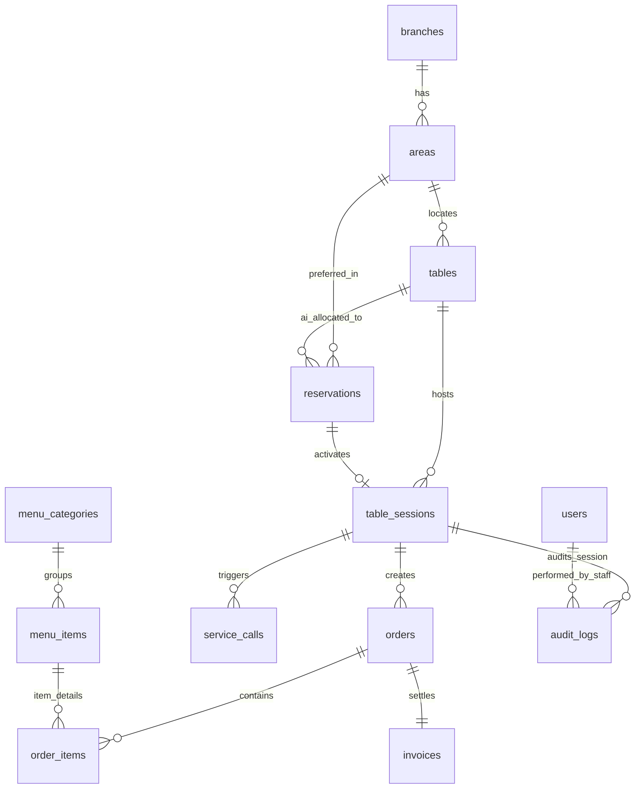

# SmartRestaurant 2.0 — Hệ Thống Tự Động Hóa Vận Hành Đặt Bàn AI, QR Self-Ordering & POS Di Động

SmartRestaurant 2.0 là hệ sinh thái tự động hóa vận hành nhà hàng khép kín thế hệ mới, ứng dụng AI để tối ưu hóa công suất lấp đầy sàn và trao quyền tự phục vụ (Self-Service) trọn vẹn cho thực khách. Hệ thống giải quyết triệt để 4 điểm nghẽn lớn của ngành F&B truyền thống bằng sự kết hợp liền mạch giữa: **AI Booking Chatbot tư vấn**, **Thuật toán AI phân bổ bàn tự động (AI Table Allocation Engine)**, **Quét QR gọi món tại bàn bảo mật bằng Host OTP**, **Giỏ hàng nhóm thời gian thực (Collaborative Group Cart)**, **Màn hình trạm bếp 1-chạm (Kitchen Display System - KDS)**, **Quy tắc hủy món phân tầng thông minh**, **Tự thanh toán tại bàn (Pay-at-Table cấn trừ 100% cọc)**, và **Cơ chế lưu vết kiểm toán bất biến (Immutable Audit Trail) ở tầng PostgreSQL Trigger**.

---

## 1. Yêu Cầu Nghiệp Vụ — Use Cases, INVEST Stories & Tiêu Chí Nghiệm Thu (Acceptance Criteria)

Tập yêu cầu định nghĩa các mục tiêu SmartRestaurant 2.0 cần đạt được, giá trị tự động hóa mang lại và các tiêu chí nghiệm thu có thể kiểm chứng được trong dịch vụ hàng ngày. Toàn bộ yêu cầu chức năng được cấu trúc thành 21 ca sử dụng (Use Cases), kiểm chứng theo tiêu chuẩn Agile INVEST và phân định ranh giới theo ma trận phân quyền dựa trên vai trò (RBAC).

### 1.1 Sơ Đồ Tư Duy Sản Phẩm (Product Mind Map)


---

### 1.2 Danh Mục Ca Sử Dụng (Use Case Catalog)

Phạm vi hệ thống được cụ thể hóa thành 21 ca sử dụng bao phủ trọn vẹn quy trình vận hành tự động hóa:

| Mã UC | Tên Ca Sử Dụng | Miền Chức Năng | Tác Nhân Chính | Quy Tắc Vận Hành Trọng Yếu |
| :--- | :--- | :--- | :--- | :--- |
| **UC01** | Trò chuyện với Chatbot AI tư vấn | Đặt bàn & AI | Khách hàng | AI phân tích khẩu vị, gợi ý set menu, không gian phòng và khung giờ vắng. |
| **UC02** | Đặt bàn & Vị trí ưu tiên mềm | Đặt bàn & AI | Khách hàng | Khách đăng ký vị trí mong muốn; AI có quyền tối ưu hóa để tối đa hóa công suất. |
| **UC03** | Thanh toán cọc tự động qua VietQR | Đặt bàn & AI | Khách hàng | Đoàn $\ge 6$ người hoặc phòng VIP cọc 500k; tự động hủy nếu quá 30 phút không cọc. |
| **UC04** | AI Tối ưu hóa & Phân bổ bàn tự động | Bộ não AI | AI Allocation Engine | Tự động gán mã bàn tối ưu trước 60 phút và gửi SMS thông báo kèm **Host OTP**. |
| **UC05** | Quét QR tại bàn & Xác thực Host OTP | Gọi món tự phục vụ | Khách hàng (Host/Member) | Nhập đúng Host OTP để mở phiên bàn `table_sessions`, chống người lạ quét trộm order bậy. |
| **UC06** | Check-in tự động cho khách vãng lai | Gọi món tự phục vụ | Khách vãng lai | Quét QR bàn trống `AVAILABLE` (trống $\ge 90$p), tự kích hoạt phiên ăn tức thì. |
| **UC07** | Tham gia Giỏ hàng nhóm thời gian thực | Gọi món tự phục vụ | Khách cùng bàn | Nhiều thiết bị cùng thêm món vào giỏ hàng chung qua WebSocket. |
| **UC08** | Host chốt đơn & Bắn món xuống bếp | Gọi món tự phục vụ | Chủ bàn (Host) | Duy nhất người đại diện đặt bàn (Host) mới có quyền bấm gửi order xuống bếp. |
| **UC09** | KDS Bếp cập nhật trạng thái món | Màn hình Bếp (KDS) | Đầu bếp (Chef) | Chạm 1: `COOKING` (khóa tự hủy của khách); Chạm 2: `READY` (báo bồi bàn ra món). |
| **UC10** | Khách tự hủy món đang chờ (PENDING) | Gọi món tự phục vụ | Khách hàng | Món chưa nấu (`PENDING`) khách được tự hủy ngay; Trigger CSDL ghi log kiểm toán. |
| **UC11** | Yêu cầu nhân viên hủy món đang nấu | Hỗ trợ & Ngoại lệ | Khách hàng, Bồi bàn | Món đã sang `COOKING`, khách phải gọi nhân viên xác nhận với bếp để hủy. |
| **UC12** | Bấm chuông gọi phục vụ thông minh | Hỗ trợ & Ngoại lệ | Khách hàng | Chuông gọi phân loại (đổi món, thêm đá/khăn, dọn bàn); Staff App rung chuông tức thì. |
| **UC13** | Tự thanh toán tại bàn (Pay-at-Table) | Hóa đơn & Thu ngân | Khách hàng (Host) | Bảng kê điện tử cấn trừ 100% cọc, thanh toán qua VietQR động, nhận e-receipt. |
| **UC14** | Tự động chuyển bàn ⚫ DIRTY & Dọn dẹp | Sơ đồ sàn 2D | Hệ thống, Nhân viên | Thanh toán xong bàn chuyển ⚫ `DIRTY`; Nhân viên dọn xong bấm chuyển về 🟢 `AVAILABLE`. |
| **UC15** | Tự động phạt cọc & Nhả bàn khi No-Show | Bộ não AI / Cron | Auto-Release Worker | Quá giờ hẹn 20 phút không check-in $\rightarrow$ Tự phạt 100% cọc, nhả bàn về 🟢 `AVAILABLE`. |
| **UC16** | Giám sát Sơ đồ bàn 2D thời gian thực | Sơ đồ sàn 2D | Quản lý, Nhân viên | Giám sát 4 màu trạng thái và số tiền tạm tính cập nhật theo thời gian thực. |
| **UC17** | Quản lý Thực đơn & Bật/Tắt hết hàng | Quản lý Menu | Đầu bếp, Quản lý | Chạm 1 nút tắt món hết nguyên liệu tức thì trên toàn bộ Web App của khách. |
| **UC18** | Xem Dashboard KPI & Tự Động Hóa | Báo cáo & Điều hành | Quản lý, Admin | Thống kê doanh thu, tỷ lệ tự phục vụ (Self-service rate) và thời gian ra món của bếp. |
| **UC19** | Tự động ghi nhật ký kiểm toán bất biến | Kiểm toán Tự động | Database Trigger | Trigger PostgreSQL tự động lưu vết mọi hành vi hủy món, hoàn tiền, gọi phục vụ. |
| **UC20** | Tra cứu & Đối soát vết kiểm toán | Giám sát An toàn | Quản lý, Admin | Bộ lọc tra cứu vết gian lận với dữ liệu JSONB trước/sau và lý do thao tác. |
| **UC21** | Quản trị Người dùng & Cấu hình AI | Quản trị Hệ thống | Quản trị viên (Admin) | Quản lý tài khoản RBAC, điều chỉnh ngưỡng cọc và tham số thuật toán AI. |

---

### 1.3 Sơ Đồ Ca Sử Dụng Tổng Thể (Use Case Diagram)

```mermaid
flowchart TB
    subgraph actors["Tác Nhân Hệ Thống (Actors)"]
        direction LR
        customer(["Khách Hàng / Host"])
        chef(["Đầu Bếp (KDS)"])
        staff(["Nhân Viên Phục Vụ"])
        manager(["Quản Lý / Admin"])
        aiSystem(["Hệ Thống AI / Cron"])
    end

    subgraph system["SmartRestaurant 2.0 — Hệ Thống Tự Động Hóa Vận Hành"]
        direction TB

        subgraph bookingZone["1. Đặt Bàn & AI Xếp Chỗ"]
            direction LR
            uc01["UC01: Chatbot AI tư vấn"]
            uc02["UC02: Đặt bàn & Vị trí ưu tiên"]
            uc03["UC03: Quét VietQR cọc tự động"]
            uc04["UC04: AI Tối ưu & Xếp bàn tự động"]
            uc15["UC15: Auto-Release khi No-Show"]
        end

        subgraph diningZone["2. Gọi Món & Trải Nghiệm Tại Bàn"]
            direction LR
            uc05["UC05: Quét QR & Nhập Host OTP"]
            uc06["UC06: Khách vãng lai Check-in nhanh"]
            uc07["UC07: Giỏ hàng nhóm thời gian thực"]
            uc08["UC08: Host chốt đơn gửi bếp"]
            uc10["UC10: Khách tự hủy món PENDING"]
            uc11["UC11: Gọi hỗ trợ hủy món COOKING"]
            uc12["UC12: Chuông gọi phục vụ thông minh"]
            uc13["UC13: Pay-at-table (Trừ 100% cọc)"]
        end

        subgraph opsZone["3. Điều Hành Bếp, Sàn & Quản Trị"]
            direction LR
            uc09["UC09: KDS Bếp 1-chạm (COOKING/READY)"]
            uc14["UC14: Dọn bàn (DIRTY ➔ AVAILABLE)"]
            uc16["UC16: Giám sát sơ đồ bàn 2D"]
            uc17["UC17: Bật/Tắt hết món tức thì"]
            uc18["UC18: Dashboard KPI & Tự động hóa"]
            uc19["UC19: Trigger CSDL lưu Audit Log"]
            uc20["UC20: Tra cứu kiểm toán nhạy cảm"]
            uc21["UC21: Phân quyền & Cấu hình AI"]
        end
    end

    customer --> uc01
    customer --> uc02
    customer --> uc03
    customer --> uc05
    customer --> uc06
    customer --> uc07
    customer --> uc08
    customer --> uc10
    customer --> uc11
    customer --> uc12
    customer --> uc13

    aiSystem --> uc04
    aiSystem --> uc15
    aiSystem --> uc19

    chef --> uc09
    chef --> uc17

    staff --> uc11
    staff --> uc12
    staff --> uc14
    staff --> uc16

    manager --> uc16
    manager --> uc17
    manager --> uc18
    manager --> uc20
    manager --> uc21

    classDef customerStyle fill:#e3f2fd,stroke:#1565c0,stroke-width:2px;
    classDef chefStyle fill:#fff3e0,stroke:#e65100,stroke-width:2px;
    classDef staffStyle fill:#e8f5e9,stroke:#2e7d32,stroke-width:2px;
    classDef managerStyle fill:#f3e5f5,stroke:#7b1fa2,stroke-width:2px;
    classDef aiStyle fill:#fce4ec,stroke:#c2185b,stroke-width:2px;

    class customer customerStyle;
    class chef chefStyle;
    class staff staffStyle;
    class manager managerStyle;
    class aiSystem aiStyle;
```



---

### 1.4 Ma Trận Phân Quyền Theo Vai Trò (RBAC Matrix)

Hệ thống thiết lập ranh giới quyền hạn chặt chẽ giữa 5 vai trò, đảm bảo trải nghiệm tự phục vụ mượt mà cho khách hàng nhưng vẫn bảo toàn an ninh tài chính và tính toàn vẹn dữ liệu:

| Quyền Hạn Nghiệp Vụ | Admin | Manager | Staff Concierge | Đầu Bếp (Chef) | Khách Hàng (Guest / Host) |
| :--- | :---: | :---: | :---: | :---: | :---: |
| **Trò chuyện với AI Chatbot** | Toàn quyền | Toàn quyền | Toàn quyền | Toàn quyền | Toàn quyền |
| **Đặt bàn & Đăng ký ưu tiên mềm** | Toàn quyền | Toàn quyền | Hỗ trợ khách | Bị chặn | Tự thực hiện |
| **AI Phân bổ bàn tự động** | Cấu hình AI | Xem kết quả | Bị chặn | Bị chặn | Nhận thông báo SMS |
| **Quét QR & Mở phiên Host OTP** | Toàn quyền | Toàn quyền | Hỗ trợ mở | Bị chặn | **Host nhập OTP để mở bàn** |
| **Thêm món vào Giỏ hàng nhóm** | Toàn quyền | Toàn quyền | Hỗ trợ order | Bị chặn | Cùng bàn tự thực hiện |
| **Chốt đơn gửi bếp** | Toàn quyền | Toàn quyền | Hỗ trợ chốt | Bị chặn | **Chỉ Host mới có quyền** |
| **KDS nhận nấu (`COOKING`) & báo xong**| Toàn quyền | Toàn quyền | Bị chặn | **Toàn quyền trạm bếp** | Bị chặn |
| **Tự hủy món đang `PENDING`** | Toàn quyền | Toàn quyền | Bị chặn | Bị chặn | **Khách tự do bấm hủy 100%** |
| **Hủy món đang nấu `COOKING`** | Toàn quyền | Toàn quyền | **Xác nhận với bếp (Cần lý do)**| Bị chặn | **Bị khóa — Phải gọi nhân viên** |
| **Chuông gọi phục vụ thông minh** | Xem log | Xem log | **Nhận rung chuông** | Bị chặn | **Khách bấm gọi trên Web** |
| **Pay-at-Table (Trừ 100% cọc)** | Toàn quyền | Toàn quyền | Thu tiền mặt nếu lỗi | Bị chặn | **Khách tự quét VietQR tại bàn** |
| **Xác nhận đã dọn xong bàn `DIRTY`**| Toàn quyền | Toàn quyền | **Chạm nút hoàn tất dọn** | Bị chặn | Bị chặn |
| **Tra cứu Nhật ký kiểm toán bất biến**| Toàn quyền | Toàn quyền | Bị chặn | Bị chặn | Bị chặn |

---

## 2. Kiến Trúc Thông Tin & Giao Diện Người Dùng (5 Phân Hệ)

SmartRestaurant 2.0 tổ chức kiến trúc thông tin xoay quanh 5 phân hệ tương tác thời gian thực:

```text
┌────────────────────────────────────────────────────────────────────────────────────────┐
│                        KIẾN TRÚC THÔNG TIN 5 PHÂN HỆ                                   │
├─────────────────────┬──────────────────────────┬───────────────────────────────────────┤
│ 1. CỔNG KHÁCH HÀNG  │ 2. SCAN-TO-ORDER & PAY   │ 3. TRẠM BẾP KDS                       │
│    (Web 1-Page)     │    (Dine-in Web App)     │    (Kitchen Display System)           │
├─────────────────────┼──────────────────────────┼───────────────────────────────────────┤
│ • Hero Section      │ • Quét QR bàn & Host OTP │ • Phân trạm: Bếp Nóng, Nguội, Bar     │
│ • AI Chatbot Drawer │ • Giỏ hàng nhóm realtime │ • Chạm 1: Bắt đầu nấu COOKING         │
│ • Thực đơn tinh hoa │ • Live Item Tracker      │ • Chạm 2: Nấu xong READY              │
│ • Vị trí ưu tiên mềm│ • Tự hủy món PENDING     │ • Nút báo hết món tức thì             │
│ • Cọc VietQR động   │ • Chuông gọi thông minh  ├───────────────────────────────────────┤
│ • Vé điện tử BK-xxxx│ • Pay-at-table trừ cọc   │ 4. STAFF CONCIERGE APP (Trợ lý sàn)   │
├─────────────────────┴──────────────────────────┼───────────────────────────────────────┤
│ 5. EXECUTIVE MANAGER DASHBOARD                 │ • Nhận cảnh báo chuông gọi phục vụ    │
│ • Sơ đồ mặt bằng 2D thời gian thực (4 màu)     │ • Can thiệp hủy món COOKING (có lý do)│
│ • Giám sát thuật toán AI phân bổ bàn           │ • Danh sách bàn DIRTY & nút dọn xong  │
│ • KPI Doanh thu, Tỷ lệ tự phục vụ, Tốc độ bếp  │ • Hỗ trợ khách lớn tuổi order hộ      │
│ • Bảng tra cứu Audit Trail bất biến (Trigger)  │                                       │
└────────────────────────────────────────────────┴───────────────────────────────────────┘
```

---

## 3. Kiến Trúc Cơ Sở Dữ Liệu & Database Triggers (PostgreSQL 16)

Hệ thống sử dụng **PostgreSQL 16** với 13 bảng quan hệ chuẩn hóa 3NF, 10 kiểu ENUMs và các Database Triggers độc lập đảm bảo an toàn giao dịch:

### 3.1 Sơ Đồ Quan Hệ Thực Thể (ERD)



### 3.2 Bộ Ba Trigger Kiểm Toán & Ràng Buộc Hủy Món
1. **`trg_check_item_cancellation` (BEFORE UPDATE ON order_items):** Chặn đứng mọi nỗ lực của thực khách tự ý hủy món khi món đã chuyển sang `COOKING` (chỉ cho phép khi người thực hiện có quyền `STAFF`).
2. **`trg_audit_order_item_cancellation` (AFTER UPDATE ON order_items):** Tự động ghi lại toàn bộ thông tin hủy món vào `audit_logs` (ghi rõ `actor_type: GUEST` hoặc `STAFF`, dữ liệu cũ/mới dạng JSONB và lý do thao tác).
3. **`trg_enforce_audit_immutability` (BEFORE UPDATE OR DELETE ON audit_logs):** Cấm hoàn toàn mọi lệnh `UPDATE` và `DELETE` trên bảng audit logs để đảm bảo dữ liệu kiểm toán là bất biến.

---

## 4. Lộ Trình Triển Khai 4 Chặng (Implementation Increments)

| Chặng | Tên Chặng | Trọng Tâm Bàn Giao | Năng Lực Nghiệm Thu |
| :---: | :--- | :--- | :--- |
| **Chặng 1** | **Nền Tảng CSDL & Sơ Đồ Bàn 2D** | CSDL 13 bảng, Triggers kiểm toán, Xác thực RBAC/JWT, Component Sơ đồ mặt bằng kiến trúc 2D máy trạng thái 4 màu. | Kiểm thử thành công Triggers hủy món và sơ đồ bàn hiển thị đúng tọa độ. |
| **Chặng 2** | **AI Đặt Bàn & Tối Ưu Xếp Chỗ** | Cổng khách 1-Page, AI Chatbot tư vấn, Cọc VietQR động, AI Table Allocation Engine, Cron Worker tự động phạt No-show. | Khách chat với AI, đặt cọc VietQR, AI tự gán bàn tối ưu và gửi SMS Host OTP. |
| **Chặng 3** | **Scan-to-Order & KDS Trạm Bếp** | Quét QR bàn, Host OTP Session, Walk-in Check-in, Giỏ hàng nhóm realtime (WebSocket), KDS Bếp 1-chạm, Khách tự hủy món `PENDING`. | Khách cùng bàn cùng chọn món, bếp chạm nhận `COOKING` $\rightarrow$ Web App tự khóa nút hủy. |
| **Chặng 4** | **Pay-at-Table & Staff Concierge** | Pay-at-Table trừ 100% cọc qua VietQR Webhook, E-Receipt, Staff Concierge App (chuông gọi thông minh & dọn bàn), Executive Dashboard. | Khách tự thanh toán tại bàn thành công $\rightarrow$ bàn chuyển ⚫ `DIRTY` $\rightarrow$ nhân viên dọn xong về 🟢 `AVAILABLE`. |

---

## 5. Danh Mục Tài Liệu Kỹ Thuật Chi Tiết

Mọi đặc tả chi tiết đã được cập nhật đồng bộ trong thư mục `docs/`:

* [01 — Bối Cảnh Nghiệp Vụ & Phạm Vi Dự Án (01-scope.md)](./docs/01-scope.md)
* [02 — Danh Mục Tính Năng Chi Tiết (02-features.md)](./docs/02-features.md)
* [03 — Đặc Tả 21 Ca Sử Dụng & Sơ Đồ Use Case (03-use-cases.md)](./docs/03-use-cases.md)
* [04 — Kiến Trúc Thông Tin & UX Flow 5 Phân Hệ (04-information-architecture.md)](./docs/04-information-architecture.md)
* [05 — Mô Hình Dữ Liệu & Máy Trạng Thái Tự Động (05-data-model.md)](./docs/05-data-model.md)
* [06 — Tiêu Chí Nghiệm Thu BDD Given-When-Then (06-acceptance-criteria.md)](./docs/06-acceptance-criteria.md)
* [07 — Cấu Trúc Thư Mục Toàn Dự Án (07-folder-structure.md)](./docs/07-folder-structure.md)
* [08 — Danh Mục 20 User Stories Chuẩn INVEST (08-invest-requirements.md)](./docs/08-invest-requirements.md)
* [09 — Kế Hoạch Sẵn Sàng Triển Khai (09-step-7-readiness.md)](./docs/09-step-7-readiness.md)
* [Đặc Tả Cơ Sở Dữ Liệu PostgreSQL 16 & Triggers (DATABASE.md)](./docs/DATABASE.md)
* [11 Quy Tắc Nghiệp Vụ Cốt Lõi (business-rules.md)](./docs/requirements/business-rules.md)
* [Ma Trận Truy Vết Yêu Cầu RTM (rtm.md)](./docs/traceability/rtm.md)
* [Lược Đồ DBML Chuẩn Hóa (schema.dbml)](./docs/architecture/schema.dbml)
