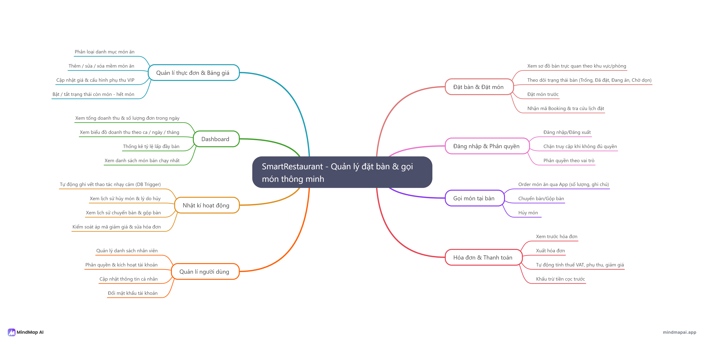
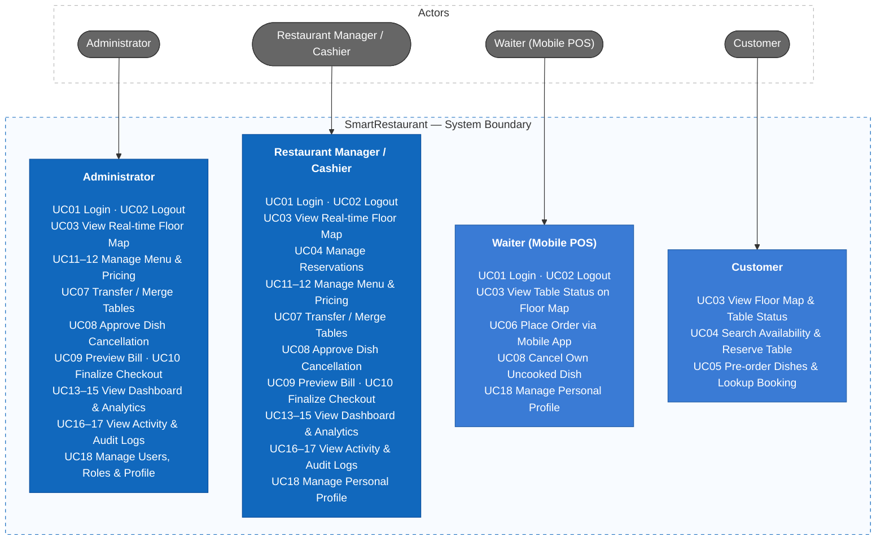
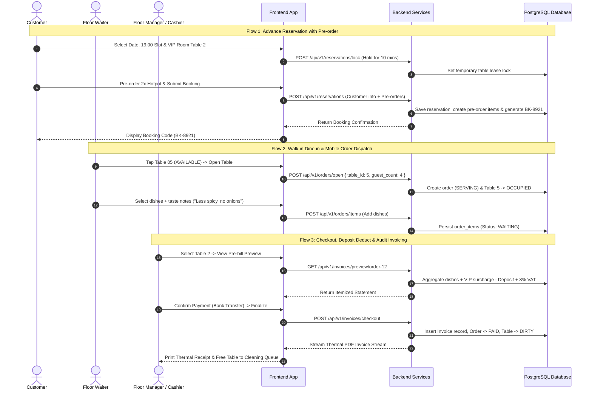

# SmartRestaurant

SmartRestaurant is a comprehensive table reservation and mobile floor POS system designed for modern restaurants to streamline daily operations, eliminate reservation conflicts, and deliver a frictionless dining experience. It seamlessly unifies real-time interactive floor maps, customer table booking with pre-ordering, mobile smartphone ordering for waitstaff, fraud-resistant billing, menu and pricing management, activity audit logs, and role-based access control.

## 1. Requirements — Use Cases, INVEST Stories, and Acceptance Criteria

Requirements define what SmartRestaurant must accomplish, the actors involved, the operational value delivered, and the verifiable acceptance criteria for day-to-day restaurant service. All functional requirements are structured into use cases, verified with the INVEST criteria, and mapped to role-based access boundaries.

### 1.1 Product Mind Map



### 1.2 Use Cases

#### 1.2.1 Use Case Catalog

The system scope is defined by 18 concrete use cases mapped directly across the 8 functional branches of the product mind map:

| UC ID | Use Case Name | Functional Domain | Primary Actors |
| :--- | :--- | :--- | :--- |
| **UC01** | Login to System | Authentication & Access Control | All Staff (Admin, Manager, Waiter) |
| **UC02** | Logout & Terminate Session | Authentication & Access Control | All Staff (Admin, Manager, Waiter) |
| **UC03** | View Floor Map & Table Status | Table Reservation & Floor Status | Customer, Waiter, Manager, Admin |
| **UC04** | Search & Reserve Table | Table Reservation & Floor Status | Customer, Manager |
| **UC05** | Pre-order Dishes & Lookup Booking | Table Reservation & Floor Status | Customer |
| **UC06** | Place Order via Mobile App | Mobile Floor POS | Waiter |
| **UC07** | Transfer & Merge Tables | Mobile Floor POS | Manager, Admin |
| **UC08** | Cancel Dish with Audit Policy | Mobile Floor POS | Waiter (own unstarted), Manager (approved) |
| **UC09** | Preview Pre-bill Statement | Billing & Checkout | Cashier, Manager, Admin |
| **UC10** | Finalize Checkout & Print Bill | Billing & Checkout | Cashier, Manager, Admin |
| **UC11** | Manage Menu Items & Categories | Menu & Pricing Management | Manager, Admin |
| **UC12** | Update Prices & VIP Surcharges | Menu & Pricing Management | Manager, Admin |
| **UC13** | View Daily Revenue & Orders KPI | Dashboard & Analytics | Manager, Admin |
| **UC14** | View Occupancy & Sales Trends | Dashboard & Analytics | Manager, Admin |
| **UC15** | View Top-selling Dishes | Dashboard & Analytics | Manager, Admin |
| **UC16** | Trigger Auto Activity Audit | Activity Audit Trail | System (Automated DB Trigger) |
| **UC17** | Inspect Sensitive Audit Logs | Activity Audit Trail | Manager, Admin |
| **UC18** | Manage Staff Accounts & Profile | User Management | Admin (All Accounts), Staff (Self Profile) |

#### 1.2.2 Use Case Diagram



For detailed actors, permissions, and business flows, see [Actors, roles, and use cases](docs/03-use-cases.md).

---

### 1.3 INVEST Requirements

The V1 backlog maps the 18 use cases into 18 development-ready user stories. Before a user story is ready for sprint development, it is verified using the INVEST criteria.

| Criterion       | Meaning in SmartRestaurant                                                                                          |
| --------------- | ------------------------------------------------------------------------------------------------------------------- |
| **Independent** | Each story provides a distinct restaurant operational feature and avoids hard technical coupling with unrelated flows. |
| **Negotiable**  | The UI and technical implementation can change as long as role permissions, table state rules, and audit trails stay intact. |
| **Valuable**    | Each story delivers direct operational value to guests, floor waitstaff, cashiers, or restaurant managers.          |
| **Estimable**   | Actor roles, input payloads, state machine transitions, dependencies, and failure modes are explicitly documented.  |
| **Small**       | Each story covers one primary capability sized for modular delivery across API, database, UI, and test tasks.     |
| **Testable**    | Every story maps to verifiable acceptance criteria covering validation, authorization, and audit trail generation.  |

```text
US01–US02   Authentication and role-based access control
US03–US05   Table reservation, floor status, and pre-ordering
US06–US08   Mobile floor POS, table transfer/merge, and dish cancellation
US09–US10   Invoicing, pre-bill statement, and checkout
US11–US12   Menu management, category classification, and pricing
US13–US15   Executive dashboard, occupancy, and sales analytics
US16–US17   Audit trail and anti-fraud activity logging
US18        User management, permissions, and staff profile
```

All V1 stories now have estimable target behavior. Token authentication uses client-side discard upon logout, table reservations lock seats reliably without double-booking, dish cancellations enforce multi-tier approval with mandatory reasons, and high-risk operational adjustments trigger automated database audit triggers. The complete story-level review is maintained in [INVEST Requirements](docs/08-invest-requirements.md).

---

### 1.4 Role-Based Access Control (RBAC Matrix)

The system enforces strict permission boundaries across four distinct user roles, including an **own-record policy** for floor waitstaff to prevent revenue tampering:

| Functional Capability | Administrator | Restaurant Manager / Cashier | Waiter (Floor POS) | Customer (Guest Portal) |
| :--- | :---: | :---: | :---: | :---: |
| **Browse Public Menu** | Full access | Full access | Full access | View only |
| **Search Availability & Reserve** | Full access | Full access | Blocked | Self-service (Active slots) |
| **View Real-time Floor Map** | Full access | Full access | View status & cleaning | View open tables only |
| **Open Dine-in Table (Walk-in)** | Full access | Full access | Smartphone POS | Blocked |
| **Add / Modify Ordered Items** | Full access | Full access | Own active orders | Blocked |
| **Cancel Ordered Dish** | Full override | Approve with reason | Own uncooked items only | Blocked |
| **Transfer / Merge Tables** | Full access | Full access | Blocked (Requires Manager) | Blocked |
| **Preview Bill & Final Checkout** | Full access | Full access | Blocked | View own statement |
| **Menu CRUD & Price Settings** | Full access | Full access | Blocked | Blocked |
| **Inspect Anti-fraud Audit Logs** | Full access | Full access | Blocked | Blocked |
| **System Settings & Staff Accounts** | Full access | Blocked | Blocked | Blocked |

> **Security Policy:** Every high-risk operational action (dish cancellation, table transfer, price adjustment) triggers an automated database audit log capturing the user ID, timestamp, before/after JSON payloads, and mandatory operational reasons.

---

## 2. Information Architecture and UI/UX Design

Information architecture organizes the navigation pathways, data hierarchies, and screen interactions across three dedicated operational environments: a customer-facing booking portal, an ultra-fast mobile smartphone POS for floor waitstaff, and a centralized management dashboard for floor managers and cashiers.

### 2.1 Information Architecture (Sitemap & Hierarchy)

The system is structured into three discrete presentation layers sharing unified backend domain contracts:

```mermaid
graph TD
    Root["SmartRestaurant System"]

    %% CUSTOMER PORTAL
    subgraph CP["1. Customer Guest Portal (Web / Mobile Browser)"]
        CP_Home["Home & Dining Ambience"]
        CP_Menu["Public Digital Menu<br/><i>Categories, Pricing, Dietary Flags</i>"]
        CP_Booking["Reservation Workflow"]
        CP_Slot["Date, Time Window & Party Size"]
        CP_Map["Interactive Floor & Room Picker<br/><i>VIP Rooms, Main Hall, Garden</i>"]
        CP_Preorder["Dish Pre-ordering (Optional)"]
        CP_Confirm["Booking Summary & Booking Code"]
        CP_Lookup["Reservation Lookup & Status Tracker"]
        
        CP_Home --> CP_Menu
        CP_Home --> CP_Booking
        CP_Booking --> CP_Slot --> CP_Map --> CP_Preorder --> CP_Confirm
        CP_Home --> CP_Lookup
    end

    %% WAITER MOBILE POS
    subgraph WP["2. Waitstaff Mobile Floor POS (Smartphone Web App)"]
        WP_Auth["Staff Quick PIN / Password Login"]
        WP_Floor["Mobile Table Grid<br/><i>Real-time Color State Indicators</i>"]
        WP_Table["Active Table Dining Sheet"]
        WP_Catalog["Category Dish Selector & Quick Search"]
        WP_ItemModal["Quantity Stepper & Kitchen Taste Notes"]
        WP_Actions["Floor Coordination<br/><i>Transfer Table · Request Dish Cancel</i>"]

        WP_Auth --> WP_Floor
        WP_Floor --> WP_Table
        WP_Table --> WP_Catalog --> WP_ItemModal
        WP_Table --> WP_Actions
    end

    %% MANAGER / CASHIER DESKTOP
    subgraph MD["3. Manager & Cashier Floor Console (Tablet / Desktop)"]
        MD_Auth["Manager JWT Login & Role Validation"]
        MD_Kpi["Live Shift Dashboard<br/><i>Revenue, Table Turns, Active Occupancy</i>"]
        MD_Floor["Real-time 2D Floor Map Canvas<br/><i>Drag-and-drop Layouts & Table Bussing</i>"]
        MD_Reservations["Reservation Calendar & Arrival Dispatch"]
        MD_Menu["Menu Engineering & Bulk Pricing"]
        MD_Checkout["Cashier Checkout Register<br/><i>Pre-bill Preview, Deposit Deduct, Thermal PDF</i>"]
        MD_Audit["Anti-fraud Audit Trail Console"]
        MD_Users["User Accounts & Role Permissions"]

        MD_Auth --> MD_Kpi
        MD_Kpi --> MD_Floor
        MD_Kpi --> MD_Reservations
        MD_Kpi --> MD_Menu
        MD_Kpi --> MD_Checkout
        MD_Kpi --> MD_Audit
        MD_Kpi --> MD_Users
    end

    Root --> CP
    Root --> WP
    Root --> MD
```



#### Application View & Navigation Map

| View Identifier | Route Path | Target Role | Key Responsibilities |
| :--- | :--- | :--- | :--- |
| `VIEW-CP-01` | `/` | Public Guest | Brand storytelling, featured seasonal dishes, entrance to booking. |
| `VIEW-CP-02` | `/menu` | Public Guest | Full visual catalog with category filters and dish descriptions. |
| `VIEW-CP-03` | `/reserve` | Public Guest | Multi-step booking wizard with 10-minute hold lock and table selection. |
| `VIEW-CP-04` | `/lookup` | Public Guest | Self-service booking lookup by phone number or booking code. |
| `VIEW-WP-01` | `/pos/tables` | Waiter | Touch-optimized floor grid displaying table status and cleaning timers. |
| `VIEW-WP-02` | `/pos/order/:tableId` | Waiter | Active dining check: order dispatch, custom notes, kitchen status. |
| `VIEW-MD-01` | `/admin/dashboard` | Manager / Admin | Executive KPIs: today's revenue, occupancy rate, best-selling dishes. |
| `VIEW-MD-02` | `/admin/floor-map` | Manager / Admin | Real-time spatial layout monitoring, table merging, and state override. |
| `VIEW-MD-03` | `/admin/menu` | Manager / Admin | Catalog CRUD, dynamic stock toggling, and VIP surcharge rates. |
| `VIEW-MD-04` | `/admin/billing/:orderId`| Cashier / Manager | Pre-bill itemized preview, deposit reconciliation, thermal receipt PDF. |
| `VIEW-MD-05` | `/admin/audit` | Manager / Admin | Queryable immutable audit log tracking cancellations and transfers. |

---

### 2.2 Core User Interaction Flows



---

### 2.3 UI Design System & Aesthetic Tokens

The visual language balances the hospitality warmth of fine dining with the crisp efficiency demanded by fast-paced restaurant operations:

* **Typography:** Modern, highly legible geometric sans-serif (`Plus Jakarta Sans` or `Inter`) paired with clean tabular numerals (`font-variant-numeric: tabular-nums`) to ensure instant readability on receipts, pricing, and bill totals.
* **Surface & Layout Architecture:**
  - **Dark Mode Support:** Soft slate-charcoal backgrounds (`#0F172A` / `#1E293B`) for low-light dining room waitstaff to eliminate eye fatigue.
  - **Light Mode Default:** Crisp, high-contrast surfaces (`#FFFFFF` / `#F8FAFC`) with subtle border elevations for daylight management and cashier terminals.
* **Semantic Table State Visual Machine:**

| State Indicator | Accent Color | Hex Code | Visual Meaning & Floor Rule |
| :--- | :--- | :--- | :--- |
| **AVAILABLE** | Emerald Green | `#22C55E` | Table is bussed, sanitized, and ready for immediate walk-in seating. |
| **RESERVED** | Vivid Amber | `#F59E0B` | Table has an upcoming booking arrival within 60 minutes; locked for walk-ins. |
| **OCCUPIED** | Crimson Coral | `#EF4444` | Table is seated; active dining session with open kitchen orders in progress. |
| **DIRTY / CLEANING**| Slate Gray | `#64748B` | Dining concluded and paid; awaiting busser cleaning before reset to available. |

---

### 2.4 Ergonomic Principles by Form Factor

1. **Customer Web Portal (Mobile & Desktop Responsive):**
   - **Zero-Friction Discovery:** Public menu browsable without login; rich high-resolution imagery and allergen badge tags.
   - **Spatial Room Picker:** Room-by-room floor selector allowing guests to select distinct dining ambiences (VIP Room, Terrace Garden, Main Dining Room).

2. **Waitstaff Floor POS (Single-Hand Smartphone UI):**
   - **Thumb-Zone Optimization:** High-frequency actions ("Add Dish", "Send to Kitchen", "Open Table") positioned within the bottom 40% of the screen.
   - **Quick Taste Tagging:** Pre-populated common instruction chips (`No Ice`, `Less Sugar`, `No Cilantro`, `Gluten-Free`) to eliminate manual keyboard typing during peak rush hours.

3. **Floor Manager & Cashier Terminal (Tablet / Desktop):**
   - **Unified Floor Canvas:** 2D spatial canvas rendering real-time table statuses, elapsed dining times, and cleaning queues at a glance.
   - **Audit Safety Rails:** Destructive actions (cancelling a served steak or applying a 20% discount) trigger a confirmation dialog demanding a structured reason dropdown and manager credentials.