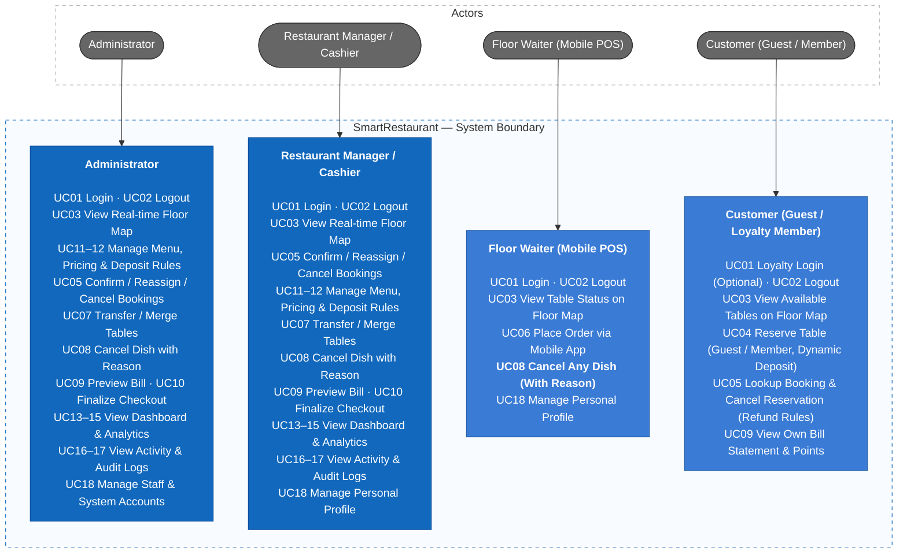
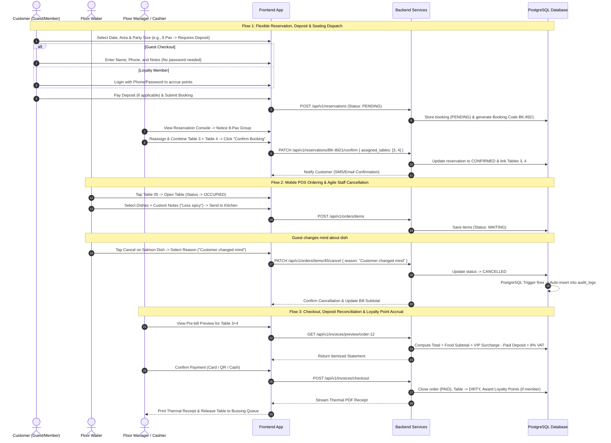

# SmartRestaurant

SmartRestaurant is an agile table reservation and mobile floor POS system designed for modern restaurants to streamline daily operations, optimize dining capacity, and deliver an exceptional guest experience. It seamlessly unifies real-time interactive floor maps, dual-mode table booking (Guest Checkout & Loyalty Member Points), manager seating confirmation and table dispatch, dynamic deposit rules for large/VIP groups, agile mobile POS ordering with universal staff dish cancellation, fraud-resistant billing with deposit reconciliation, and automated database audit logging.

## 1. Requirements — Use Cases, INVEST Stories, and Acceptance Criteria

Requirements define what SmartRestaurant must accomplish, the operational value delivered, and the verifiable acceptance criteria for daily service. All functional requirements are structured into use cases, verified with the INVEST criteria, and mapped to role-based access boundaries.

### 1.1 Product Mind Map


### 1.2 Use Cases

#### 1.2.1 Use Case Catalog

The system scope is defined by 18 concrete use cases mapped directly across the 8 functional domains of the product mind map, reflecting realistic restaurant operations:

| UC ID | Use Case Name | Functional Domain | Primary Actors | Key Operational Rules |
| :--- | :--- | :--- | :--- | :--- |
| **UC01** | Login & Member Session | Authentication & Access Control | Staff & Loyalty Customers | Supports staff role tokens & customer loyalty accounts for point accumulation. |
| **UC02** | Logout & Terminate Session | Authentication & Access Control | Staff & Loyalty Customers | Client-side token discard across desktop, tablet, and mobile devices. |
| **UC03** | View Floor Map & Table Status | Table Reservation & Floor Status | Customer, Waiter, Manager, Admin | Live 4-color state tracking (`AVAILABLE`, `RESERVED`, `OCCUPIED`, `DIRTY`). |
| **UC04** | Search & Submit Reservation | Table Reservation & Floor Status | Customer (Guest/Member), Manager | Supports guest checkout without login; configurable dining time limit; dynamic deposit for large parties ($\ge 6$ pax) or VIP rooms. |
| **UC05** | Confirm, Reassign & Cancel Booking | Table Reservation & Floor Status | Manager, Customer | Manager reviews and can reallocate/merge tables to seat large groups before confirming; customer can cancel with deposit refund rules. |
| **UC06** | Place Order via Mobile App | Mobile Floor POS | Waiter | Touch-optimized menu search, quantity steppers, and custom kitchen notes (`No onions`, `Less spicy`). |
| **UC07** | Transfer & Merge Tables | Mobile Floor POS | Manager, Admin | Reassigns active dine-in orders dynamically to accommodate party size changes. |
| **UC08** | Cancel Dish with Audit Policy | Mobile Floor POS | Any Staff Member | **Agile cancellation:** Any waiter can cancel a dish immediately; requires mandatory reason selection and triggers auto-audit logging. |
| **UC09** | Preview Pre-bill Statement | Billing & Checkout | Cashier, Manager, Customer | Itemized preview calculating subtotal, VIP surcharges, deposit deduction, loyalty points, and VAT. |
| **UC10** | Finalize Checkout & Print Bill | Billing & Checkout | Cashier, Manager | Closes order session, frees table to cleaning queue (`DIRTY`), awards loyalty points, and streams thermal PDF receipt. |
| **UC11** | Manage Menu Items & Categories | Menu & Pricing Management | Manager, Admin | Category classification, dish CRUD, and soft-delete protection for historical order data. |
| **UC12** | Update Prices, VIP Surcharges & Rules | Menu & Pricing Management | Manager, Admin | Configures dish pricing, VIP room surcharge rates, deposit threshold rules, and instant out-of-stock toggles. |
| **UC13** | View Daily Revenue & Orders KPI | Dashboard & Analytics | Manager, Admin | Real-time shift dashboard tracking gross revenue, completed covers, and active tables. |
| **UC14** | View Occupancy & Sales Trends | Dashboard & Analytics | Manager, Admin | Historical charts by shift/day/month, table turn rates, and space utilization. |
| **UC15** | View Top-selling Dishes | Dashboard & Analytics | Manager, Admin | Ranked sales volume analytics to guide kitchen prep and inventory purchasing. |
| **UC16** | Trigger Auto Activity Audit | Activity Audit Trail | System (Automated DB Trigger) | PostgreSQL triggers capture sensitive events (cancellations, transfers, bill adjustments) without application overhead. |
| **UC17** | Inspect Sensitive Audit Logs | Activity Audit Trail | Manager, Admin | Filterable compliance console detailing actor, timestamp, prior/new state, and operational reasons. |
| **UC18** | Manage Staff Accounts & Profiles | User Management | Admin (All Accounts), Staff & Members (Profile) | Staff account lifecycle, RBAC assignments, customer loyalty profile management, and password resets. |

#### 1.2.2 Use Case Diagram



For detailed actors, permissions, and business flows, see [Actors, roles, and use cases](docs/03-use-cases.md).

---

### 1.3 INVEST Requirements

The V1 backlog maps the 18 use cases into 18 development-ready user stories. Before a user story is ready for sprint development, it is verified using the INVEST criteria.

| Criterion       | Meaning in SmartRestaurant                                                                                          |
| --------------- | ------------------------------------------------------------------------------------------------------------------- |
| **Independent** | Each story delivers a distinct restaurant capability and avoids technical deadlocks across unrelated operational flows. |
| **Negotiable**  | Implementation details (e.g., dining time limits, deposit payment gateways) can adapt while core business rules remain intact. |
| **Valuable**    | Delivers immediate operational value: fast walk-in seating, reduced no-shows, agile dish cancellation, and anti-fraud auditing. |
| **Estimable**   | Roles, inputs, database triggers, state transitions, and exception scenarios are fully documented.                 |
| **Small**       | Each story covers one primary capability sized for modular delivery across API, database, UI, and test tasks.     |
| **Testable**    | Every story maps to verifiable acceptance criteria covering validation, authorization, and audit trail generation.  |

```text
US01–US02   Authentication, loyalty sessions, and access control
US03–US05   Flexible reservation, manager seating dispatch, and cancellation
US06–US08   Mobile floor POS, table transfer/merge, and universal staff dish cancellation
US09–US10   Invoicing, deposit deduction, point accrual, and checkout
US11–US12   Menu management, category classification, and dynamic deposit rules
US13–US15   Executive dashboard, occupancy, and sales analytics
US16–US17   Audit trail and anti-fraud activity logging
US18        User management, staff permissions, and customer loyalty profiles
```

All V1 stories now have estimable target behavior:
* **Dual-mode Booking:** Guests book instantly with basic contact details; registered members earn loyalty points upon checkout.
* **Seating Dispatch & Confirmation:** Reservations enter `PENDING` status, allowing managers to reallocate or combine tables for large group hospitality before issuing final confirmation (`CONFIRMED`).
* **Deposit Rules & Cancellations:** Small parties ($\le 4$ guests) book deposit-free; large parties or VIP suites require a holding deposit, fully deductible at checkout or refundable upon timely cancellation.
* **Agile Staff Cancellations:** Any floor waiter can cancel an item immediately to accommodate dynamic guest requests, safeguarded by mandatory operational reasons and automated database audit triggers.

The complete story-level review is maintained in [INVEST Requirements](docs/08-invest-requirements.md).

---

### 1.4 Role-Based Access Control (RBAC Matrix)

The system enforces strict permission boundaries across four distinct user roles, balancing operational agility with comprehensive audit accountability:

| Functional Capability | Administrator | Restaurant Manager / Cashier | Floor Waiter | Customer (Guest / Member) |
| :--- | :---: | :---: | :---: | :---: |
| **Browse Public Menu** | Full access | Full access | Full access | View only |
| **Submit Reservation (Guest/Member)** | Full access | Full access | Blocked | Self-service (Guest or Loyalty Login) |
| **Confirm / Reallocate / Merge Booking Tables** | Full access | Full access | Blocked | Blocked |
| **Cancel Reservation & Process Refund** | Full override | Manage & No-show cancel | Blocked | Self-cancel (Before policy cutoff) |
| **View Real-time Floor Map** | Full access | Full access | View status & cleaning | View open slots only |
| **Open Dine-in Table (Walk-in)** | Full access | Full access | Smartphone POS | Blocked |
| **Add / Modify Ordered Items** | Full access | Full access | Any active order | Blocked |
| **Cancel Ordered Dish** | Full access (Reason req.) | Full access (Reason req.) | **Any staff (Reason req. + Auto-audit)** | Blocked |
| **Transfer / Merge Active Tables** | Full access | Full access | Blocked (Requires Manager) | Blocked |
| **Preview Bill (Deposit & Point Deductions)** | Full access | Full access | Blocked | View own statement |
| **Finalize Checkout & Print Thermal PDF** | Full access | Full access | Blocked | Blocked |
| **Menu CRUD, Pricing & Deposit Rules** | Full access | Full access | Blocked | Blocked |
| **Inspect Anti-fraud Audit Logs** | Full access | Full access | Blocked | Blocked |
| **Staff Accounts & System Administration** | Full access | Blocked | Blocked | Self profile & points only |

> **Security Policy:** Every high-risk operational action (dish cancellation, table transfer, deposit refund, price adjustment) triggers an automated PostgreSQL database trigger capturing the user ID, timestamp, before/after JSON payloads, and mandatory operational reasons.

---

## 2. Information Architecture and UI/UX Design

Information architecture organizes navigation pathways, operational hierarchies, and screen interactions across three dedicated environments: a customer-facing reservation and loyalty portal, an ultra-agile mobile POS for floor waitstaff, and a centralized operations console for managers and cashiers.

### 2.1 Information Architecture (Sitemap & Hierarchy)

The system is structured into three discrete presentation layers sharing unified backend domain contracts:

```mermaid
graph TD
    Root["SmartRestaurant System"]

    %% CUSTOMER PORTAL
    subgraph CP["1. Customer Guest Portal (Web / Mobile Browser)"]
        CP_Home["Home & Dining Ambience"]
        CP_Auth["Loyalty Login / Register (Optional)"]
        CP_Menu["Public Digital Menu<br/><i>Categories, Pricing, Dietary Flags</i>"]
        CP_Booking["Reservation Workflow"]
        CP_Slot["Date, Time Window & Party Size<br/><i>Configurable Dining Limit</i>"]
        CP_Map["Preferred Area Picker<br/><i>VIP Rooms, Main Hall, Garden</i>"]
        CP_Deposit["Dynamic Deposit Payment<br/><i>Required for Large Parties (>= 6) / VIP</i>"]
        CP_Confirm["Booking Summary (Status: PENDING)"]
        CP_Lookup["Reservation Lookup & Self-Cancellation"]
        
        CP_Home --> CP_Auth
        CP_Home --> CP_Menu
        CP_Home --> CP_Booking
        CP_Booking --> CP_Slot --> CP_Map --> CP_Deposit --> CP_Confirm
        CP_Home --> CP_Lookup
    end

    %% WAITER MOBILE POS
    subgraph WP["2. Waitstaff Mobile Floor POS (Smartphone Web App)"]
        WP_Auth["Staff Quick PIN / Password Login"]
        WP_Floor["Mobile Table Grid<br/><i>Real-time Color State Indicators</i>"]
        WP_Table["Active Table Dining Sheet"]
        WP_Catalog["Category Dish Selector & Quick Search"]
        WP_ItemModal["Quantity Stepper & Kitchen Taste Notes"]
        WP_Cancel["Agile Item Cancellation<br/><i>Mandatory Reason Selection + Auto-Audit</i>"]
        WP_Actions["Floor Coordination<br/><i>Transfer Table · Request Bussing</i>"]

        WP_Auth --> WP_Floor
        WP_Floor --> WP_Table
        WP_Table --> WP_Catalog --> WP_ItemModal
        WP_Table --> WP_Cancel
        WP_Table --> WP_Actions
    end

    %% MANAGER / CASHIER DESKTOP
    subgraph MD["3. Manager & Cashier Floor Console (Tablet / Desktop)"]
        MD_Auth["Manager JWT Login & Role Validation"]
        MD_Kpi["Live Shift Dashboard<br/><i>Revenue, Table Turns, Active Occupancy</i>"]
        MD_Floor["Real-time 2D Floor Map Canvas<br/><i>Drag-and-drop Layouts & Table Bussing</i>"]
        MD_Reservations["Reservation Dispatch & Table Reassignment<br/><i>Review PENDING, Allocate Tables, Approve</i>"]
        MD_Menu["Menu Engineering, VIP Surcharges & Deposit Rules"]
        MD_Checkout["Cashier Checkout Register<br/><i>Pre-bill, Deposit Deduct, Loyalty Points, PDF Bill</i>"]
        MD_Audit["Anti-fraud Audit Trail Console"]
        MD_Users["User Accounts, Staff Roles & Member Loyalty"]

        MD_Auth --> MD_Kpi
        MD_Kpi --> MD_Floor
        MD_Kpi --> MD_Reservations
        MD_Kpi --> MD_Menu
        MD_Kpi --> MD_Checkout
        MD_Kpi --> MD_Audit
        MD_Kpi --> MD_Users
    end

    Root --> CP
    Root --> WP
    Root --> MD
```



#### Application View & Navigation Map

| View Identifier | Route Path | Target Role | Key Responsibilities |
| :--- | :--- | :--- | :--- |
| `VIEW-CP-01` | `/` | Public Guest | Brand storytelling, featured seasonal dishes, entrance to booking. |
| `VIEW-CP-02` | `/menu` | Public Guest | Full visual catalog with category filters and dish descriptions. |
| `VIEW-CP-03` | `/reserve` | Public / Member | Booking wizard (Guest checkout or Loyalty login, optional dining limit, deposit if $\ge 6$ pax/VIP). |
| `VIEW-CP-04` | `/lookup` | Public / Member | Booking lookup by phone/code with self-service cancellation and deposit refund status. |
| `VIEW-WP-01` | `/pos/tables` | Waiter | Touch-optimized floor grid displaying table status and cleaning timers. |
| `VIEW-WP-02` | `/pos/order/:tableId` | Waiter | Active dining check: order dispatch, custom notes, agile cancellation with mandatory reason. |
| `VIEW-MD-01` | `/admin/dashboard` | Manager / Admin | Executive KPIs: today's revenue, occupancy rate, best-selling dishes. |
| `VIEW-MD-02` | `/admin/floor-map` | Manager / Admin | Real-time spatial layout monitoring, table merging, and state override. |
| `VIEW-MD-03` | `/admin/reservations`| Manager / Admin | Booking dispatch console: review `PENDING` bookings, reallocate tables to optimize space, confirm. |
| `VIEW-MD-04` | `/admin/menu` | Manager / Admin | Catalog CRUD, dynamic stock toggling, VIP surcharges, and deposit policy thresholds. |
| `VIEW-MD-05` | `/admin/billing/:orderId`| Cashier / Manager | Pre-bill itemized preview, deposit reconciliation, loyalty points, thermal receipt PDF. |
| `VIEW-MD-06` | `/admin/audit` | Manager / Admin | Queryable immutable audit log tracking cancellations, table transfers, and manual discounts. |

---

### 2.2 Core User Interaction Flows



---

### 2.3 UI Design System & Aesthetic Tokens

The visual language balances the hospitality warmth of fine dining with the crisp efficiency demanded by fast-paced restaurant operations:

* **Typography:** Modern, highly legible geometric sans-serif (`Plus Jakarta Sans` or `Inter`) paired with clean tabular numerals (`font-variant-numeric: tabular-nums`) to ensure instant readability on receipts, pricing, and bill totals.
* **Surface & Layout Architecture:**
  - **Dark Mode Support:** Soft slate-charcoal backgrounds (`#0F172A` / `#1E293B`) for low-light dining room waitstaff to eliminate eye fatigue.
  - **Light Mode Default:** Crisp, high-contrast surfaces (`#FFFFFF` / `#F8FAFC`) with subtle border elevations for daylight management and cashier terminals.
* **Semantic Table State Visual Machine:**

| State Indicator | Accent Color | Hex Code | Visual Meaning & Floor Rule |
| :--- | :--- | :--- | :--- |
| **AVAILABLE** | Emerald Green | `#22C55E` | Table is bussed, sanitized, and ready for immediate walk-in seating. |
| **RESERVED** | Vivid Amber | `#F59E0B` | Table has an upcoming confirmed booking arrival; locked for walk-ins. |
| **OCCUPIED** | Crimson Coral | `#EF4444` | Table is seated; active dining session with open kitchen orders in progress. |
| **DIRTY / CLEANING**| Slate Gray | `#64748B` | Dining concluded and paid; awaiting busser cleaning before reset to available. |

---

### 2.4 Ergonomic Principles by Form Factor

1. **Customer Web Portal (Mobile & Desktop Responsive):**
   - **Frictionless Guest vs Member Experience:** One-click booking without mandatory account creation; optional login for customer loyalty points.
   - **Booking Status Self-Service:** Intuitive lookup page allowing customers to check confirmation status, view assigned tables, or cancel ahead of time with automated deposit refund policy checks.

2. **Waitstaff Floor POS (Single-Hand Smartphone UI):**
   - **Universal Agility:** Any floor server can open tables, fire courses, or cancel dishes immediately with single-tap standard reason chips (`Customer changed mind`, `Kitchen out of stock`, `Quantity typo`).
   - **Thumb-Zone Optimization:** High-frequency actions ("Add Dish", "Send to Kitchen", "Cancel Item") positioned within the bottom 40% of the screen.

3. **Floor Manager & Cashier Terminal (Tablet / Desktop):**
   - **Flexible Seating Console:** Visual table reassignment interface allowing managers to pair tables together to host unexpected large parties before confirming reservations.
   - **Automated Anti-Fraud Oversight:** Eliminates operational bottlenecks by delegating item cancellations to waitstaff while capturing immutable database audit records for shift reconciliation.