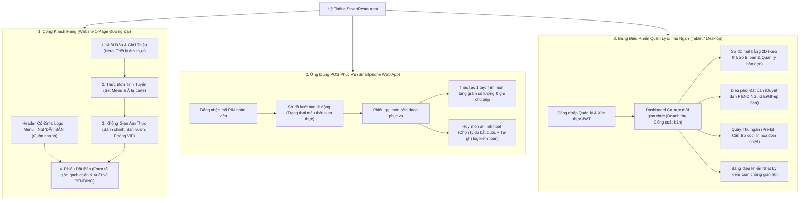
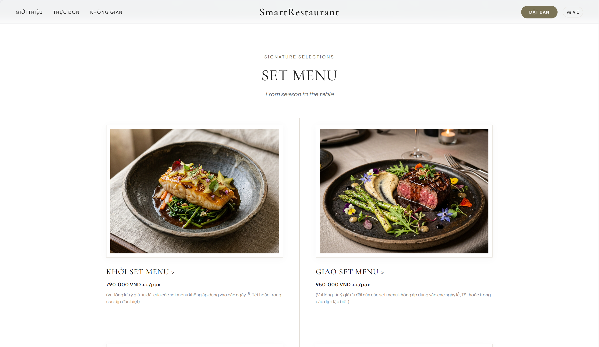
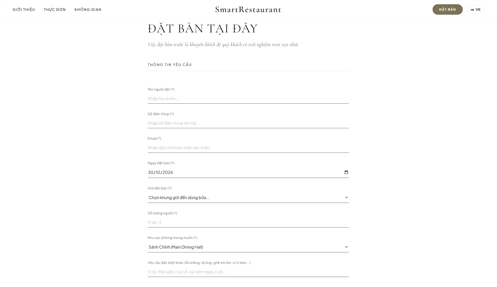
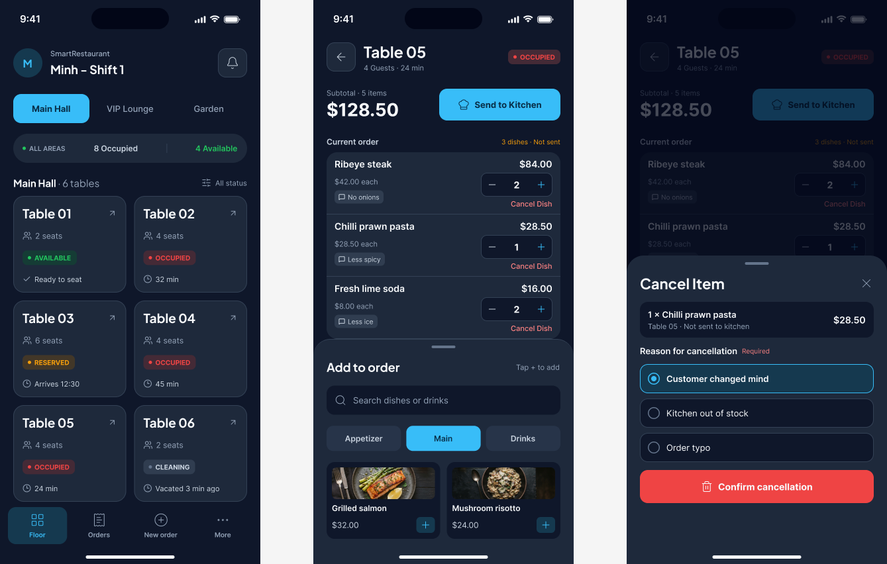
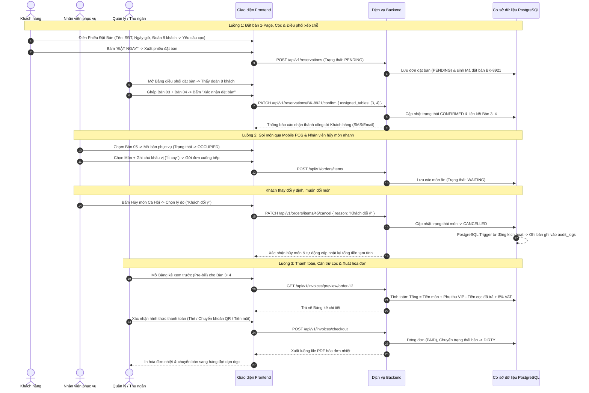

# SmartRestaurant — Hệ Thống Quản Lý Đặt Bàn & POS Gọi Món Di Động

SmartRestaurant là hệ thống đặt bàn linh hoạt và POS gọi món di động dành cho các nhà hàng hiện đại, giúp tinh gọn quy trình vận hành hàng ngày, tối ưu hóa công suất phục vụ và mang lại trải nghiệm ẩm thực vượt trội cho thực khách. Hệ thống tích hợp liền mạch giữa sơ đồ mặt bằng thời gian thực, cơ chế đặt bàn linh hoạt (Khách vãng lai & Hội viên tích điểm), bảng điều phối và xác nhận chỗ ngồi của quản lý, quy tắc đặt cọc thông minh cho nhóm đông/phòng VIP, gọi món cơ động trên smartphone kèm quyền hủy món nhanh cho nhân viên, hóa đơn đối soát cọc chống gian lận và cơ chế ghi log kiểm toán tự động trong cơ sở dữ liệu.

---

## 1. Yêu Cầu Nghiệp Vụ — Use Cases, INVEST Stories và Tiêu Chí Chấp Nhận (Acceptance Criteria)

Tập yêu cầu định nghĩa các mục tiêu SmartRestaurant cần đạt được, giá trị vận hành mang lại và các tiêu chí nghiệm thu có thể kiểm chứng được trong dịch vụ hàng ngày. Toàn bộ yêu cầu chức năng được cấu trúc thành các ca sử dụng (Use Cases), kiểm chứng theo tiêu chí INVEST và phân định ranh giới theo ma trận phân quyền dựa trên vai trò (RBAC).

### 1.1 Sơ Đồ Tư Duy Sản Phẩm (Product Mind Map)


---

### 1.2 Ca Sử Dụng (Use Cases)

#### 1.2.1 Danh Mục Ca Sử Dụng (Use Case Catalog)

Phạm vi hệ thống được cụ thể hóa thành 18 ca sử dụng thuộc 8 miền chức năng, bám sát các nghiệp vụ thực tế trong nhà hàng:

| Mã UC | Tên Ca Sử Dụng | Miền Chức Năng | Tác Nhân Chính | Quy Tắc Vận Hành Trọng Yếu |
| :--- | :--- | :--- | :--- | :--- |
| **UC01** | Đăng nhập & Phiên làm việc | Xác thực & Phân quyền | Nhân viên & Khách hội viên | Hỗ trợ phân quyền nhân viên qua token và tài khoản hội viên tích điểm. |
| **UC02** | Đăng xuất & Kết thúc phiên | Xác thực & Phân quyền | Nhân viên & Khách hội viên | Xóa phiên làm việc phía client trên cả desktop, tablet và mobile. |
| **UC03** | Xem Sơ đồ bàn & Trạng thái sàn | Đặt bàn & Trạng thái sàn | Khách hàng, Phục vụ, Quản lý, Admin | Theo dõi trực tiếp 4 trạng thái màu (`AVAILABLE`, `RESERVED`, `OCCUPIED`, `DIRTY`). |
| **UC04** | Tìm kiếm & Gửi yêu cầu đặt bàn | Đặt bàn & Trạng thái sàn | Khách hàng (Vãng lai/Hội viên), Quản lý | Cho phép đặt nhanh không cần đăng nhập; giới hạn thời gian dùng bữa; cọc linh hoạt cho đoàn đông ($\ge 6$ người) hoặc phòng VIP. |
| **UC05** | Duyệt, Gán lại bàn & Hủy đặt bàn | Đặt bàn & Trạng thái sàn | Quản lý, Khách hàng | Quản lý kiểm tra và ghép/chuyển bàn để xếp chỗ đoàn đông trước khi xác nhận; khách có thể tự hủy theo chính sách hoàn cọc. |
| **UC06** | Gọi món qua Ứng dụng di động | POS Phục vụ di động | Nhân viên phục vụ | Tìm kiếm món chạm tối ưu, bộ tăng giảm số lượng và ghi chú gửi bếp (`Không hành`, `Ít cay`). |
| **UC07** | Chuyển bàn & Gộp bàn | POS Phục vụ di động | Quản lý, Admin | Điều chuyển đơn bàn đang ăn theo nhu cầu thay đổi chỗ ngồi của khách. |
| **UC08** | Hủy món kèm chính sách kiểm toán | POS Phục vụ di động | Bất kỳ nhân viên nào | **Hủy món linh hoạt:** Nhân viên có thể hủy món ngay; bắt buộc chọn lý do hủy và hệ thống tự động ghi nhật ký kiểm toán. |
| **UC09** | Xem trước Bảng kê thanh toán | Hóa đơn & Thu ngân | Thu ngân, Quản lý, Khách hàng | Bảng kê chi tiết gồm tiền món, phụ thu VIP, trừ tiền cọc đã trả, điểm tích lũy và thuế VAT. |
| **UC10** | Chốt thanh toán & In hóa đơn | Hóa đơn & Thu ngân | Thu ngân, Quản lý | Đóng phiên order, chuyển bàn sang trạng thái chờ dọn (`DIRTY`), cộng điểm hội viên và in hóa đơn nhiệt dạng PDF. |
| **UC11** | Quản lý Thực đơn & Danh mục | Quản lý Thực đơn & Giá | Quản lý, Admin | Phân loại danh mục, CRUD món ăn và hỗ trợ xóa mềm (*soft-delete*) để bảo toàn lịch sử hóa đơn. |
| **UC12** | Cập nhật Giá, Phụ thu VIP & Quy tắc cọc | Quản lý Thực đơn & Giá | Quản lý, Admin | Thiết lập giá món, tỷ lệ phụ thu phòng VIP, ngưỡng tiền cọc và bật/tắt trạng thái hết món tức thì. |
| **UC13** | Xem KPI Doanh thu & Đơn hàng ngày | Báo cáo & Phân tích | Quản lý, Admin | Dashboard ca trực thời gian thực: doanh thu gộp, số lượng khách phục vụ và số bàn đang hoạt động. |
| **UC14** | Xem Xu hướng Công suất & Doanh số | Báo cáo & Phân tích | Quản lý, Admin | Biểu đồ lịch sử theo ca/ngày/tháng, tốc độ xoay vòng bàn và hiệu suất sử dụng diện tích. |
| **UC15** | Xem Top Món ăn Bán chạy | Báo cáo & Phân tích | Quản lý, Admin | Xếp hạng số lượng bán ra giúp bếp chuẩn bị nguyên liệu và tối ưu nhập hàng. |
| **UC16** | Tự động Kích hoạt Ghi log Kiểm toán | Nhật ký Kiểm toán Hoạt động | Hệ thống (Trigger DB Tự động) | Trigger PostgreSQL tự động lưu lại các sự kiện nhạy cảm (hủy món, chuyển bàn, chỉnh sửa hóa đơn). |
| **UC17** | Tra cứu Nhật ký Kiểm toán Nhạy cảm | Nhật ký Kiểm toán Hoạt động | Quản lý, Admin | Màn hình tra cứu tuân thủ có bộ lọc: người thực hiện, thời gian, dữ liệu trước/sau và lý do thao tác. |
| **UC18** | Quản lý Tài khoản Nhân viên & Hồ sơ | Quản lý Người dùng | Admin (Toàn bộ), Nhân viên & Khách (Hồ sơ) | Vòng đời tài khoản nhân viên, gán quyền RBAC, quản lý hồ sơ tích điểm và đặt lại mật khẩu. |

#### 1.2.2 Sơ Đồ Ca Sử Dụng (Use Case Diagram)


---

### 1.3 Tiêu Chuẩn INVEST Cho Yêu Cầu Nghiệp Vụ

Tập backlog phiên bản V1 ánh xạ 18 ca sử dụng thành 18 User Stories sẵn sàng cho phát triển. Mỗi câu chuyện người dùng đều được thẩm định theo tiêu chí INVEST:

| Tiêu chí | Ý nghĩa trong hệ thống SmartRestaurant |
| :--- | :--- |
| **Independent (Độc lập)** | Mỗi User Story mang lại một năng lực nghiệp vụ riêng biệt, tránh phụ thuộc kỹ thuật chéo giữa các luồng vận hành khác nhau. |
| **Negotiable (Thương lượng được)** | Chi tiết cài đặt (giới hạn giờ ăn, cổng thanh toán cọc) có thể tinh chỉnh linh hoạt trong khi các quy tắc nghiệp vụ cốt lõi vẫn được giữ vững. |
| **Valuable (Có giá trị)** | Mang lại giá trị vận hành trực tiếp: xếp bàn nhanh cho khách vãng lai, giảm tình trạng khách bỏ hẹn (*no-show*), hủy món linh hoạt và ngăn chặn thất thoát gian lận. |
| **Estimable (Ước lượng được)** | Các vai trò, tham số đầu vào, trigger cơ sở dữ liệu, máy chuyển trạng thái và các kịch bản ngoại lệ đều được quy chuẩn hóa rõ ràng. |
| **Small (Đủ nhỏ)** | Mỗi Story gói gọn một khả năng chính, được chia nhỏ thành các tác vụ API, Cơ sở dữ liệu, Giao diện và Kiểm thử. |
| **Testable (Kiểm thử được)** | Mỗi Story đều có tiêu chí chấp nhận cụ thể (Acceptance Criteria), kiểm tra được tính hợp lệ dữ liệu, quyền truy cập và dữ liệu ghi log kiểm toán. |

```text
US01–US02   Xác thực tài khoản, phiên làm việc hội viên và kiểm soát truy cập
US03–US05   Đặt bàn linh hoạt, quản lý xếp/ghép bàn và hủy đặt bàn
US06–US08   POS phục vụ di động, chuyển/gộp bàn và nhân viên hủy món nhanh
US09–US10   Xuất hóa đơn, cấn trừ cọc, tích điểm thưởng và hoàn tất thanh toán
US11–US12   Quản lý thực đơn, phân loại danh mục và cấu hình quy tắc đặt cọc
US13–US15   Dashboard điều hành, phân tích công suất bàn và xu hướng bán hàng
US16–US17   Ghi nhận nhật ký kiểm toán và báo cáo chống gian lận
US18        Quản trị người dùng, phân quyền nhân viên và hồ sơ hội viên
```

Các tính năng nổi bật đã được định lượng rõ ràng:
* **Đặt bàn 2 chế độ:** Khách vãng lai đặt chỗ nhanh chỉ với thông tin liên hệ cơ bản; khách hội viên đăng nhập để tích lũy điểm sau khi thanh toán.
* **Điều phối & Xác nhận chỗ ngồi:** Đơn đặt bàn mới vào hệ thống ở trạng thái `PENDING`, giúp quản lý dễ dàng sắp xếp, gộp bàn cho các đoàn khách lớn trước khi chốt duyệt (`CONFIRMED`).
* **Quy tắc cọc & Hủy bàn:** Nhóm nhỏ ($\le 4$ khách) không cần cọc; nhóm đông hoặc đặt phòng VIP yêu cầu đặt cọc giữ chỗ, được cấn trừ toàn bộ vào hóa đơn hoặc hoàn lại nếu hủy trước hạn quy định.

---

### 1.4 Ma Trận Phân Quyền Theo Vai Trò (RBAC Matrix)

Hệ thống thiết lập ranh giới quyền hạn chặt chẽ giữa 4 vai trò người dùng, đảm bảo sự linh hoạt tối đa khi phục vụ khách mà vẫn bảo toàn tính toàn vẹn và minh bạch của dữ liệu:

| Khả Năng Nghiệp Vụ | Administrator | Quản lý / Thu ngân | Nhân viên phục vụ | Khách hàng (Vãng lai / Hội viên) |
| :--- | :---: | :---: | :---: | :---: |
| **Xem Thực đơn công khai** | Toàn quyền | Toàn quyền | Toàn quyền | Chỉ xem |
| **Gửi đơn Đặt bàn** | Toàn quyền | Toàn quyền | Bị chặn | Tự thực hiện (Vãng lai hoặc Đăng nhập) |
| **Duyệt / Ghép / Gán bàn đặt** | Toàn quyền | Toàn quyền | Bị chặn | Bị chặn |
| **Hủy đơn đặt & Hoàn tiền cọc** | Toàn quyền | Duyệt & Xử lý vắng mặt | Bị chặn | Tự hủy (Trước hạn quy định) |
| **Xem Sơ đồ bàn thời gian thực** | Toàn quyền | Toàn quyền | Xem trạng thái bàn & dọn dẹp | Chỉ xem bàn trống khi đặt chỗ |
| **Mở bàn phục vụ tại chỗ** | Toàn quyền | Toàn quyền | Thực hiện qua Smartphone POS | Bị chặn |
| **Gọi thêm / Điều chỉnh món ăn** | Toàn quyền | Toàn quyền | Thao tác trên bàn đang ăn | Bị chặn |
| **Hủy món ăn đã gọi** | Toàn quyền (Cần lý do) | Toàn quyền (Cần lý do) | **Bất kỳ nhân viên nào (Cần lý do + Tự ghi log)** | Bị chặn |
| **Chuyển bàn / Gộp bàn ăn** | Toàn quyền | Toàn quyền | Bị chặn (Cần quyền Quản lý) | Bị chặn |
| **Xem trước Hóa đơn (Cấn trừ cọc)** | Toàn quyền | Toàn quyền | Bị chặn | Xem bảng kê của bàn mình |
| **Thanh toán & In hóa đơn nhiệt** | Toàn quyền | Toàn quyền | Bị chặn | Bị chặn |
| **CRUD Menu, Giá & Quy tắc cọc** | Toàn quyền | Toàn quyền | Bị chặn | Bị chặn |
| **Tra cứu Nhật ký kiểm toán** | Toàn quyền | Toàn quyền | Bị chặn | Bị chặn |
| **Quản trị Tài khoản Nhân viên** | Toàn quyền | Bị chặn | Bị chặn | Xem thông tin & điểm của mình |

> **Chính sách bảo mật:** Mọi thao tác nhạy cảm có rủi ro thất thoát (hủy món ăn, chuyển bàn, hoàn cọc, giảm giá) đều kích hoạt cơ chế trigger tự động của PostgreSQL để lưu lại: Mã người thực hiện, thời gian chính xác, dữ liệu trước/sau và lý do nghiệp vụ bắt buộc.

---

## 2. Kiến Trúc Thông Tin & Thiết Kế Giao Diện UI/UX

Kiến trúc thông tin (Information Architecture - IA) của SmartRestaurant tổ chức trải nghiệm người dùng theo 3 phân hệ chuyên biệt: **Cổng Khách Hàng (Website 1-Page Đương Đại)**, **POS Di Động Phục Vụ (Smartphone 1 Tay)**, và **Bảng Điều Khiển Quản Lý & Thu Ngân (Desktop/Tablet Console)**.

---

### 2.1 Kiến Trúc Thông Tin (Sitemap & Luồng Trải Nghiệm 1-Page)

Phân hệ Khách hàng được thiết kế theo trải nghiệm **1-Page Cuộn Mượt Mà (Single-Page Smooth Scroll — Cảm hứng từ Khuê Restaurant)**, tích hợp toàn bộ hành trình ẩm thực từ Giới thiệu $\rightarrow$ Khám phá Thực đơn $\rightarrow$ Không gian phòng $\rightarrow$ Phiếu Đặt Bàn (Booking Ticket).



#### Bảng Ánh Xạ Tuyến Đường & Màn Hình Hệ Thống

| Định Danh View | Đường Dẫn Tuyến | Phân Hệ & Thiết Bị | Nhiệm Vụ Nghiệp Vụ Trọng Tâm |
| :--- | :--- | :--- | :--- |
| `VIEW-CP-01` | `/` *(Tất cả trong 1)* | Khách hàng (Web/Mobile) | Trang chủ trải nghiệm 1-page: Giới thiệu thương hiệu, Thực đơn, Không gian và Phiếu đặt bàn. |
| `VIEW-CP-02` | `/#menu` | Khách hàng (Web/Mobile) | Phần xem thực đơn theo phong cách Editorial Grid với khung viền và đường kẻ chỉ tinh tế. |
| `VIEW-CP-03` | `/#dat-ban` | Khách hàng (Web/Mobile) | Phiếu đặt bàn (Form gạch chân tối giản), tự động áp dụng quy tắc cọc cho đoàn $\ge 6$ người / phòng VIP. |
| `VIEW-WP-01` | `/pos/tables` | Phục vụ (Smartphone) | Lưới trạng thái bàn di động tối ưu chạm, hiển thị thời gian dùng bữa và bàn chờ dọn. |
| `VIEW-WP-02` | `/pos/order/:tableId` | Phục vụ (Smartphone) | Phiếu gọi món bàn đang ăn: thêm món, ghi chú gửi bếp, hủy món tức thì kèm lý do. |
| `VIEW-MD-01` | `/admin/dashboard` | Quản lý (Desktop/Tablet) | Báo cáo KPI điều hành: doanh thu trong ngày, tỷ lệ kín bàn, đơn chờ duyệt, món bán chạy. |
| `VIEW-MD-02` | `/admin/floor-map` | Quản lý (Desktop/Tablet) | Bản đồ không gian 2D: gộp bàn/chuyển bàn và ghi đè trạng thái. |
| `VIEW-MD-03` | `/admin/reservations`| Quản lý (Desktop/Tablet) | Bàn điều phối đặt bàn: duyệt các đơn `PENDING`, ghép bàn đón đoàn đông, xác nhận đơn. |
| `VIEW-MD-04` | `/admin/billing/:orderId`| Thu ngân (Desktop/Tablet)| Xem bảng kê tạm tính (Pre-bill), cấn trừ cọc, tích điểm hội viên, xuất hóa đơn nhiệt PDF. |
| `VIEW-MD-05` | `/admin/audit` | Quản lý (Desktop/Tablet) | Tra cứu nhật ký kiểm toán bất biến: theo dõi lịch sử hủy món, chuyển bàn, chiết khấu. |

---

### 2.2 Wireframes & Thiết Kế Giao Diện Trực Quan (UI Showcase)

Dưới đây là các bản thiết kế giao diện thực tế của hệ thống được lưu trữ trong thư mục `docs/`:

#### 1. Cổng Khách Hàng — Trang Chủ & Giới Thiệu (Hero Section)
Thiết kế thanh lịch với hình ảnh ruộng bậc thang cinematic, triết lý ẩm thực đương đại và nút bấm cuộn mượt xuống phiếu đặt bàn:


#### 2. Cổng Khách Hàng — Thực Đơn Tinh Tuyển (Editorial Menu Grid)
Bố cục thực đơn tối giản với đường kẻ mảnh phân cách, khung hình thanh tao và giá niêm yết theo set:


#### 3. Cổng Khách Hàng — Không Gian Nhà Hàng (Dining Spaces)
Giới thiệu các không gian thưởng thức: Sảnh chính hoàng gia, Sân vườn terrace và Phòng tiệc VIP khép kín:


#### 4. Cổng Khách Hàng — Phiếu Đặt Bàn (Reservation Ticket)
Form đặt bàn dạng đường gạch chân tối giản (Border-bottom minimal), dễ điền và tự động tính cọc cho đoàn đông:


#### 5. Phân Hệ Phục Vụ — POS Gọi Món Di Động (Mobile Waiter POS)
Thiết kế tối ưu cho điện thoại thông minh, thao tác 1 tay (Thumb-zone), hiển thị bàn đang ăn và quyền hủy món nhanh:


---

### 2.3 Các Luồng Tương Tác Cốt Lõi (Core Interaction Flows)



---

### 2.4 Hệ Thống Thiết Kế & Quy Chuẩn Công Thái Học (UI Design & Ergonomics)

1. **Ngôn ngữ thiết kế tối giản (Minimalist Luxury Aesthetic):**
   * **Kiểu chữ:** Kết hợp giữa phông chữ có chân thanh lịch cổ điển (`Cormorant Garamond`, `Playfair Display`) cho tiêu đề và phông không chân sắc nét (`Plus Jakarta Sans`) cho nội dung và số liệu.
   * **Bảng màu:** Tông nền sáng kem trang nhã (`#FFFFFF` / `#FAF8F5`), tương phản cùng chữ đen than chì (`#1E1E1E`) và điểm xuyết sắc xanh olive / vàng đồng trầm (`#726B52`).
   * **Đường nét:** Đường kẻ chỉ mỏng nhẹ (`1px solid #E6E2DB`), loại bỏ các khối hộp viền dày cứng nhắc, tạo cảm giác nhẹ nhàng, tĩnh lặng.

2. **Nguyên lý công thái học theo từng thiết bị (Ergonomics by Form Factor):**
   * **Cổng Khách hàng (Desktop/Mobile Web):** Trải nghiệm 1-page liền mạch, không chuyển trang rườm rà. Nút đặt bàn ở đầu trang luôn sẵn sàng cuộn nhanh đến phiếu điền thông tin.
   * **POS Di động cho Phục vụ (Smartphone 1 tay):** Tối ưu hóa vùng ngón tay cái (Thumb-zone), các nút chọn danh mục và thao tác hủy món được bố trí ở nửa dưới màn hình để bồi bàn bấm nhanh khi đang di chuyển.
   * **Màn hình Quản lý & Thu ngân (Widescreen Tablet/Desktop):** Giao diện bảng điều khiển chia đôi (Split-screen) giúp vừa quan sát sơ đồ bàn 2D, vừa xử lý duyệt đơn đặt bàn `PENDING` và in hóa đơn thanh toán.