# 03 — Đặc Tả Ca Sử Dụng (Use Cases Specification)

> **Dự án:** SmartRestaurant — Hệ Thống Tự Động Hóa Vận Hành Đặt Bàn AI, QR Self-Ordering & POS Di Động  
> **Phiên bản:** 2.0.0 — Full Automation & AI-Driven Architecture  
> **Tài liệu:** Danh Mục 21 Ca Sử Dụng & Sơ Đồ Use Case Toàn Diện  

---

## 1. Danh Mục Tác Nhân Hệ Thống (Actors)

1. **Khách Hàng (Customer / Guest):** Thực khách vãng lai hoặc hội viên; tương tác với Chatbot AI, đặt chỗ, quét QR tại bàn, tham gia giỏ hàng nhóm và tự thanh toán.
2. **Chủ Bàn (Host Customer):** Người đại diện đặt bàn, nắm giữ mã **Host OTP**, có đặc quyền chốt đơn từ Giỏ hàng nhóm và bấm thanh toán hóa đơn.
3. **Đầu Bếp (Kitchen / Bar Chef):** Sử dụng màn hình KDS tại các trạm để nhận món, chuyển trạng thái `COOKING` (khóa tự hủy) và `READY` (báo ra món).
4. **Nhân Viên Phục Vụ (Staff Concierge):** Sử dụng smartphone để nhận chuông gọi phục vụ, hỗ trợ khách lớn tuổi, can thiệp hủy món đang nấu và xác nhận dọn xong bàn `DIRTY`.
5. **Quản Lý Nhà Hàng (Manager):** Giám sát sơ đồ bàn 2D thời gian thực, xem dashboard KPI, đối soát audit logs và can thiệp điều chuyển bàn ngoại lệ.
6. **Quản Trị Viên (Admin):** Quản trị tài khoản nhân sự, phân quyền RBAC, cập nhật menu và cấu hình tham số AI / quy tắc cọc.
7. **Hệ Thống Tự Động (AI & Automated Services):** AI Chatbot tư vấn, AI Table Allocator (Tối ưu xếp chỗ), Auto-Release Worker (Tự động phạt cọc và nhả bàn khi no-show), Database Triggers.

---

## 2. Bảng Danh Mục 21 Ca Sử Dụng (Use Case Catalog)

| Mã UC | Tên Ca Sử Dụng | Miền Chức Năng | Tác Nhân Chính | Điều Kiện Tiên Quyết | Kết Quả Đạt Được |
| :--- | :--- | :--- | :--- | :--- | :--- |
| **UC01** | Trò chuyện với Chatbot AI tư vấn | Đặt bàn & AI | Khách hàng | Truy cập Cổng đặt bàn 1-Page | Nhận gợi ý set menu, khung giờ vắng và vị trí phòng phù hợp |
| **UC02** | Đặt bàn & Đăng ký vị trí ưu tiên mềm | Đặt bàn & AI | Khách hàng | Chọn được ngày, giờ, số khách | Sinh phiếu đặt bàn `BK-xxxx` trạng thái `PENDING` |
| **UC03** | Thanh toán cọc tự động qua VietQR | Đặt bàn & AI | Khách hàng | Đặt đoàn $\ge 6$ người hoặc phòng VIP | Quét VietQR cọc 500k, đơn chuyển sang `PENDING_ALLOCATION` |
| **UC04** | AI Tối ưu hóa & Phân bổ bàn tự động | Bộ não AI | AI Allocation Engine | Đến mốc 60 phút trước giờ hẹn | Tối ưu xếp chỗ, chốt mã bàn và bắn SMS/Email kèm mã **Host OTP** |
| **UC05** | Quét QR tại bàn & Xác thực Host OTP | Gọi món tự phục vụ | Khách hàng (Host/Member) | Đang ngồi tại bàn ăn đã xếp | Mở phiên gọi món, bảo vệ bàn khỏi người ngoài quét trộm |
| **UC06** | Check-in tự động cho khách vãng lai | Gọi món tự phục vụ | Khách vãng lai | Bàn trống 🟢 `AVAILABLE` (trống $\ge 90$p) | Nhập SĐT, mở phiên tức thì và sinh OTP ngay trên web |
| **UC07** | Tham gia Giỏ hàng nhóm thời gian thực | Gọi món tự phục vụ | Tất cả khách cùng bàn | Đã nhập đúng Host OTP | Cùng chọn món và đồng bộ giỏ hàng nhóm qua WebSocket |
| **UC08** | Host chốt đơn & Bắn món xuống bếp | Gọi món tự phục vụ | Chủ bàn (Host) | Giỏ hàng nhóm có món ăn | Món được đẩy thẳng xuống màn hình KDS trạm bếp |
| **UC09** | KDS Bếp cập nhật trạng thái món | Màn hình Bếp (KDS) | Đầu bếp (Chef) | Có thẻ món mới trên màn hình KDS | Chạm 1: `COOKING` (khóa nút tự hủy); Chạm 2: `READY` (báo ra món) |
| **UC10** | Khách tự hủy món đang chờ (PENDING) | Gọi món tự phục vụ | Khách hàng | Món ăn đang ở trạng thái `PENDING` | Món bị hủy ngay, tự trừ tiền bill, Trigger CSDL ghi log kiểm toán |
| **UC11** | Yêu cầu nhân viên hủy món đang nấu | Hỗ trợ & Ngoại lệ | Khách hàng, Bồi bàn | Món ăn đã chuyển sang `COOKING` | Bồi bàn xác minh với bếp, nhập lý do hủy qua Staff App |
| **UC12** | Bấm chuông gọi phục vụ thông minh | Hỗ trợ & Ngoại lệ | Khách hàng | Đang trong phiên gọi món tại bàn | Staff App của nhân viên rung chuông kèm phân loại yêu cầu cụ thể |
| **UC13** | Tự thanh toán tại bàn (Pay-at-Table) | Hóa đơn & Thu ngân | Khách hàng (Host) | Khách dùng bữa xong | Xem Pre-bill (trừ 100% cọc), quét VietQR trả tiền, nhận e-bill |
| **UC14** | Tự động chuyển bàn ⚫ DIRTY & Dọn dẹp | Sơ đồ sàn 2D | Hệ thống, Nhân viên phục vụ | Thanh toán tại bàn thành công | Bàn chuyển ⚫ `DIRTY`; Nhân viên dọn xong bấm nút chuyển về 🟢 `AVAILABLE` |
| **UC15** | Tự động xử lý No-show & Nhả bàn | Bộ não AI / Cron | Auto-Release Worker | Khách trễ hẹn 15-20 phút | Tự động phạt cọc, hủy đơn `NO_SHOW`, nhả bàn về 🟢 `AVAILABLE` |
| **UC16** | Giám sát Sơ đồ bàn 2D thời gian thực | Sơ đồ sàn 2D | Quản lý, Nhân viên | Hệ thống đang chạy | Theo dõi trực quan 4 trạng thái màu và số tiền tạm tính của bàn |
| **UC17** | Quản lý Thực đơn & Bật/Tắt hết hàng | Quản lý Menu | Đầu bếp, Quản lý, Admin | Đăng nhập tài khoản nghiệp vụ | Cập nhật giá, tắt món hết nguyên liệu tức thì trên web khách |
| **UC18** | Xem Dashboard KPI & Tỷ lệ Tự động hóa | Báo cáo & Điều hành | Quản lý, Admin | Tài khoản có quyền Quản lý | Xem doanh thu, tỷ lệ khách tự quét QR order, thời gian bếp ra món |
| **UC19** | Tự động ghi nhật ký kiểm toán bất biến | Kiểm toán Tự động | Database Trigger | Mọi hành vi nhạy cảm phát sinh | Trigger PostgreSQL ghi nhận log bất biến (Actor: `GUEST`/`STAFF`) |
| **UC20** | Tra cứu & Đối soát vết kiểm toán | Giám sát An toàn | Quản lý, Admin | Tài khoản có quyền Quản lý | Tra cứu lịch sử hủy món, hoàn tiền, điều chuyển bàn |
| **UC21** | Quản trị Người dùng & Cấu hình AI | Quản trị Hệ thống | Quản trị viên (Admin) | Tài khoản có quyền Admin | Phân quyền RBAC, cấu hình mức cọc và tham số thuật toán AI |

---

## 3. Sơ Đồ Ca Sử Dụng Tổng Thể (Use Case Diagram)

```mermaid
flowchart TB
    subgraph actors["Tác Nhân Hệ Thống (Actors)"]
        direction LR
        customer(["Khách Hàng / Host"])
        chef(["Đầu Bếp (KDS)"])
        staff(["Nhân Viên Phục Vụ"])
        manager(["Quản Lý / Admin"])
        aiSystem(["Hệ Thống AI / Cron"])
    end

    subgraph system["SmartRestaurant 2.0 — Hệ Thống Tự Động Hóa Vận Hành"]
        direction TB

        subgraph bookingZone["1. Đặt Bàn & AI Xếp Chỗ"]
            direction LR
            uc01["UC01: Chatbot AI tư vấn"]
            uc02["UC02: Đặt bàn & Vị trí ưu tiên"]
            uc03["UC03: Quét VietQR cọc tự động"]
            uc04["UC04: AI Tối ưu & Xếp bàn tự động"]
            uc15["UC15: Auto-Release khi No-Show"]
        end

        subgraph diningZone["2. Gọi Món & Trải Nghiệm Tại Bàn"]
            direction LR
            uc05["UC05: Quét QR & Nhập Host OTP"]
            uc06["UC06: Khách vãng lai Check-in nhanh"]
            uc07["UC07: Giỏ hàng nhóm thời gian thực"]
            uc08["UC08: Host chốt đơn gửi bếp"]
            uc10["UC10: Khách tự hủy món PENDING"]
            uc11["UC11: Gọi hỗ trợ hủy món COOKING"]
            uc12["UC12: Chuông gọi phục vụ thông minh"]
            uc13["UC13: Pay-at-table (Trừ 100% cọc)"]
        end

        subgraph opsZone["3. Điều Hành Bếp, Sàn & Quản Trị"]
            direction LR
            uc09["UC09: KDS Bếp 1-chạm (COOKING/READY)"]
            uc14["UC14: Dọn bàn (DIRTY ➔ AVAILABLE)"]
            uc16["UC16: Giám sát sơ đồ bàn 2D"]
            uc17["UC17: Bật/Tắt hết món tức thì"]
            uc18["UC18: Dashboard KPI & Tự động hóa"]
            uc19["UC19: Trigger CSDL lưu Audit Log"]
            uc20["UC20: Tra cứu kiểm toán nhạy cảm"]
            uc21["UC21: Phân quyền & Cấu hình AI"]
        end
    end

    customer --> uc01
    customer --> uc02
    customer --> uc03
    customer --> uc05
    customer --> uc06
    customer --> uc07
    customer --> uc08
    customer --> uc10
    customer --> uc11
    customer --> uc12
    customer --> uc13

    aiSystem --> uc04
    aiSystem --> uc15
    aiSystem --> uc19

    chef --> uc09
    chef --> uc17

    staff --> uc11
    staff --> uc12
    staff --> uc14
    staff --> uc16

    manager --> uc16
    manager --> uc17
    manager --> uc18
    manager --> uc20
    manager --> uc21

    classDef customerStyle fill:#e3f2fd,stroke:#1565c0,stroke-width:2px;
    classDef chefStyle fill:#fff3e0,stroke:#e65100,stroke-width:2px;
    classDef staffStyle fill:#e8f5e9,stroke:#2e7d32,stroke-width:2px;
    classDef managerStyle fill:#f3e5f5,stroke:#7b1fa2,stroke-width:2px;
    classDef aiStyle fill:#fce4ec,stroke:#c2185b,stroke-width:2px;

    class customer customerStyle;
    class chef chefStyle;
    class staff staffStyle;
    class manager managerStyle;
    class aiSystem aiStyle;
```

