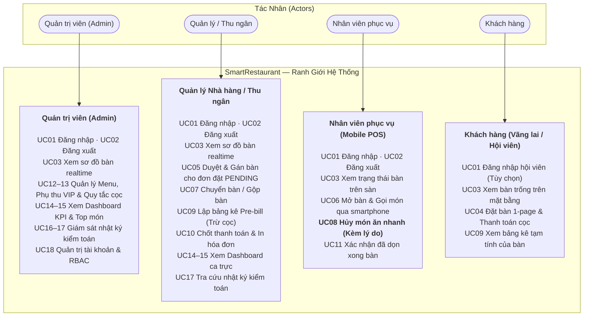

# 03 — Đặc Tả Ca Sử Dụng (Use Cases Specification)

> **Dự án:** SmartRestaurant — Hệ Thống Quản Lý Đặt Bàn & POS Gọi Món Di Động  
> **Phiên bản:** 1.0.0 — Production Readiness  
> **Tài liệu:** Danh Mục 18 Ca Sử Dụng & Sơ Đồ Use Case Toàn Diện  

---

## 1. Danh Mục Tác Nhân Hệ Thống (Actors)

1. **Khách Hàng (Customer):** Thực khách vãng lai hoặc hội viên có tài khoản, thực hiện xem menu và gửi đơn đặt bàn.
2. **Nhân Viên Phục Vụ (Waiter):** Sử dụng smartphone để mở bàn, gọi món tại bàn, hủy món nhanh có lý do.
3. **Quản Lý Nhà Hàng (Manager):** Giám sát sơ đồ bàn 2D, điều phối đơn đặt chỗ `PENDING`, ghép bàn, xem dashboard KPI và nhật ký kiểm toán.
4. **Thu Ngân (Cashier):** Lập bảng kê tạm tính (Pre-bill), cấn trừ cọc, chốt thanh toán và in hóa đơn nhiệt.
5. **Quản Trị Viên (Admin):** Quản trị tài khoản nhân viên, phân quyền RBAC, cấu hình bảng giá và quy tắc cọc.

---

## 2. Bảng Danh Mục 18 Ca Sử Dụng (Use Case Catalog)

| Mã UC | Tên Ca Sử Dụng | Miền Chức Năng | Tác Nhân Chính | Điều Kiện Tiên Quyết | Kết Quả Đạt Được |
| :--- | :--- | :--- | :--- | :--- | :--- |
| **UC01** | Đăng nhập & Xác thực phiên | Xác thực & Quyền hạn | Tất cả tác nhân | Đã có tài khoản hợp lệ | Nhận JWT Token và thông tin vai trò RBAC |
| **UC02** | Đăng xuất & Kết thúc phiên | Xác thực & Quyền hạn | Tất cả tác nhân | Đang trong phiên làm việc | Hủy token, xóa dữ liệu nhạy cảm ở client |
| **UC03** | Xem Sơ đồ bàn & Trạng thái sàn | Sơ đồ Mặt bằng 2D | Mọi tác nhân | Hệ thống đang hoạt động | Xem trực quan 4 trạng thái màu (`AVAILABLE`, `RESERVED`, `OCCUPIED`, `DIRTY`) |
| **UC04** | Gửi yêu cầu đặt bàn (Booking) | Đặt bàn Trực tuyến | Khách hàng, Quản lý | Chọn được ngày giờ & số khách | Xuất phiếu đặt bàn sinh mã `BK-xxxx` trạng thái `PENDING` |
| **UC05** | Duyệt & Gán bàn cho đơn đặt | Điều phối Đặt bàn | Quản lý nhà hàng | Có đơn ở trạng thái `PENDING` | Gán bàn chính thức, chuyển đơn sang `CONFIRMED`, bàn chuyển `RESERVED` |
| **UC06** | Mở bàn & Gọi món tại chỗ | POS Phục vụ Di động | Nhân viên phục vụ | Bàn đang ở trạng thái `AVAILABLE` | Mở phiên order (`OCCUPIED`), bắn danh sách món xuống bếp |
| **UC07** | Điều chuyển bàn & Gộp bàn ăn | POS Phục vụ Di động | Quản lý, Admin | Bàn đang ở trạng thái `OCCUPIED` | Chuyển toàn bộ món sang bàn mới an toàn |
| **UC08** | Hủy món ăn kèm lý do bắt buộc | POS Phục vụ Di động | **Bất kỳ nhân viên nào** | Món đang ở trạng thái `WAITING` | Hủy món tức thì; Trigger CSDL tự động ghi nhật ký vào `audit_logs` |
| **UC09** | Lập Bảng kê xem trước (Pre-bill)| Hóa đơn & Thu ngân | Thu ngân, Khách hàng | Bàn đang có đơn `OCCUPIED` | Hiển thị chi tiết tiền món, phụ thu VIP, trừ 100% tiền cọc, tính 8% VAT |
| **UC10** | Chốt thanh toán & In hóa đơn | Hóa đơn & Thu ngân | Thu ngân | Đã xác nhận Pre-bill | Đóng đơn `PAID`, in hóa đơn nhiệt, bàn chuyển `DIRTY` chờ dọn |
| **UC11** | Xác nhận dọn dẹp bàn hoàn tất | Sơ đồ Mặt bằng 2D | Phục vụ, Thu ngân | Bàn đang ở trạng thái `DIRTY` | Chuyển bàn sang `AVAILABLE` sẵn sàng đón lượt khách tiếp theo |
| **UC12** | Quản lý Thực đơn & Trạng thái | Quản lý Menu | Quản lý, Admin | Đăng nhập quyền Quản lý | Thêm/sửa món, bật/tắt hết hàng tức thì, soft-delete món cũ |
| **UC13** | Cấu hình Phụ thu VIP & Mức cọc | Bảng giá & Chính sách | Quản lý, Admin | Đăng nhập quyền Admin | Thiết lập tỷ lệ phụ thu phòng VIP và ngưỡng khách cần cọc |
| **UC14** | Xem Dashboard Doanh thu ca | Báo cáo & Điều hành | Quản lý, Admin | Đăng nhập quyền Quản lý | Theo dõi doanh thu ngày/tuần/tháng kèm biểu đồ cột và biểu đồ tròn phòng |
| **UC15** | Xem Bảng xếp hạng món bán chạy | Báo cáo & Phân tích | Quản lý, Admin | Đăng nhập quyền Quản lý | Thống kê số lượng đĩa bán ra giúp bếp chuẩn bị nguyên liệu |
| **UC16** | Tự động ghi nhật ký kiểm toán | Kiểm toán Tự động | Database Trigger | Xảy ra sự kiện nhạy cảm | Ghi vết bất biến: ID người làm, thời gian, dữ liệu trước/sau và lý do |
| **UC17** | Tra cứu Nhật ký kiểm toán | Giám sát Chống gian lận | Quản lý, Admin | Đăng nhập quyền Quản lý | Bộ lọc tra cứu vết hủy món, chuyển bàn, chỉnh sửa bill |
| **UC18** | Quản trị Người dùng & Hội viên | Quản trị Hệ thống | Quản trị viên (Admin) | Đăng nhập quyền Admin | Quản lý vòng đời tài khoản, cấp phát vai trò RBAC |

---

## 3. Sơ Đồ Ca Sử Dụng (Use Case Diagram)

