# 04 — Kiến Trúc Thông Tin & Giao Diện Người Dùng (Information Architecture & UI)

> **Dự án:** SmartRestaurant — Hệ Thống Tự Động Hóa Vận Hành Đặt Bàn AI, QR Self-Ordering & POS Di Động  
> **Phiên bản:** 2.0.0 — Full Automation & AI-Driven Architecture  
> **Tài liệu:** Bản Đồ Kiến Trúc Thông Tin, Luồng Điều Hướng & Giao Diện 5 Phân Hệ  

---

## 1. Bản Đồ Kiến Trúc Thông Tin (Information Architecture Sitemap)

SmartRestaurant 2.0 tổ chức kiến trúc thông tin xoay quanh trải nghiệm tự phục vụ của thực khách, đồng bộ thời gian thực với trạm bếp, nhân viên sàn và bảng điều hành quản lý:

```mermaid
graph TD
    Root["Hệ Thống SmartRestaurant 2.0"]

    subgraph C1["1. Cổng Khách Hàng & AI Chatbot (Web 1-Page)"]
        CP_Hero["Hero Section: Triết lý ẩm thực & Không gian"]
        CP_Chat["AI Chatbot Widget: Tư vấn món, giờ vắng, bàn phù hợp"]
        CP_Menu["Editorial Menu Grid: Phân loại danh mục & Set menu"]
        CP_Space["Không Gian Phòng: Sảnh Chính, Sân Vườn, VIP Royal"]
        CP_Book["Phiếu Đặt Bàn: Số khách, giờ hẹn, vị trí ưu tiên mềm"]
        CP_Dep["Cổng Cọc VietQR Động: Đoàn đông & Phòng VIP"]
        CP_Ticket["Vé Đặt Bàn Điện Tử: Mã BK-xxxx & Host OTP 4 số"]
        
        CP_Hero --> CP_Chat
        CP_Hero --> CP_Menu --> CP_Space --> CP_Book --> CP_Dep --> CP_Ticket
    end

    subgraph C2["2. Web App Gọi Món & Thanh Toán Tại Bàn (Scan-to-Order)"]
        SO_Scan["Quét QR Code tại bàn ăn"]
        SO_Auth["Xác thực Host OTP (hoặc Walk-in SĐT Check-in)"]
        SO_Room["Phòng Gọi Món Chung (Collaborative Group Cart)"]
        SO_Track["Live Item Tracker: PENDING ➔ COOKING ➔ READY"]
        SO_Cancel["Nút Tự Hủy Món PENDING (Trừ bill tức thì)"]
        SO_Bell["Chuông Gọi Phục Vụ Thông Minh: Đổi món, thêm đá, dọn bàn"]
        SO_Pay["Pay-at-Table: Pre-bill trừ cọc 100% ➔ VietQR động ➔ E-Receipt"]

        SO_Scan --> SO_Auth --> SO_Room --> SO_Track
        SO_Track --> SO_Cancel
        SO_Track --> SO_Bell
        SO_Room --> SO_Pay
    end

    subgraph C3["3. Màn Hình Trạm Bếp KDS (Kitchen Display System)"]
        KD_Station["Phân trạm: Bếp Nóng · Bếp Nguội · Quầy Bar"]
        KD_Card["Thẻ Order: Danh sách món, bàn số, thời gian chờ"]
        KD_Touch1["Chạm 1: Xác nhận COOKING (Hệ thống khóa nút tự hủy của khách)"]
        KD_Touch2["Chạm 2: Xác nhận READY (Phát chuông báo bồi bàn mang ra)"]
        KD_Stock["Nút chuyển trạng thái HẾT MÓN tức thì"]

        KD_Station --> KD_Card --> KD_Touch1 --> KD_Touch2
        KD_Station --> KD_Stock
    end

    subgraph C4["4. Staff Concierge App (Trợ Lý Phục Vụ Sàn)"]
        ST_Alert["Màn hình nhận thông báo chuông gọi phục vụ thông minh"]
        ST_Intervene["Can thiệp xử lý hủy món đang COOKING (Xác nhận với bếp)"]
        ST_Dirty["Danh sách nhiệm vụ dọn dẹp bàn DIRTY"]
        ST_Done["Chạm nút: Đã dọn xong (Bàn chuyển về AVAILABLE)"]
        ST_Help["Hỗ trợ khách lớn tuổi order hộ qua máy nhân viên"]

        ST_Alert --> ST_Intervene
        ST_Dirty --> ST_Done
        ST_Alert --> ST_Help
    end

    subgraph C5["5. Bảng Điều Khiển Quản Lý & Admin (Manager Console)"]
        MN_Floor["Sơ Đồ Mặt Bằng 2D: Vị trí bàn thực tế & 4 màu trạng thái"]
        MN_Ai["AI Allocation Monitor: Giám sát thuật toán xếp bàn tự động"]
        MN_Kpi["Executive Dashboard: Doanh thu, Tỷ lệ tự order, Tốc độ ra món"]
        MN_Audit["Tra cứu Nhật ký kiểm toán bất biến chống gian lận (Trigger DB)"]
        MN_Menu["Quản trị Menu, Giá bán, Phụ thu VIP & Cấu hình ngưỡng cọc"]

        MN_Floor --> MN_Ai --> MN_Kpi --> MN_Audit --> MN_Menu
    end

    Root --> C1
    Root --> C2
    Root --> C3
    Root --> C4
    Root --> C5
```

---

## 2. Thiết Kế Trải Nghiệm Người Dùng (UX Flow Chi Tiết)

### 2.1 Luồng Tự Phục Vụ Của Thực Khách (The Guest Journey)
1. **Lên Web / Chat AI:** Khách mở trang web, trò chuyện với AI Chatbot để nhận tư vấn chỗ ngồi và món đặc sắc.
2. **Đặt bàn & Nhận OTP:** Điền form chọn vị trí ưu tiên mềm $\rightarrow$ Quét cọc VietQR (nếu $\ge 6$ người/VIP) $\rightarrow$ Nhận vé điện tử hiển thị mã **Host OTP**.
3. **Đến quán & Quét QR bàn:** Khách vào đúng bàn do AI phân bổ, dùng camera quét QR trên bàn $\rightarrow$ Nhập Host OTP $\rightarrow$ Mở phòng gọi món.
4. **Chọn món cùng nhóm:** Các thành viên trong bàn quét QR cùng nhập OTP để thêm món vào giỏ hàng chung; Host bấm nút "Gửi Bếp".
5. **Theo dõi tiến độ món:** 
   * Món đang `PENDING`: Khách bấm "Hủy món" được ngay nếu đổi ý.
   * Món chuyển `COOKING`: Nút hủy khóa lại, khách bấm "Gọi phục vụ hỗ trợ" nếu thực sự cần hủy.
6. **Tự thanh toán tại bàn:** Bấm "Thanh toán", kiểm tra hóa đơn đã khấu trừ 100% tiền cọc $\rightarrow$ Quét mã VietQR chuyển khoản $\rightarrow$ Nhận e-receipt và rời quán.

---

### 2.2 Luồng Vận Hành Trạm Bếp (The Chef Journey)
1. **Tiếp nhận order:** Màn hình KDS trạm bếp phát âm thanh thông báo thẻ order mới hiển thị bàn, tên món, ghi chú khẩu vị (`Ít cay`, `Không hành`).
2. **Chế biến món:** Đầu bếp chạm vào thẻ món $\rightarrow$ Chuyển trạng thái sang `COOKING`. Hệ thống lập tức khóa quyền tự hủy của khách hàng.
3. **Hoàn thành đĩa ăn:** Đầu bếp chạm lần 2 $\rightarrow$ Chuyển trạng thái sang `READY`. Hệ thống đẩy thông báo cho nhân viên sàn bưng ra bàn.

---

### 2.3 Luồng Trợ Lý Nhân Viên (The Staff Concierge Journey)
1. **Nhận cảnh báo cuộc gọi:** Điện thoại nhân viên rung chuông: *"Bàn VIP-01 cần hỗ trợ đổi món Bò Wagyu"* hoặc *"Bàn T-03 xin thêm đá lạnh"*.
2. **Hỗ trợ tận nơi:** Nhân viên đến bàn giải quyết yêu cầu; nếu hủy món đang nấu thì nhân viên thao tác xác nhận trên máy kèm nhập lý do hủy.
3. **Tiếp nhận bàn cần dọn:** Sau khi khách thanh toán tại bàn, hệ thống đẩy task: *"Bàn T-05 đã thanh toán, đang chờ dọn"*.
4. **Hồi sinh bàn:** Nhân viên dọn dẹp sạch sẽ, chạm nút "Đã dọn xong" $\rightarrow$ Bàn trên sơ đồ 2D lập tức chuyển sang màu xanh 🟢 `AVAILABLE` để AI xếp khách mới.
