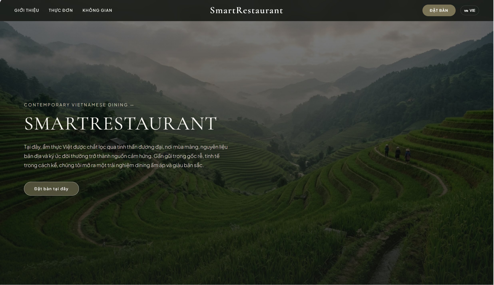
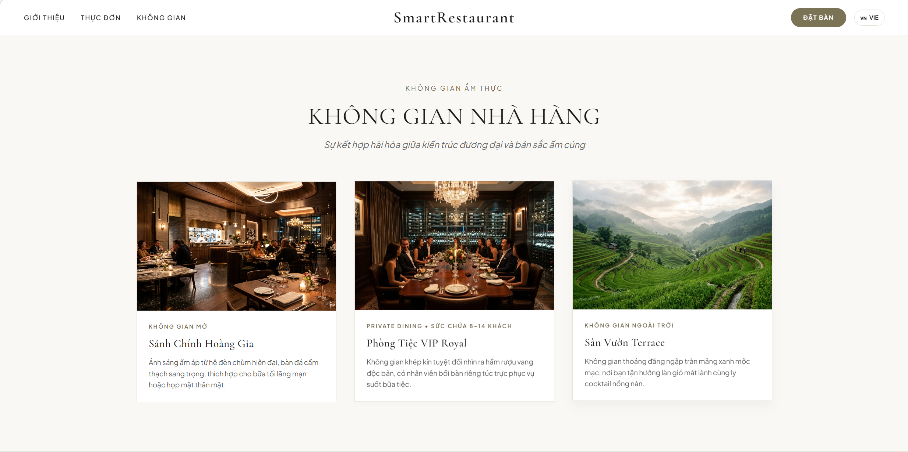
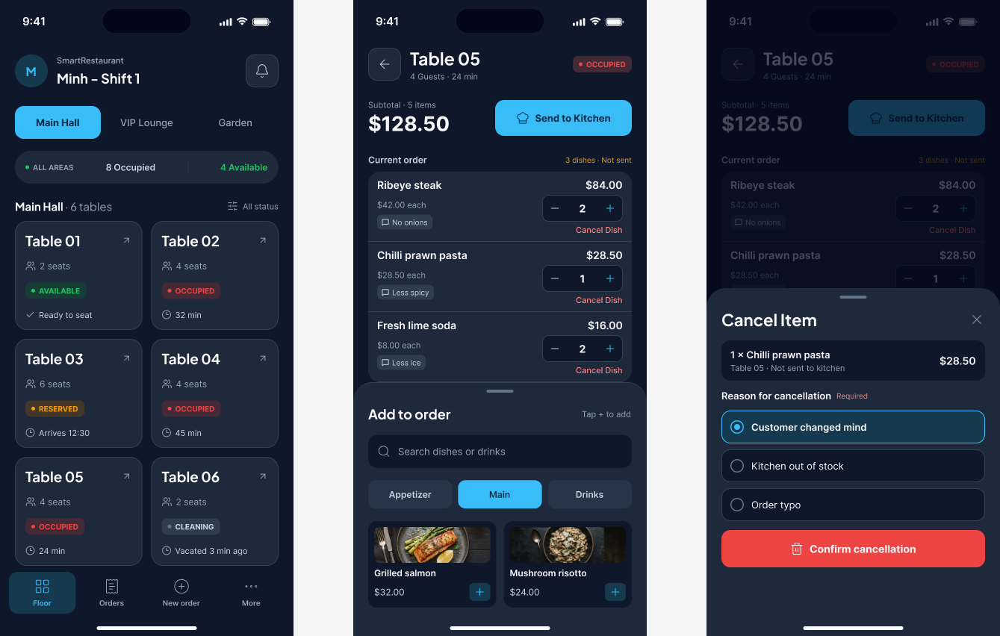
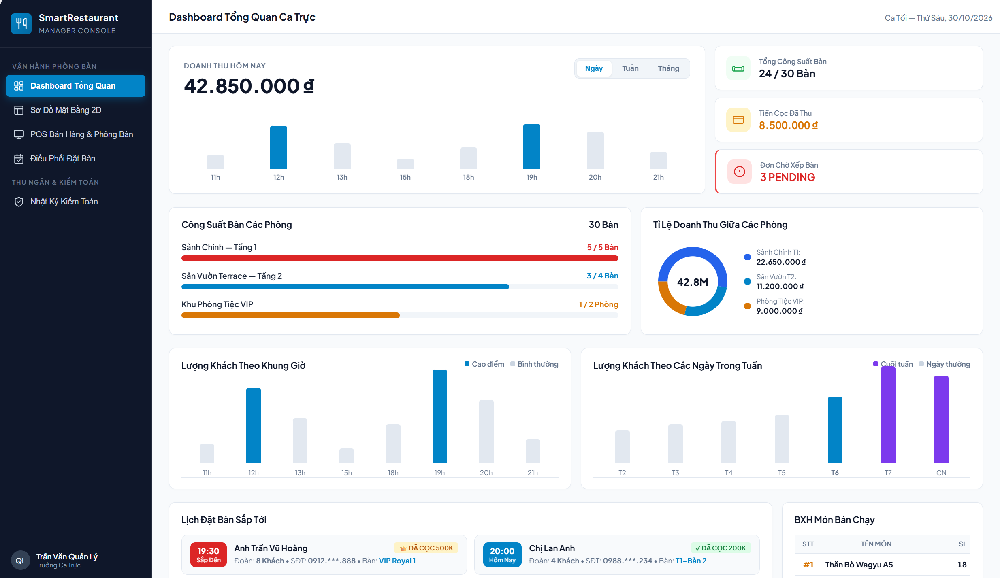
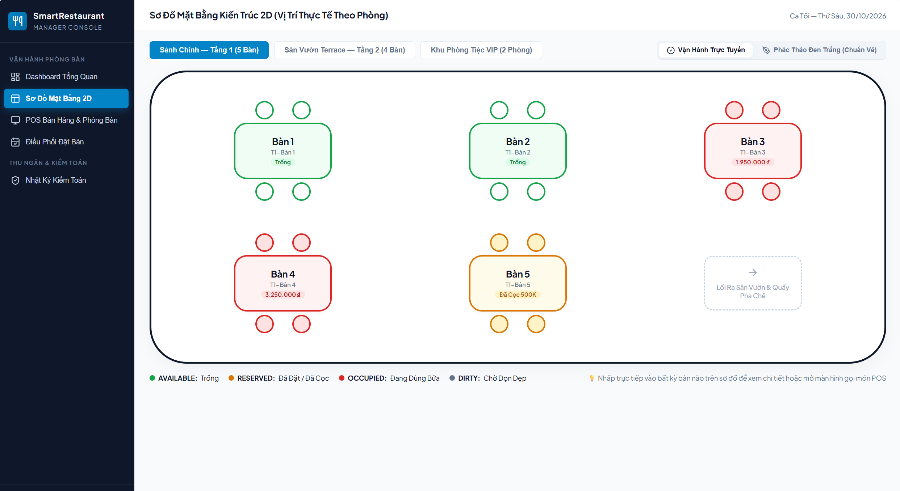

# 04 — Kiến Trúc Thông Tin & Giao Diện Người Dùng (Information Architecture & UI)

> **Dự án:** SmartRestaurant — Hệ Thống Quản Lý Đặt Bàn & POS Gọi Món Di Động  
> **Phiên bản:** 1.0.0 — Production Readiness  
> **Tài liệu:** Kiến Trúc Điều Hướng, Tuyến Đường & Thư Viện Giao Diện Trực Quan  

---

## 1. Bản Đồ Kiến Trúc Thông Tin (Information Architecture Sitemap)

Hệ thống tổ chức cấu trúc màn hình và luồng điều hướng theo 3 phân hệ độc lập:

```mermaid
graph TD
    Root["SmartRestaurant Application"]

    subgraph Customer["1. Cổng Khách Hàng (Website 1-Page Đương Đại)"]
        CP_Nav["Header Cố Định: Logo · Thực Đơn · Không Gian · Nút ĐẶT BÀN"]
        CP_Hero["Hero Section: Hình ảnh nghệ thuật & Triết lý ẩm thực"]
        CP_Menu["Editorial Menu Grid: Set Menu & Món theo danh mục"]
        CP_Spaces["Không Gian Ẩm Thực: Sảnh Chính, Sân Vườn, Phòng VIP"]
        CP_Ticket["Phiếu Đặt Bàn: Form gạch chân tối giản & Xuất vé PENDING"]

        CP_Nav -.-> CP_Ticket
        CP_Hero --> CP_Menu --> CP_Spaces --> CP_Ticket
    end

    subgraph Waiter["2. POS Phục Vụ Di Động (Smartphone 1 Tay)"]
        WP_Auth["Đăng nhập mã PIN nhân viên"]
        WP_Floor["Lưới trạng thái bàn di động (Màu sắc thời gian thực)"]
        WP_Order["Phiếu gọi món bàn đang phục vụ"]
        WP_Thumb["Thao tác 1 tay: Tìm món, tăng giảm số lượng & ghi chú bếp"]
        WP_Cancel["Hủy món ăn linh hoạt (Chọn lý do + Tự kích hoạt Trigger)"]

        WP_Auth --> WP_Floor --> WP_Order --> WP_Thumb
        WP_Order --> WP_Cancel
    end

    subgraph Manager["3. Bảng Điều Khiển Quản Lý & Thu Ngân (Desktop/Tablet)"]
        MD_Kpi["Executive Dashboard: Doanh thu cột/tròn, Công suất & Top món"]
        MD_Floor["Sơ đồ mặt bằng kiến trúc 2D: Vị trí bàn thực tế theo phòng"]
        MD_Pos["POS Quản lý & Thu ngân: Bảng kê Pre-bill, trừ cọc, in hóa đơn"]
        MD_Dispatch["Bảng điều phối đặt bàn: Hàng đợi PENDING & Xếp bàn đoàn đông"]
        MD_Audit["Bảng tra cứu nhật ký kiểm toán bất biến chống gian lận"]

        MD_Kpi --> MD_Floor --> MD_Pos --> MD_Dispatch --> MD_Audit
    end

    Root --> Customer
    Root --> Waiter
    Root --> Manager
```

---

## 2. Bảng Ánh Xạ Tuyến Đường & Màn Hình Hệ Thống

| Định Danh View | Tuyến Đường (URL Route) | Phân Hệ & Thiết Bị | Nhiệm Vụ Nghiệp Vụ Trọng Tâm |
| :--- | :--- | :--- | :--- |
| `VIEW-CP-01` | `/` | Khách hàng (Web/Mobile) | Trang chủ 1-page liền mạch: Giới thiệu thương hiệu, Thực đơn, Không gian và Phiếu đặt bàn. |
| `VIEW-CP-02` | `/#menu` | Khách hàng (Web/Mobile) | Phần xem thực đơn theo phong cách Editorial Grid với khung viền thanh mảnh. |
| `VIEW-CP-03` | `/#dat-ban` | Khách hàng (Web/Mobile) | Phiếu đặt bàn tối giản; tự động tính tiền cọc cho đoàn $\ge 6$ người hoặc phòng VIP. |
| `VIEW-WP-01` | `/pos/tables` | Phục vụ (Smartphone) | Lưới trạng thái bàn di động tối ưu chạm, hiển thị thời gian dùng bữa và bàn chờ dọn. |
| `VIEW-WP-02` | `/pos/order/:tableId` | Phục vụ (Smartphone) | Phiếu gọi món bàn đang ăn: thêm món, ghi chú gửi bếp, hủy món tức thì kèm lý do. |
| `VIEW-MD-01` | `/admin/dashboard` | Quản lý (Desktop/Tablet) | Báo cáo KPI điều hành: thẻ doanh thu trắng tích hợp biểu đồ cột, biểu đồ tròn phòng, hàng chờ 3/4 và BXH 1/4. |
| `VIEW-MD-02` | `/admin/floor-map` | Quản lý (Desktop/Tablet) | Bản đồ không gian 2D: hiển thị chính xác vị trí thực tế của từng bàn trong từng phòng. |
| `VIEW-MD-03` | `/admin/reservations`| Quản lý (Desktop/Tablet) | Bàn điều phối đặt bàn: duyệt đơn `PENDING`, ghép bàn đón đoàn đông, xác nhận đơn. |
| `VIEW-MD-04` | `/admin/billing/:orderId`| Thu ngân (Desktop/Tablet)| Xem bảng kê tạm tính (Pre-bill), cấn trừ 100% tiền cọc, xuất hóa đơn nhiệt PDF. |
| `VIEW-MD-05` | `/admin/audit` | Quản lý (Desktop/Tablet) | Tra cứu nhật ký kiểm toán bất biến: theo dõi lịch sử hủy món, chuyển bàn, chiết khấu. |

---

## 3. Thư Viện Giao Diện Trực Quan (UI Showcase)

Tất cả các bản thiết kế thực tế của hệ thống được lưu trữ trong thư mục `docs/images/`:

### 3.1 Cổng Khách Hàng — Trang Chủ & Giới Thiệu (Hero Section)

### 3.2 Cổng Khách Hàng — Thực Đơn Tinh Tuyển (Editorial Menu Grid)

### 3.3 Cổng Khách Hàng — Không Gian Nhà Hàng (Dining Spaces)

### 3.4 Cổng Khách Hàng — Phiếu Đặt Bàn (Reservation Ticket)

### 3.5 Phân Hệ Phục Vụ — POS Gọi Món Di Động (Mobile Waiter POS)

### 3.6 Phân Hệ Quản Lý — Dashboard Tổng Quan Ca Trực (Executive Dashboard)

### 3.7 Phân Hệ Quản Lý — Sơ Đồ Mặt Bằng Kiến Trúc 2D (Spatial Floor Map)

