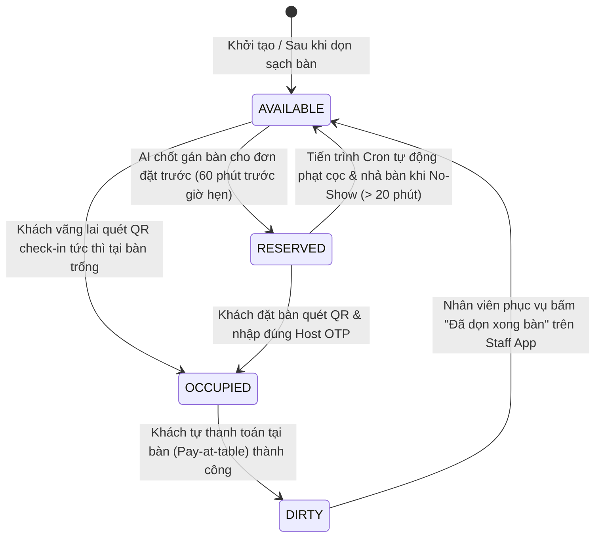
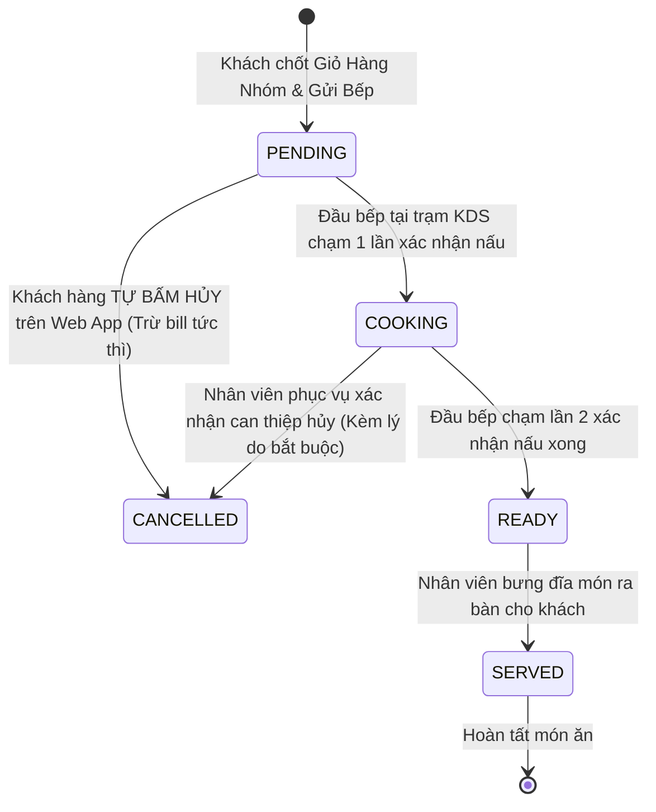
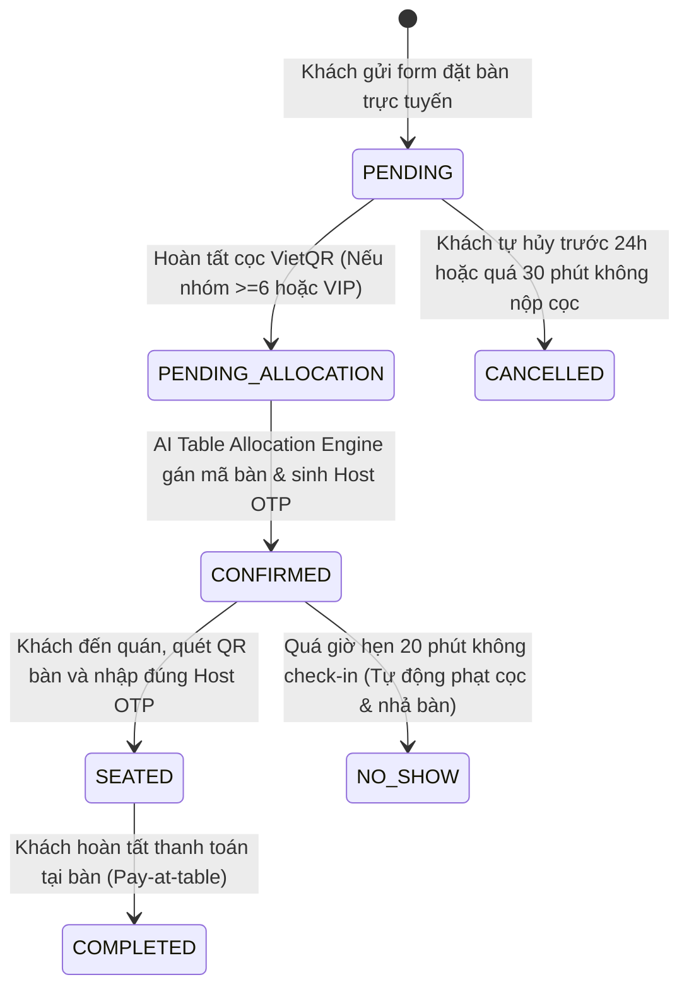

# 05 — Mô Hình Dữ Liệu & Máy Trạng Thái Nghiệp Vụ (Data Model & State Machines)

> **Dự án:** SmartRestaurant — Hệ Thống Tự Động Hóa Vận Hành Đặt Bàn AI, QR Self-Ordering & POS Di Động  
> **Phiên bản:** 2.0.0 — Full Automation & AI-Driven Architecture  
> **Tài liệu:** Lược Đồ Dữ Liệu Thực Thể & Các Máy Trạng Thái Tự Động Hóa  

---

## 1. Phân Cấp Sơ Đồ Không Gian & Thực Thể Phiên Bàn

```text
Chi Nhánh (branches) ──► Khu Vực (areas) ──► Bàn Ăn (tables) ──► Phiên Bàn Ăn (table_sessions)
```

* **`branches`:** Quản lý thông tin chi nhánh nhà hàng.
* **`areas`:** Khu vực không gian phục vụ (`Sảnh Chính T1`, `Sân Vườn Terrace T2`, `Phòng Tiệc VIP Royal` với tỷ lệ phụ thu `surcharge_percent = 10%`).
* **`tables`:** Từng bàn ăn với tọa độ kiến trúc `coord_x, coord_y`, sức chứa `capacity`, trạng thái hiện tại `status` và `qr_code_token`.
* **`table_sessions` (MỚI):** Đại diện cho một phiên khách ngồi ăn tại bàn. Lưu giữ mã **`host_otp` (4 số)**, liên kết với `reservation_id` (hoặc đánh dấu khách vãng lai `is_walkin = true`). Mọi thiết bị cùng bàn muốn thêm món vào giỏ hàng chung đều phải liên kết với `session_id` này.

---

## 2. Máy Trạng Thái Của Bàn Ăn (Table State Machine)



| Trạng Thái | Màu Sắc | Ý Nghĩa Nghiệp Vụ | Thao Tác Kích Hoạt |
| :--- | :---: | :--- | :--- |
| **AVAILABLE** | 🟢 Xanh lá | Bàn đang trống, sạch sẽ, sẵn sàng đón khách. | Nhân viên chạm nút "Đã dọn xong" (`POST /api/v1/tables/:id/clean`). |
| **RESERVED** | 🟡 Vàng cam | Bàn đã được AI phân bổ cho khách đặt trước sắp tới trong 60 phút. | Thuật toán AI phân bổ bàn (`PATCH /api/v1/reservations/:id/allocate`). |
| **OCCUPIED** | 🔴 Đỏ | Bàn đang có khách ngồi ăn; phiên gọi món đang mở và bảo mật bằng OTP. | Khách quét mã QR & nhập đúng Host OTP (`POST /api/v1/sessions/verify-otp`). |
| **DIRTY** | ⚫ Xám | Khách đã thanh toán xong qua QR; bàn cần được nhân viên vệ sinh. | Webhook ngân hàng báo thanh toán thành công (`POST /api/v1/payments/webhook`). |

---

## 3. Máy Trạng Thái Của Món Ăn (Order Item State Machine)

Vòng đời của từng món ăn trong phiên được kiểm soát nghiêm ngặt để phân định rõ quyền hạn hủy món:



* **Quy tắc phân quyền hủy:**
  1. Ở trạng thái `PENDING`: Hệ thống cho phép **Khách hàng tự do hủy 100%**. Trigger CSDL tự động ghi nhận `actor_type: 'GUEST'`.
  2. Ở trạng thái `COOKING`: Nút tự hủy trên Web App bị **khóa cứng**. Khách phải bấm chuông gọi nhân viên sàn. Nhân viên ra bếp kiểm tra, nếu bếp đồng ý dừng nấu thì nhân viên mới được quyền bấm hủy trên Staff App kèm lý do. Trigger CSDL ghi nhận `actor_type: 'STAFF'`.
  3. Ở trạng thái `READY` hoặc `SERVED`: Món ăn **không thể hủy**.

---

## 4. Máy Trạng Thái Của Phiếu Đặt Bàn (Reservation State Machine)


