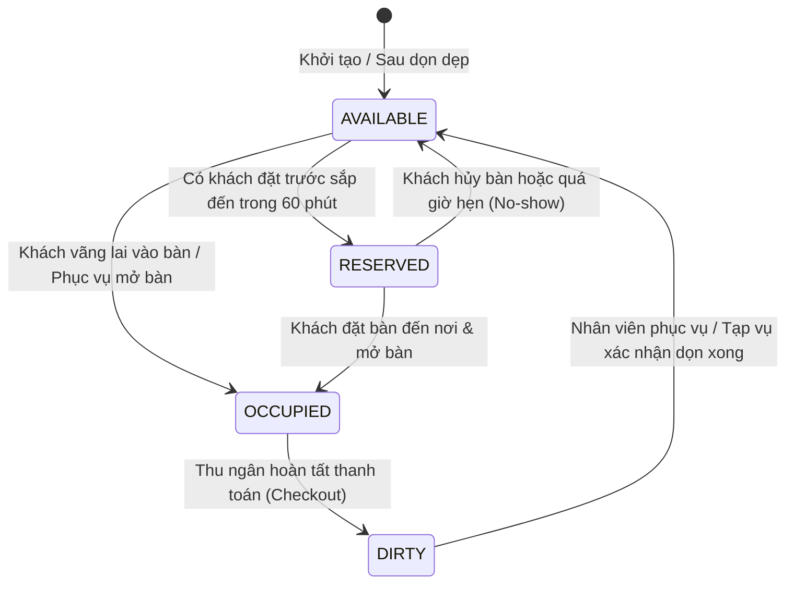
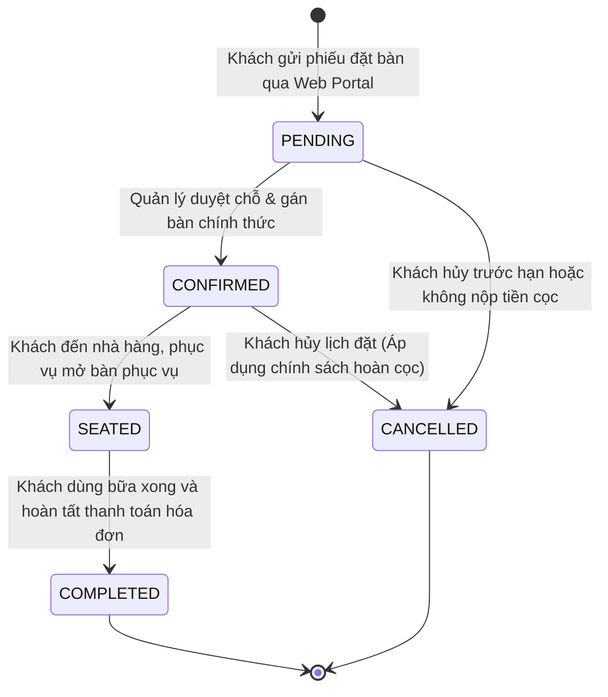
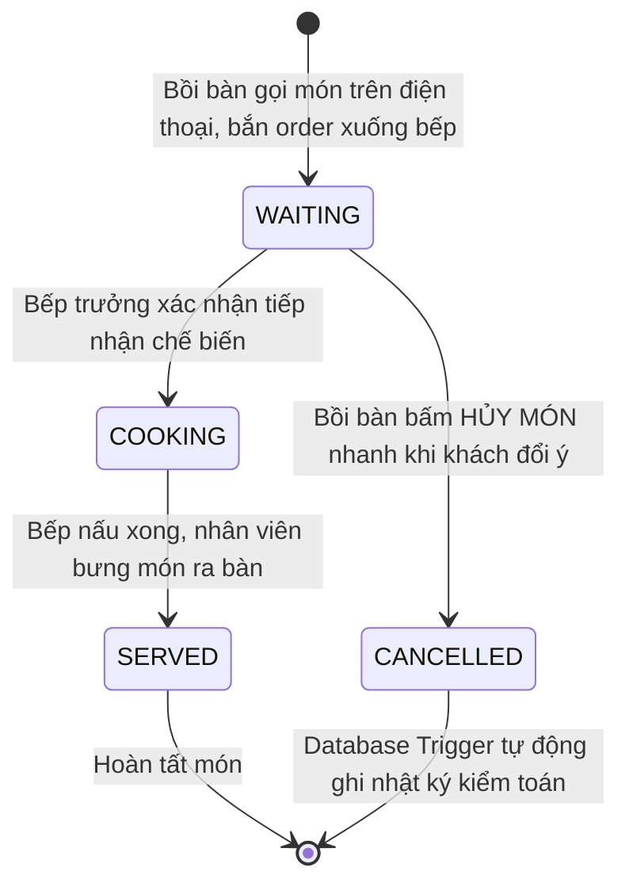

# 05 — Mô Hình Dữ Liệu & Máy Trạng Thái Nghiệp Vụ (Data Model & State Machines)

> **Dự án:** SmartRestaurant — Hệ Thống Quản Lý Đặt Bàn & POS Gọi Món Di Động  
> **Phiên bản:** 1.0.0 — Production Readiness  
> **Tài liệu:** Đặc Tả Mô Hình Thực Thể & Các Máy Chuyển Trạng Thái Cốt Lõi  

---

## 1. Phân Cấp Sơ Đồ Không Gian Nhà Hàng (Spatial Hierarchy)

Cấu trúc không gian phục vụ được tổ chức theo quan hệ phân cấp 3 tầng nghiêm ngặt:

$$\text{Chi Nhánh (branches)} \longrightarrow \text{Khu Vực / Phòng (areas)} \longrightarrow \text{Bàn Ăn (tables)}$$

* **Chi Nhánh (`branches`):** Tên cơ sở, địa chỉ, số điện thoại hotline.
* **Khu Vực / Phòng (`areas`):**
  * *Sảnh Chính (Tầng 1):* Không gian mở hoàng gia, sức chứa lớn, phụ thu $0\%$.
  * *Sân Vườn Terrace (Tầng 2):* Không gian thoáng mát ngoài trời, phụ thu $0\%$.
  * *Phòng Tiệc VIP Royal:* Phòng tiệc khép kín có điều hòa riêng, phụ thu cố định (ví dụ $10\%$).
* **Bàn Ăn (`tables`):** Định danh duy nhất theo từng phòng (ví dụ `T1-Bàn 1`, `VIP-Phòng 1`), sức chứa tiêu chuẩn, tọa độ `coord_x, coord_y` để kết xuất trực tiếp lên sơ đồ 2D.

---

## 2. Máy Trạng Thái Của Bàn Ăn (Table State Machine)

Vòng đời của từng bàn ăn được quản lý bằng bộ chuyển trạng thái tự động và đồng bộ thời gian thực:

| Trạng Thái | Màu Sắc | Ý Nghĩa Vận Hành | Thao Tác Kích Hoạt |
| :--- | :---: | :--- | :--- |
| **AVAILABLE** | 🟢 Xanh lá | Bàn đang trống, sạch sẽ, sẵn sàng tiếp nhận khách mới. | Nhân viên xác nhận dọn xong (`POST /tables/:id/clean`). |
| **RESERVED** | 🟡 Vàng cam | Bàn đã có khách đặt trước sắp đến trong vòng 60 phút hoặc đơn đã cọc. | Quản lý duyệt phiếu đặt bàn (`PATCH /reservations/:id/confirm`). |
| **OCCUPIED** | 🔴 Đỏ | Bàn đang có khách ngồi ăn; đang phục vụ các món trong phiên. | Bồi bàn mở bàn trên smartphone (`POST /orders/open`). |
| **DIRTY** | ⚫ Xám | Khách đã thanh toán rời đi; bàn cần được dọn dẹp vệ sinh. | Thu ngân chốt bill thành công (`POST /invoices/checkout`). |

---

## 3. Vòng Đời Phiếu Đặt Bàn (Reservation Lifecycle)

---

## 4. Vòng Đời Món Ăn Trong Phiếu Gọi (Order Item Lifecycle)

> ⚠️ **Quy tắc vàng chống gian lận:** Khi một món ăn chuyển sang trạng thái `CANCELLED`, hệ thống **bắt buộc** phải có `cancel_reason` và ID nhân viên thực hiện (`cancelled_by`). PostgreSQL Trigger sẽ tự động chèn bản ghi vào bảng `audit_logs` trước khi commit giao dịch.

---

## 5. Quy Tắc Tính Tiền & Đối Soát Cọc (Billing & Calculation Formula)

Số tiền thanh toán cuối cùng trên hóa đơn (`invoices.final_amount`) được tính toán theo công thức chuẩn:

$$\text{Final Amount} = \text{Subtotal} + \text{VIP Surcharge} - \text{Deposit Deducted} - \text{Discount} + \text{VAT}$$

Trong đó:
* **Subtotal (Tổng tiền món):** $\sum (\text{quantity} \times \text{price})$ của toàn bộ các món có trạng thái `SERVED` hoặc `COOKING`. Các món `CANCELLED` hoàn toàn không tính tiền.
* **VIP Surcharge (Phụ thu VIP):** $\text{Subtotal} \times \text{surcharge\_rate}$ nếu bàn thuộc phòng VIP.
* **Deposit Deducted (Khấu trừ cọc):** Trừ $100\%$ số tiền cọc khách đã thanh toán trước đó (lưu trong `reservations.deposit_amount`).
* **VAT (Thuế GTGT):** Tính $8\%$ trên tổng giá trị sau khi đã trừ cọc và chiết khấu.

---

> 🔗 *Xem chi tiết toàn bộ kịch bản DDL và mã DBML tại [DATABASE.md](./DATABASE.md).*
