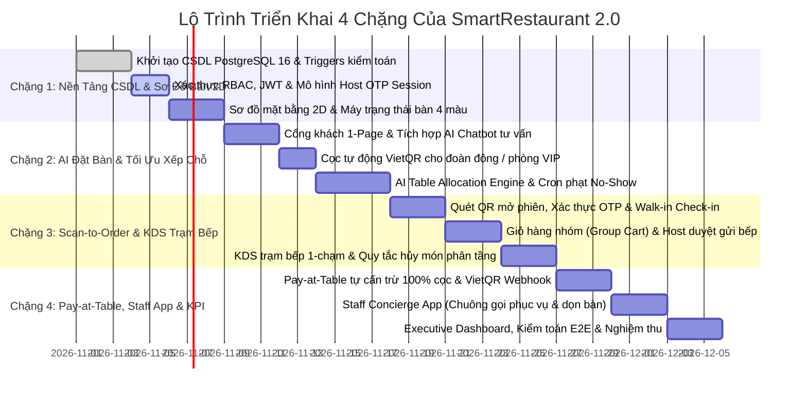

# 09 — Kế Hoạch Sẵn Sàng Triển Khai (Implementation Readiness)

> **Dự án:** SmartRestaurant — Hệ Thống Tự Động Hóa Vận Hành Đặt Bàn AI, QR Self-Ordering & POS Di Động  
> **Phiên bản:** 2.0.0 — Full Automation & AI-Driven Architecture  
> **Tài liệu:** Tiêu Chuẩn Sẵn Sàng Bắt Đầu Phát Triển & Lộ Trình Triển Khai 4 Chặng  

---

## 1. Định Nghĩa Sẵn Sàng Phát Triển (Definition of Ready - DoR)

Trước khi bắt đầu giai đoạn phát triển mã nguồn production, toàn bộ tài liệu và thiết kế kỹ thuật của SmartRestaurant 2.0 đã thỏa mãn $100\%$ các tiêu chuẩn DoR:

* [x] **Yêu cầu nghiệp vụ & Use Cases:** 21 Ca sử dụng bao phủ trọn vẹn luồng tự động hóa từ AI Chatbot, AI Table Allocation, Scan-to-Order, KDS trạm bếp đến Pay-at-table.
* [x] **Trực quan hóa giao diện & Luồng UX:** Sơ đồ kiến trúc thông tin phân chia rõ ràng 5 phân hệ (Web 1-page khách, Web App gọi món tại bàn, KDS trạm bếp, Staff Concierge, Manager Console).
* [x] **Lược đồ dữ liệu & Database Triggers:** 13 bảng dữ liệu quan hệ (bao gồm `table_sessions`, `service_calls`), 10 ENUM types, và các Trigger PostgreSQL kiểm soát ràng buộc hủy món và lưu log kiểm toán bất biến.
* [x] **Hợp đồng API & Giao thức thời gian thực:** Đặc tả RESTful APIs kết hợp WebSocket/SSE phục vụ đồng bộ giỏ hàng nhóm và trạng thái món ăn KDS.
* [x] **Mô hình bảo mật phiên bàn:** Thiết kế cơ chế Host OTP chống order trộm và phân định quyền hạn rõ ràng giữa GUEST và STAFF.

---

## 2. Lộ Trình Triển Khai 4 Chặng Gia Tăng (Implementation Increments)

Dự án được phân bổ thành 4 chặng gia tăng nối tiếp nhau, mỗi chặng đều có thể kiểm thử độc lập và bàn giao giá trị chạy được:

### Chặng 1: Nền Tảng Cơ Sở Dữ Liệu, Host OTP & Sơ Đồ Mặt Bằng 2D
* Khởi tạo cơ sở dữ liệu PostgreSQL 16 với 13 bảng quan hệ và 10 ENUMs.
* Cài đặt Database Triggers: kiểm soát ràng buộc hủy món (`fn_check_item_cancellation_permission`) và ghi vết kiểm toán bất biến (`fn_audit_order_item_cancellation`).
* Phát triển component Sơ đồ mặt bằng kiến trúc 2D hiển thị trực quan 4 màu trạng thái bàn.

### Chặng 2: Cổng Khách Hàng AI, Đặt Bàn & Bộ Não Xếp Chỗ Tự Động
* Xây dựng Cổng khách hàng 1-Page Contemporary Luxury tích hợp AI Chatbot Assistant.
* Tích hợp thanh toán cọc tự động qua VietQR cho đoàn $\ge 6$ người hoặc phòng VIP.
* Phát triển **AI Table Allocation Engine**: tự động phân bổ bàn dựa trên quy tắc lấp đầy sàn và phát thông báo SMS/Email kèm mã Host OTP.
* Cài đặt tiến trình Cron Worker tự động phạt cọc và nhả bàn khi khách No-Show quá 20 phút.

### Chặng 3: Scan-to-Order, Giỏ Hàng Nhóm & KDS Trạm Bếp
* Phát triển giao diện Web App tại bàn: quét mã QR, xác thực Host OTP (và luồng Check-in nhanh cho khách vãng lai).
* Xây dựng cơ chế **Giỏ Hàng Nhóm Thời Gian Thực (Collaborative Group Cart)** qua WebSocket.
* Xây dựng màn hình trạm bếp **KDS 1-chạm**: đầu bếp chạm 1 để chuyển `COOKING` (tự động khóa nút hủy của khách) và chạm 2 để chuyển `READY`.
* Triển khai tính năng khách tự bấm hủy món khi đang ở trạng thái `PENDING`.

### Chặng 4: Pay-at-Table, Staff Concierge App & Executive Dashboard
* Phát triển phân hệ **Pay-at-Table**: hiển thị bảng kê xem trước tự động cấn trừ 100% tiền cọc, tích hợp cổng thanh toán VietQR động và xuất e-receipt.
* Tự động chuyển bàn sang ⚫ `DIRTY` khi nhận Webhook thanh toán thành công.
* Xây dựng **Staff Concierge App**: nhận chuông gọi phục vụ thông minh, can thiệp hỗ trợ hủy món đang nấu và bấm hoàn tất dọn bàn.
* Hoàn thiện **Executive Dashboard**: thống kê doanh thu, tỷ lệ tự phục vụ (Self-service rate), thời gian ra món trung bình của bếp và kiểm thử tích hợp toàn diện (E2E Integration Test).

---

## 3. Tiêu Chuẩn Hoàn Thành (Definition of Done - DoD)

Một tính năng chỉ được đánh giá là hoàn thành khi thỏa mãn:
1. Mã nguồn tuân thủ coding conventions, không phát sinh cảnh báo lint hay lỗi console.
2. Tất cả endpoints thỏa mãn hợp đồng đặc tả API và có mã phản hồi chuẩn hóa.
3. Cơ chế kiểm soát quyền hủy món được bảo vệ 2 lớp: Client UI chặn bấm và Database Trigger chặn ở tầng CSDL.
4. Mọi thao tác hủy món, hoàn tiền, gọi phục vụ, thanh toán đều được lưu vết bất biến trong bảng `audit_logs`.
5. Giao diện Web App tương thích mượt mà trên trình duyệt di động iOS Safari & Android Chrome mà không cần cài đặt ứng dụng.
