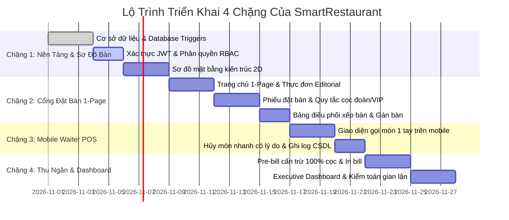

# 09 — Kế Hoạch Sẵn Sàng Triển Khai (Step 7 Implementation Readiness)

> **Dự án:** SmartRestaurant — Hệ Thống Quản Lý Đặt Bàn & POS Gọi Món Di Động  
> **Phiên bản:** 1.0.0 — Production Readiness  
> **Tài liệu:** Tiêu Chuẩn Sẵn Sàng Bắt Đầu Phát Triển & Lộ Trình Triển Khai  

---

## 1. Định Nghĩa Sẵn Sàng Phát Triển (Definition of Ready - DoR)

Trước khi bước vào giai đoạn lập trình mã nguồn production (Step 7), toàn bộ tài liệu và môi trường kỹ thuật của SmartRestaurant đã thỏa mãn $100\%$ các tiêu chí kiểm tra:

* [x] **Yêu cầu nghiệp vụ & Use Cases:** 18 Ca sử dụng được quy hoạch rõ ràng, phân ranh giới quyền hạn RBAC chặt chẽ giữa 4 vai trò.
* [x] **Trực quan hóa giao diện & UX Prototype:** Bản mẫu tương tác HTML/CSS/JS đã được nghiệm thu thực tế tại cổng `localhost:8080/dashboard.html`.
* [x] **Mô hình kiến trúc C4:** Đầy đủ 4 cấp độ: C1 Bối cảnh hệ thống, C2 Khối triển khai, C3 Thành phần Backend API, C4 Lược đồ dữ liệu.
* [x] **Cơ sở dữ liệu hoàn chỉnh:** Kịch bản DDL PostgreSQL 16 (`schema.sql`), kịch bản dữ liệu mẫu (`sample_data.sql`), DBML (`schema.dbml`) và Trigger kiểm toán tự động.
* [x] **Hợp đồng API chuẩn mực:** Tệp đặc tả OpenAPI 3.0 (`docs/api/openapi.yaml`) gồm 20 endpoints RESTful, đầy đủ schema request/response payload và xác thực JWT.
* [x] **Khung mã nguồn cơ bản:** Cấu trúc thư mục chuẩn đã khởi tạo tại `src/frontend` (React 18 + Vite) và `src/backend` (Node.js + Express).

---

## 2. Lộ Trình Triển Khai Từng Chặng (Implementation Increments)

Dự án được chia thành 4 chặng gia tăng (Increments) nối tiếp nhau, mỗi chặng đều có thể kiểm thử và bàn giao sản phẩm chạy được:

### Chặng 1: Nền Tảng Hệ Thống & Sơ Đồ Mặt Bằng Kiến Trúc 2D
* Khởi tạo cơ sở dữ liệu PostgreSQL 16, tạo 11 bảng, cấu hình khóa ngoại và kết nối pool `pg`.
* Xây dựng module xác thực `AuthController`: Đăng nhập, cấp phát JWT mang claim vai trò (`ADMIN`, `MANAGER`, `WAITER`, `CASHIER`, `CUSTOMER`).
* Phát triển component Sơ đồ mặt bằng 2D: hiển thị đúng vị trí bàn trong Sảnh Chính, Sân Vườn, VIP với 4 màu trạng thái.

### Chặng 2: Cổng Khách Hàng 1-Page & Điều Phối Đặt Bàn
* Xây dựng giao diện Khách hàng 1-page cuộn mượt mà (Hero, Thực đơn Editorial, Không gian phòng).
* Tích hợp Phiếu đặt bàn: tự động tính cọc khi khách chọn đoàn $\ge 6$ người hoặc phòng VIP $\rightarrow$ sinh mã `BK-xxxx` trạng thái `PENDING`.
* Xây dựng màn hình điều phối cho Quản lý: duyệt đơn `PENDING`, ghép bàn cho đoàn đông và chuyển trạng thái sang `CONFIRMED`.

### Chặng 3: POS Di Động Phục Vụ & Hủy Món Có Kiểm Toán
* Phát triển giao diện bồi bàn trên điện thoại: chạm mở bàn tại chỗ (`AVAILABLE` $\rightarrow$ `OCCUPIED`), chọn món nhanh, thêm ghi chú khẩu vị cho bếp.
* Triển khai tính năng **Hủy món linh hoạt**: cho phép nhân viên hủy món ngay kèm lý do bắt buộc; kiểm thử Trigger PostgreSQL tự động ghi vết vào `audit_logs`.

### Chặng 4: Quầy Thu Ngân, Đối Soát Cọc & Executive Dashboard
* Xây dựng module Thu ngân: kết xuất Bảng kê xem trước (Pre-bill), tự động khấu trừ $100\%$ tiền cọc, phụ thu VIP, tính thuế VAT $8\%$, chốt thanh toán và in hóa đơn nhiệt.
* Hoàn thiện Executive Dashboard: thẻ doanh thu trắng tích hợp biểu đồ cột theo ngày/tuần/tháng, biểu đồ tròn tỉ lệ doanh thu phòng, hàng chờ đặt bàn 3/4 và BXH món bán chạy 1/4.
* Kiểm thử tích hợp toàn diện (End-to-End Integration Test).

---

## 3. Tiêu Chuẩn Hoàn Thành (Definition of Done - DoD)

Một tính năng chỉ được đánh giá là hoàn thành khi thỏa mãn:
1. Mã nguồn tuân thủ coding conventions, không có lỗi lint hoặc cảnh báo console.
2. Các API endpoints vượt qua kiểm thử với tệp đặc tả `docs/api/openapi.yaml`.
3. Mọi thao tác nhạy cảm (hủy món, chuyển bàn, trừ cọc) đều được ghi nhận đầy đủ trong bảng `audit_logs`.
4. Giao diện responsive mượt mà trên cả desktop (1920x1080) lẫn thiết bị di động (iPhone / Android).
5. Có đầy đủ commit message mô tả rõ ràng nghiệp vụ đã hoàn tất.
