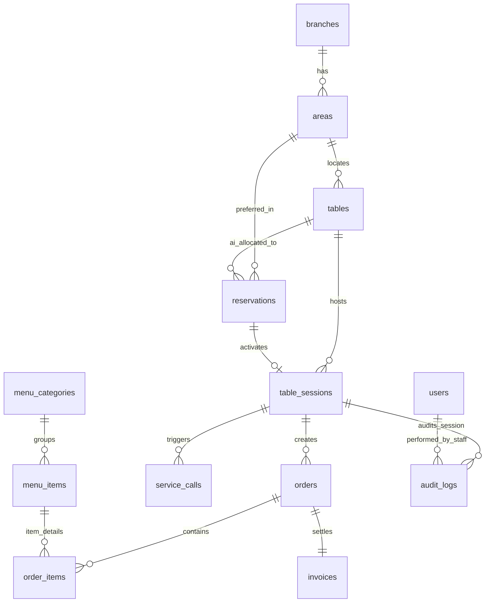

# DATABASE.md — Đặc Tả Cơ Sở Dữ Liệu Tự Động Hóa (PostgreSQL 16)

> **Dự án:** SmartRestaurant — Hệ Thống Tự Động Hóa Vận Hành Đặt Bàn AI, QR Self-Ordering & POS Di Động  
> **Phiên bản:** 2.0.0 — Full Automation & AI-Driven Architecture  
> **Tài liệu:** Từ Điển Dữ Liệu, Sơ Đồ ERD, ENUMs & Triggers Kiểm Toán Bất Biến  

---

## 1. Sơ Đồ Quan Hệ Thực Thể Toàn Diện (ER Mermaid Diagram)



---

## 2. Danh Sách ENUM Types Chuẩn Hóa

```sql
CREATE TYPE user_role AS ENUM ('ADMIN', 'MANAGER', 'STAFF_CONCIERGE', 'CHEF', 'CUSTOMER');
CREATE TYPE table_status AS ENUM ('AVAILABLE', 'RESERVED', 'OCCUPIED', 'DIRTY');
CREATE TYPE reservation_status AS ENUM ('PENDING', 'PENDING_ALLOCATION', 'CONFIRMED', 'SEATED', 'CANCELLED', 'NO_SHOW');
CREATE TYPE deposit_status AS ENUM ('NONE', 'PENDING', 'PAID', 'REFUNDED', 'FORFEITED');
CREATE TYPE session_status AS ENUM ('ACTIVE', 'COMPLETED', 'EXPIRED');
CREATE TYPE order_status AS ENUM ('OPEN', 'PAID', 'CANCELLED');
CREATE TYPE item_status AS ENUM ('PENDING', 'COOKING', 'READY', 'SERVED', 'CANCELLED');
CREATE TYPE actor_type AS ENUM ('GUEST', 'STAFF', 'AI_SYSTEM');
CREATE TYPE service_call_type AS ENUM ('CANCEL_COOKING_ITEM', 'EXTRA_ICE_CONDIMENT', 'CLEAN_TABLE', 'GENERAL_HELP');
CREATE TYPE service_call_status AS ENUM ('PENDING', 'ACKNOWLEDGED', 'RESOLVED');
```

---

## 3. Từ Điển Dữ Liệu Chi Tiết (Data Dictionary)

### 3.1 Bảng `tables` (Bàn Ăn)
| Cột | Kiểu Dữ Liệu | Ràng Buộc | Ý Nghĩa |
| :--- | :--- | :--- | :--- |
| `id` | SERIAL | PRIMARY KEY | Định danh duy nhất của bàn. |
| `area_id` | INT | NOT NULL, FK `areas(id)` | Khu vực phòng (Sảnh, Sân Vườn, VIP). |
| `table_number` | VARCHAR(20) | NOT NULL, UNIQUE | Mã bàn (ví dụ: `T1-01`, `VIP-01`). |
| `capacity` | INT | NOT NULL, CHECK > 0 | Sức chứa tối đa (2, 4, 6, 8 chỗ). |
| `coord_x`, `coord_y` | INT | NOT NULL | Tọa độ trên bản vẽ mặt bằng 2D. |
| `status` | table_status | DEFAULT 'AVAILABLE' | Trạng thái: `AVAILABLE`, `RESERVED`, `OCCUPIED`, `DIRTY`. |
| `qr_code_token` | VARCHAR(64) | UNIQUE | Token bảo mật gắn cố định vào mã QR tại bàn. |

### 3.2 Bảng `table_sessions` (Phiên Khách Ngồi Ăn Tại Bàn - MỚI)
| Cột | Kiểu Dữ Liệu | Ràng Buộc | Ý Nghĩa |
| :--- | :--- | :--- | :--- |
| `id` | SERIAL | PRIMARY KEY | Định danh phiên bàn. |
| `table_id` | INT | NOT NULL, FK `tables(id)` | Bàn ăn đang mở phiên. |
| `reservation_id` | INT | NULL, FK `reservations(id)` | Khách đặt trước (NULL nếu là khách vãng lai). |
| `host_phone` | VARCHAR(20) | NOT NULL | Số điện thoại của người chủ bàn (Host). |
| `host_otp` | VARCHAR(6) | NOT NULL | Mã OTP 4-6 số bảo mật phiên gọi món. |
| `status` | session_status | DEFAULT 'ACTIVE' | Trạng thái: `ACTIVE`, `COMPLETED`, `EXPIRED`. |
| `is_walkin` | BOOLEAN | DEFAULT FALSE | Đánh dấu khách vãng lai check-in trực tiếp. |
| `opened_at` | TIMESTAMP | DEFAULT NOW() | Thời gian mở phiên. |
| `closed_at` | TIMESTAMP | NULL | Thời gian đóng phiên sau khi thanh toán. |

### 3.3 Bảng `reservations` (Phiếu Đặt Bàn & AI Phân Bổ)
| Cột | Kiểu Dữ Liệu | Ràng Buộc | Ý Nghĩa |
| :--- | :--- | :--- | :--- |
| `id` | SERIAL | PRIMARY KEY | Định danh đơn đặt bàn. |
| `code` | VARCHAR(20) | NOT NULL, UNIQUE | Mã đặt chỗ (ví dụ: `BK-8921`). |
| `customer_name` | VARCHAR(100) | NOT NULL | Tên người đặt bàn. |
| `customer_phone` | VARCHAR(20) | NOT NULL | Số điện thoại liên hệ. |
| `guest_count` | INT | NOT NULL, CHECK > 0 | Số lượng khách. |
| `reservation_time` | TIMESTAMP | NOT NULL | Thời gian hẹn dùng bữa. |
| `preferred_area_id`| INT | NULL, FK `areas(id)` | Vị trí ưu tiên mềm (Soft Preference) do khách chọn. |
| `assigned_table_id` | INT | NULL, FK `tables(id)` | Mã bàn chính thức do AI phân bổ tối ưu. |
| `host_otp` | VARCHAR(6) | NOT NULL | Mã OTP cấp cho khách để mở phiên tại bàn. |
| `status` | reservation_status | DEFAULT 'PENDING' | Tiến trình duyệt và check-in của đơn. |
| `deposit_amount` | NUMERIC(12,2) | DEFAULT 0 | Số tiền cọc cần đóng ($500.000\text{ ₫}$ nếu $\ge 6$ người/VIP). |
| `deposit_status` | deposit_status | DEFAULT 'NONE' | Trạng thái cọc VietQR. |

### 3.4 Bảng `order_items` (Chi Tiết Món Trong Phiên)
| Cột | Kiểu Dữ Liệu | Ràng Buộc | Ý Nghĩa |
| :--- | :--- | :--- | :--- |
| `id` | SERIAL | PRIMARY KEY | Định danh món trong order. |
| `order_id` | INT | NOT NULL, FK `orders(id)` | Thuộc đơn order nào. |
| `menu_item_id` | INT | NOT NULL, FK `menu_items(id)` | Món ăn được chọn. |
| `quantity` | INT | NOT NULL, CHECK > 0 | Số lượng đĩa. |
| `unit_price` | NUMERIC(12,2) | NOT NULL | Đơn giá tại thời điểm gọi. |
| `item_notes` | VARCHAR(255) | NULL | Ghi chú khẩu vị (`Ít cay`, `Không hành`). |
| `item_status` | item_status | DEFAULT 'PENDING' | Vòng đời món: `PENDING`, `COOKING`, `READY`, `SERVED`, `CANCELLED`. |
| `cancel_reason` | TEXT | NULL | Lý do hủy món (bắt buộc khi hủy). |
| `cancelled_by_actor`| actor_type | NULL | Ai hủy: `GUEST` (tự hủy khi pending) hoặc `STAFF` (can thiệp khi cooking). |
| `cancelled_by_id` | VARCHAR(50) | NULL | ID nhân viên (nếu do staff hủy) hoặc Phone của Guest. |

### 3.5 Bảng `service_calls` (Chuông Gọi Phục Vụ Thông Minh - MỚI)
| Cột | Kiểu Dữ Liệu | Ràng Buộc | Ý Nghĩa |
| :--- | :--- | :--- | :--- |
| `id` | SERIAL | PRIMARY KEY | Định danh yêu cầu phục vụ. |
| `session_id` | INT | NOT NULL, FK `table_sessions(id)` | Phiên bàn gửi yêu cầu. |
| `table_id` | INT | NOT NULL, FK `tables(id)` | Bàn phát sinh yêu cầu. |
| `call_type` | service_call_type | NOT NULL | Loại: Hủy món đang nấu, thêm đá/khăn, dọn dẹp, hỗ trợ khác. |
| `details` | TEXT | NULL | Thông tin cụ thể (ví dụ: "Hủy đĩa Bò Wagyu A5"). |
| `status` | service_call_status | DEFAULT 'PENDING' | Tiến trình xử lý của nhân viên. |
| `created_at` | TIMESTAMP | DEFAULT NOW() | Thời gian khách bấm chuông. |
| `resolved_by` | INT | NULL, FK `users(id)` | Nhân viên đã tiếp nhận xử lý. |

### 3.6 Bảng `audit_logs` (Nhật Ký Kiểm Toán Bất Biến)
| Cột | Kiểu Dữ Liệu | Ràng Buộc | Ý Nghĩa |
| :--- | :--- | :--- | :--- |
| `id` | SERIAL | PRIMARY KEY | Định danh bản ghi kiểm toán. |
| `action` | VARCHAR(50) | NOT NULL | Hành vi: `CANCEL_ITEM_PENDING`, `CANCEL_ITEM_COOKING`, `PAY_AT_TABLE`, `NO_SHOW_RELEASE`, v.v. |
| `actor_type` | actor_type | NOT NULL | Phân loại tác nhân: `GUEST`, `STAFF`, `AI_SYSTEM`. |
| `actor_id` | VARCHAR(50) | NOT NULL | ID định danh tác nhân thực hiện. |
| `session_id` | INT | NULL | Liên kết với phiên bàn (nếu có). |
| `old_values` | JSONB | NULL | Dữ liệu trạng thái trước khi thay đổi. |
| `new_values` | JSONB | NULL | Dữ liệu trạng thái sau khi thay đổi. |
| `reason` | TEXT | NOT NULL | Lý do bắt buộc cho thao tác nhạy cảm. |
| `created_at` | TIMESTAMP | DEFAULT NOW() | Dấu thời gian bất biến. |

---

## 4. Trigger Cơ Sở Dữ Liệu Tự Động (PostgreSQL 16)

### 4.1 Trigger Kiểm Soát Ràng Buộc Hủy Món (Enforce Item Cancellation Security)
Ngăn chặn tuyệt đối việc Khách hàng tự ý gửi request hủy món khi món đã chuyển sang `COOKING`:

```sql
CREATE OR REPLACE FUNCTION fn_check_item_cancellation_permission()
RETURNS TRIGGER AS $$
BEGIN
    -- Nếu trạng thái chuyển sang CANCELLED
    IF NEW.item_status = 'CANCELLED' AND OLD.item_status != 'CANCELLED' THEN
        -- Nếu món đang nấu (COOKING), chỉ STAFF mới được quyền can thiệp hủy
        IF OLD.item_status = 'COOKING' AND NEW.cancelled_by_actor != 'STAFF' THEN
            RAISE EXCEPTION 'Món ăn đang trong quá trình chế biến (COOKING). Thực khách không thể tự hủy trực tiếp. Vui lòng gọi nhân viên phục vụ hỗ trợ.'
                USING ERRCODE = '45001';
        END IF;

        -- Bắt buộc phải có lý do hủy món
        IF NEW.cancel_reason IS NULL OR LENGTH(TRIM(NEW.cancel_reason)) = 0 THEN
            RAISE EXCEPTION 'Thao tác hủy món bắt buộc phải cung cấp lý do cụ thể.'
                USING ERRCODE = '45002';
        END IF;
    END IF;
    RETURN NEW;
END;
$$ LANGUAGE plpgsql;

CREATE TRIGGER trg_check_item_cancellation
BEFORE UPDATE ON order_items
FOR EACH ROW
EXECUTE FUNCTION fn_check_item_cancellation_permission();
```

### 4.2 Trigger Tự Động Ghi Vết Kiểm Toán Bất Biến (Immutable Audit Trigger)
Tự động kích hoạt khi có bất kỳ món ăn nào bị hủy, lưu chi tiết vào bảng `audit_logs`:

```sql
CREATE OR REPLACE FUNCTION fn_audit_order_item_cancellation()
RETURNS TRIGGER AS $$
BEGIN
    IF NEW.item_status = 'CANCELLED' AND OLD.item_status != 'CANCELLED' THEN
        INSERT INTO audit_logs (
            action,
            actor_type,
            actor_id,
            session_id,
            old_values,
            new_values,
            reason,
            created_at
        ) VALUES (
            CASE 
                WHEN OLD.item_status = 'PENDING' THEN 'CANCEL_ITEM_PENDING'
                ELSE 'CANCEL_ITEM_COOKING'
            END,
            NEW.cancelled_by_actor,
            COALESCE(NEW.cancelled_by_id, 'UNKNOWN'),
            (SELECT session_id FROM orders WHERE id = NEW.order_id),
            jsonb_build_object('item_id', OLD.id, 'status', OLD.item_status, 'quantity', OLD.quantity),
            jsonb_build_object('item_id', NEW.id, 'status', NEW.item_status, 'cancel_reason', NEW.cancel_reason),
            NEW.cancel_reason,
            NOW()
        );
    END IF;
    RETURN NEW;
END;
$$ LANGUAGE plpgsql;

CREATE TRIGGER trg_audit_order_item_cancellation
AFTER UPDATE ON order_items
FOR EACH ROW
EXECUTE FUNCTION fn_audit_order_item_cancellation();
```

### 4.3 Trigger Bảo Vệ Bất Biến Bảng `audit_logs` (Immutability Enforcement)
Cấm hoàn toàn mọi lệnh `UPDATE` hoặc `DELETE` trên bảng nhật ký kiểm toán:

```sql
CREATE OR REPLACE FUNCTION fn_prevent_audit_log_modification()
RETURNS TRIGGER AS $$
BEGIN
    RAISE EXCEPTION 'Dữ liệu kiểm toán an toàn (audit_logs) là bất biến. Nghiêm cấm mọi hành vi UPDATE hoặc DELETE!'
        USING ERRCODE = '45003';
END;
$$ LANGUAGE plpgsql;

CREATE TRIGGER trg_enforce_audit_immutability
BEFORE UPDATE OR DELETE ON audit_logs
FOR EACH ROW
EXECUTE FUNCTION fn_prevent_audit_log_modification();
```
