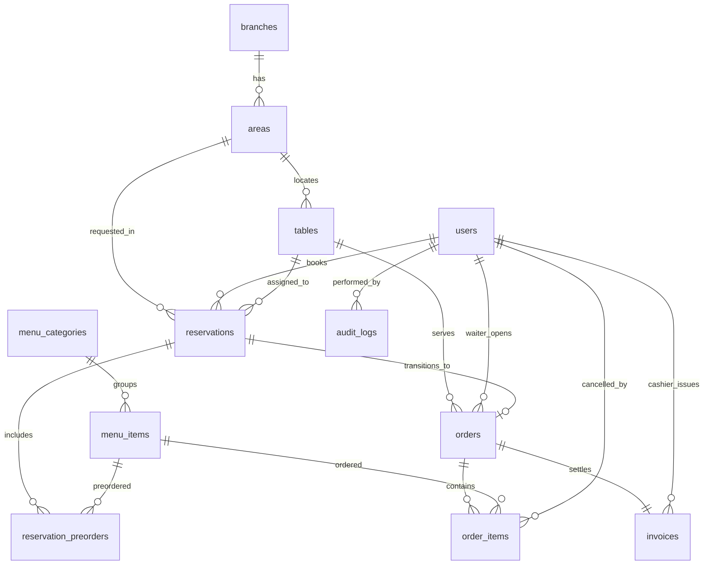

# DATABASE.md — Đặc Tả Cơ Sở Dữ Liệu Chi Tiết (PostgreSQL)

> **Dự án:** SmartRestaurant — Hệ Thống Quản Lý Đặt Bàn & POS Gọi Món Di Động  
> **Hệ quản trị CSDL:** PostgreSQL 16  
> **Tài liệu:** Từ Điển Dữ Liệu, Lược Đồ DBML, Sơ Đồ ERD & Trigger Kiểm Toán  

---

## 1. Tổng Quan Lược Đồ Cơ Sở Dữ Liệu (Schema Overview)

Cơ sở dữ liệu của SmartRestaurant được thiết kế theo chuẩn dạng chuẩn 3 (3NF), đảm bảo tính toàn vẹn dữ liệu, hiệu năng truy vấn cao và an toàn giao dịch tài chính ACID:
* **11 Bảng dữ liệu quan hệ:** Bao phủ đầy đủ các phân hệ người dùng, không gian phòng bàn, thực đơn, đặt chỗ trực tuyến, phiên gọi món tại bàn, hóa đơn thu ngân và nhật ký kiểm toán.
* **5 Kiểu dữ liệu ENUM:** Chuẩn hóa các trạng thái nghiệp vụ cố định (`user_role`, `table_status`, `reservation_status`, `order_status`, `item_status`).
* **Trigger tự động:** Kích hoạt lưu vết kiểm toán bất biến khi có thao tác nhạy cảm (hủy món).

> 📂 File DBML chuẩn hóa: [architecture/schema.dbml](./architecture/schema.dbml)  
> 📂 Kịch bản DDL tạo bảng: [../src/database/schema.sql](../src/database/schema.sql)  
> 📂 Dữ liệu mẫu khởi tạo: [../src/database/sample_data.sql](../src/database/sample_data.sql)

---

## 2. Sơ Đồ Quan Hệ Thực Thể (ER Mermaid Diagram)



---

## 3. Từ Điển Dữ Liệu Chi Tiết (Data Dictionary)

### 3.1 Bảng `users` (Tài khoản & Phân quyền)
| Tên Cột | Kiểu Dữ Liệu | Ràng Buộc | Ý Nghĩa Nghiệp Vụ |
| :--- | :--- | :--- | :--- |
| `id` | BIGSERIAL | PRIMARY KEY | Định danh người dùng duy nhất |
| `username` | VARCHAR(50) | UNIQUE, NOT NULL | Tên đăng nhập |
| `password_hash` | VARCHAR(255) | NOT NULL | Mật khẩu mã hóa bằng bcrypt |
| `full_name` | VARCHAR(100) | NOT NULL | Họ và tên hiển thị |
| `phone` | VARCHAR(20) | UNIQUE, NOT NULL | Số điện thoại liên lạc |
| `role` | user_role | NOT NULL, DEFAULT 'CUSTOMER' | Vai trò: `ADMIN`, `MANAGER`, `CASHIER`, `WAITER`, `CUSTOMER` |
| `loyalty_points`| INT | DEFAULT 0, CHECK >= 0 | Điểm tích lũy hội viên sau mỗi lần thanh toán |
| `is_active` | BOOLEAN | DEFAULT TRUE | Trạng thái hoạt động của tài khoản |
| `created_at` | TIMESTAMPTZ | DEFAULT CURRENT_TIMESTAMP | Thời điểm tạo tài khoản |

### 3.2 Bảng `branches` (Chi nhánh nhà hàng)
| Tên Cột | Kiểu Dữ Liệu | Ràng Buộc | Ý Nghĩa Nghiệp Vụ |
| :--- | :--- | :--- | :--- |
| `id` | BIGSERIAL | PRIMARY KEY | Mã chi nhánh |
| `name` | VARCHAR(100) | NOT NULL | Tên chi nhánh |
| `address` | TEXT | NOT NULL | Địa chỉ chi nhánh |
| `phone` | VARCHAR(20) | NOT NULL | Số hotline chi nhánh |

### 3.3 Bảng `areas` (Khu vực / Phòng ẩm thực)
| Tên Cột | Kiểu Dữ Liệu | Ràng Buộc | Ý Nghĩa Nghiệp Vụ |
| :--- | :--- | :--- | :--- |
| `id` | BIGSERIAL | PRIMARY KEY | Mã khu vực |
| `branch_id` | BIGINT | FK $\rightarrow$ `branches(id)` | Thuộc chi nhánh nào |
| `name` | VARCHAR(100) | NOT NULL | Tên khu vực: Sảnh Chính T1, Sân Vườn T2, Phòng VIP |
| `is_vip` | BOOLEAN | DEFAULT FALSE | Cờ đánh dấu phòng VIP khép kín |
| `surcharge_rate`| NUMERIC(5,2)| DEFAULT 0.00 | Tỷ lệ phụ thu phòng VIP tính theo % (ví dụ 10.00%) |

### 3.4 Bảng `tables` (Bàn ăn & Tọa độ 2D)
| Tên Cột | Kiểu Dữ Liệu | Ràng Buộc | Ý Nghĩa Nghiệp Vụ |
| :--- | :--- | :--- | :--- |
| `id` | BIGSERIAL | PRIMARY KEY | Mã bàn ăn duy nhất |
| `area_id` | BIGINT | FK $\rightarrow$ `areas(id)` | Thuộc khu vực/phòng nào |
| `table_number` | VARCHAR(20) | NOT NULL | Tên bàn: `T1-Bàn 1`, `T2-Bàn 4`, `VIP-Phòng 1` |
| `capacity` | INT | NOT NULL, CHECK > 0 | Sức chứa số lượng ghế ngồi tiêu chuẩn |
| `coord_x` | INT | DEFAULT 0 | Tọa độ X vẽ trên sơ đồ mặt bằng 2D |
| `coord_y` | INT | DEFAULT 0 | Tọa độ Y vẽ trên sơ đồ mặt bằng 2D |
| `status` | table_status | DEFAULT 'AVAILABLE' | Máy trạng thái 4 màu: `AVAILABLE`, `RESERVED`, `OCCUPIED`, `DIRTY` |

### 3.5 Bảng `reservations` (Phiếu đặt bàn trước)
| Tên Cột | Kiểu Dữ Liệu | Ràng Buộc | Ý Nghĩa Nghiệp Vụ |
| :--- | :--- | :--- | :--- |
| `id` | BIGSERIAL | PRIMARY KEY | Khóa chính đơn đặt |
| `booking_code` | VARCHAR(20) | UNIQUE, NOT NULL | Mã đặt bàn duy nhất gửi cho khách (ví dụ `BK-8921`) |
| `customer_id` | BIGINT | FK $\rightarrow$ `users(id)`, NULLABLE | Khách hội viên (NULL nếu là khách vãng lai) |
| `customer_name`| VARCHAR(100)| NOT NULL | Tên người liên hệ |
| `customer_phone`| VARCHAR(20)| NOT NULL | Số điện thoại nhận tin nhắn xác nhận |
| `guest_count` | INT | NOT NULL, CHECK > 0 | Số lượng khách tham gia |
| `assigned_table_id`| BIGINT | FK $\rightarrow$ `tables(id)`, NULLABLE | Bàn được gán (NULL khi PENDING, gán khi CONFIRMED) |
| `reservation_time`| TIMESTAMPTZ | NOT NULL | Ngày giờ đặt hẹn đến nhà hàng |
| `deposit_amount`| NUMERIC(12,2)| DEFAULT 0.00 | Số tiền cọc giữ chỗ đã thanh toán |
| `status` | reservation_status | DEFAULT 'PENDING' | Trạng thái: `PENDING`, `CONFIRMED`, `SEATED`, `CANCELLED` |

### 3.6 Bảng `orders` & `order_items` (Phiên phục vụ & Món ăn tại bàn)
* **`orders`:** Quản lý phiên dùng bữa của một bàn (`table_id`, `waiter_id`, `status: SERVING | PAID | CANCELLED`, `opened_at`, `closed_at`).
* **`order_items`:** Chi tiết từng món ăn trong phiên phục vụ (`order_id`, `menu_item_id`, `quantity`, `price`, `taste_notes`, `status: WAITING | COOKING | SERVED | CANCELLED`, `cancel_reason`, `cancelled_by`).

### 3.7 Bảng `invoices` (Hóa đơn & Thu ngân)
| Tên Cột | Kiểu Dữ Liệu | Ràng Buộc | Ý Nghĩa Nghiệp Vụ |
| :--- | :--- | :--- | :--- |
| `id` | BIGSERIAL | PRIMARY KEY | Khóa chính hóa đơn |
| `order_id` | BIGINT | UNIQUE, FK $\rightarrow$ `orders(id)`| Thuộc phiên order nào |
| `cashier_id` | BIGINT | FK $\rightarrow$ `users(id)` | Thu ngân chốt thanh toán |
| `subtotal_amount`| NUMERIC(12,2)| NOT NULL | Tổng tiền món ăn |
| `vip_surcharge`| NUMERIC(12,2)| DEFAULT 0.00 | Phụ thu phòng VIP |
| `deposit_deducted`| NUMERIC(12,2)| DEFAULT 0.00 | Tiền cọc đã cấn trừ 100% |
| `tax_vat` | NUMERIC(12,2)| DEFAULT 0.00 | Thuế VAT 8% |
| `final_amount` | NUMERIC(12,2)| NOT NULL | Số tiền thực thu cuối cùng |
| `payment_method`| VARCHAR(50) | DEFAULT 'CASH' | `CASH`, `CREDIT_CARD`, `VIETQR` |
| `paid_at` | TIMESTAMPTZ | DEFAULT CURRENT_TIMESTAMP | Thời điểm thanh toán |

### 3.8 Bảng `audit_logs` (Nhật ký kiểm toán chống gian lận)
| Tên Cột | Kiểu Dữ Liệu | Ràng Buộc | Ý Nghĩa Nghiệp Vụ |
| :--- | :--- | :--- | :--- |
| `id` | BIGSERIAL | PRIMARY KEY | Khóa chính bản ghi kiểm toán |
| `table_name` | VARCHAR(50) | NOT NULL | Bảng bị tác động (ví dụ `order_items`) |
| `record_id` | BIGINT | NOT NULL | Khóa chính của bản ghi bị tác động |
| `action_type` | VARCHAR(20) | NOT NULL | `CANCEL_ITEM`, `TRANSFER_TABLE`, `REFUND_DEPOSIT` |
| `performed_by` | BIGINT | FK $\rightarrow$ `users(id)`, NULLABLE| ID nhân viên thực hiện thao tác |
| `reason` | TEXT | NOT NULL | Lý do nghiệp vụ bắt buộc |
| `old_data` | JSONB | NULLABLE | Dữ liệu trước khi sửa đổi |
| `new_data` | JSONB | NULLABLE | Dữ liệu sau khi sửa đổi |
| `created_at` | TIMESTAMPTZ | DEFAULT CURRENT_TIMESTAMP | Thời gian bất biến của máy chủ CSDL |

---

## 4. Cơ Chế Database Trigger Tự Động Ghi Log Khi Hủy Món

Để đảm bảo bồi bàn có thể linh hoạt hủy món khi khách đổi ý nhưng hoàn toàn loại trừ rủi ro thông đồng gian lận tiền mặt, hệ thống cài đặt Trigger tự động tại PostgreSQL:

```sql
CREATE OR REPLACE FUNCTION audit_order_item_cancel()
RETURNS TRIGGER AS $$
BEGIN
    -- Chỉ kích hoạt khi trạng thái món chuyển sang CANCELLED
    IF (OLD.status <> 'CANCELLED' AND NEW.status = 'CANCELLED') THEN
        INSERT INTO audit_logs (
            table_name,
            record_id,
            action_type,
            performed_by,
            reason,
            old_data,
            new_data
        )
        VALUES (
            'order_items',
            NEW.id,
            'CANCEL_ITEM',
            NEW.cancelled_by,
            NEW.cancel_reason,
            row_to_json(OLD)::jsonb,
            row_to_json(NEW)::jsonb
        );
    END IF;
    RETURN NEW;
END;
$$ LANGUAGE plpgsql;

CREATE TRIGGER trg_audit_cancel_item
AFTER UPDATE ON order_items
FOR EACH ROW EXECUTE FUNCTION audit_order_item_cancel();
```

---

## 5. Chính Sách Bất Biến (Immutability Policy)
Bảng `audit_logs` tuân thủ nguyên tắc ghi chép kiểm toán bất biến (*Append-Only Log*):
* Cấp quyền: `GRANT SELECT, INSERT ON audit_logs TO restaurant_app;`
* Thu hồi toàn bộ quyền: `REVOKE UPDATE, DELETE, TRUNCATE ON audit_logs FROM restaurant_app;`
* Bất kỳ nỗ lực sửa đổi hoặc xóa bản ghi kiểm toán đều bị chặn ngay ở tầng nhân cơ sở dữ liệu.
