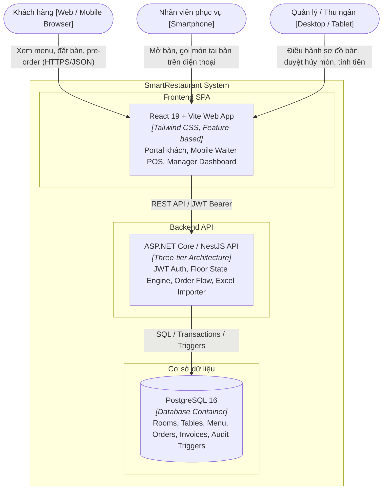
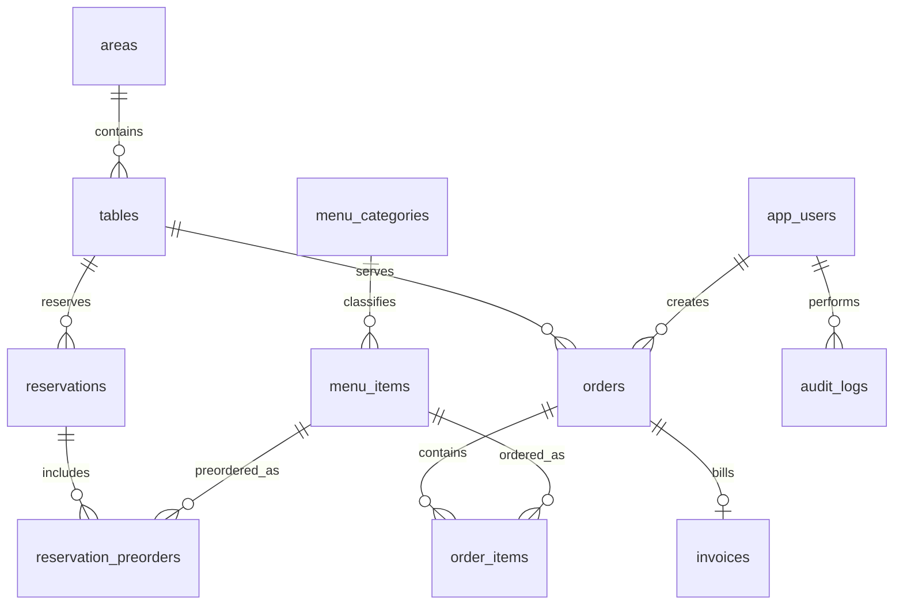

# TÀI LIỆU ĐẶC TẢ CHI TIẾT DỰ ÁN: SMARTRESTAURANT
## HỆ THỐNG QUẢN LÝ ĐẶT BÀN & GỌI MÓN NHÀ HÀNG THÔNG MINH

> **Tên dự án:** SmartRestaurant (Table Reservation & Mobile Floor POS)  
> **Phiên bản tài liệu:** V1.0 — Architecture & Business Specification  
> **Mục tiêu:** Cung cấp tài liệu đặc tả hoàn chỉnh về nghiệp vụ, kiến trúc, cơ sở dữ liệu và API để sẵn sàng khởi tạo mã nguồn ở thư mục dự án mới.

---

## MỤC LỤC
1. [Tổng quan dự án & Bối cảnh nghiệp vụ](#1-tổng-quan-dự-án--bối-cảnh-nghiệp-vụ)
2. [Phân vai tác nhân & Ma trận quyền hạn (RBAC)](#2-phân-vai-tác-nhân--ma-trận-quyền-hạn-rbac)
3. [Quy hoạch Sơ đồ Mặt bằng & Trạng thái Bàn](#3-quy-hoạch-sơ-đồ-mặt-bằng--trạng-thái-bàn)
4. [Các luồng nghiệp vụ cốt lõi (Core Business Workflows)](#4-các-luồng-nghiệp-vụ-cốt-lõi-core-business-workflows)
5. [Danh mục 18 User Stories (INVEST)](#5-danh-mục-18-user-stories-invest)
6. [Mô hình Kiến trúc Hệ thống (C4 Architecture)](#6-mô-hình-kiến-trúc-hệ-thống-c4-architecture)
7. [Mô hình Cơ sở Dữ liệu Chi tiết (PostgreSQL Schema)](#7-mô-hình-cơ-sở-dữ-liệu-chi-tiết-postgresql-schema)
8. [Đặc tả Hợp đồng API (RESTful Endpoints)](#8-đặc-tả-hợp-đồng-api-restful-endpoints)
9. [Cấu trúc Thư mục Dự án Đề xuất](#9-cấu-trúc-thư-mục-dự-án-đề-xuất)
10. [Lộ trình Triển khai (Implementation Increments)](#10-lộ-trình-triển-khai-implementation-increments)

---

## 1. Tổng quan dự án & Bối cảnh nghiệp vụ

### 1.1. Bài toán thực tế
Các nhà hàng truyền thống thường gặp các vấn đề lớn trong vận hành:
* **Đặt bàn thủ công qua điện thoại/sổ sách:** Dễ dẫn đến việc trùng bàn (*double-booking*), không kiểm soát được khách đặt phòng cụ thể (ví dụ: khách muốn ngồi `Phòng VIP E - Bàn 2`).
* **Gọi món chậm trễ:** Nhân viên ghi chép ra giấy, di chuyển vào quầy thu ngân/bếp nhập lại, dẫn đến sai sót món, thất thoát thông tin ghi chú khẩu vị (`không hành`, `ít cay`).
* **Gian lận thu ngân & phục vụ:** Nhân viên tự ý hủy món sau khi khách ăn xong để bỏ túi tiền mặt, hoặc giảm giá không qua kiểm duyệt.
* **Khó quản lý thời gian thực:** Quản lý không nắm được bàn nào đã có khách đặt trước, lúc mấy giờ, bàn nào đang chờ dọn, món nào sắp hết nguyên liệu.

### 1.2. Giải pháp: SmartRestaurant
**SmartRestaurant** là nền tảng quản lý vận hành toàn diện kết hợp giữa:
1. **Khách hàng (Customer Portal - Web/Mobile):** Tự do xem thực đơn, chọn khu vực/phòng/bàn trực quan theo nhu cầu, đặt giờ hẹn và chọn món ăn trước (Pre-order).
2. **Nhân viên phục vụ (Mobile Web Waiter POS):** Ứng dụng web tối ưu cho điện thoại thông minh; mở bàn, chọn món, ghi chú và bắn order trực tiếp vào hệ thống trong vài giây.
3. **Quản lý & Thu ngân (Floor Management Dashboard):** Quan sát trực quan sơ đồ mặt bằng (Floor map) thời gian thực, quản lý đặt cọc, xử lý gộp/chuyển bàn, thanh toán và kiểm soát nhật ký gian lận (*Audit log*).

---

## 2. Phân vai tác nhân & Ma trận quyền hạn (RBAC)

Hệ thống được thiết kế với 4 vai trò rõ ràng:

1. **Administrator (Admin / Chủ nhà hàng):** Quản trị toàn quyền: thiết lập sơ đồ phòng/bàn, quản lý tài khoản nhân viên, cấu hình phân quyền, xem báo cáo doanh thu tài chính tổng thể.
2. **Restaurant Manager / Thu ngân (Manager / Cashier):** Giám sát sơ đồ bàn thời gian thực, duyệt/hủy lịch đặt bàn, gộp bàn/chuyển bàn, duyệt yêu cầu hủy món từ nhân viên, áp mã giảm giá và in hóa đơn thanh toán.
3. **Waiter (Nhân viên phục vụ - dùng Smartphone):** Xem bàn trống, mở bàn tại chỗ cho khách, order món ăn, cập nhật trạng thái đã phục vụ món. **Chính sách sở hữu (*Own-record policy*):** Chỉ được sửa/xóa món do mình order trước khi bếp xác nhận nấu.
4. **Customer (Khách hàng):** Xem thực đơn public, đặt bàn theo vị trí mong muốn, chọn món trước, tra cứu lịch đặt bằng số điện thoại.

### Bảng Ma trận Phân quyền

| Chức năng | Admin | Manager / Thu ngân | Waiter (Phục vụ) | Customer (Khách) |
| :--- | :---: | :---: | :---: | :---: |
| **Xem Thực đơn Public** | Cho phép | Cho phép | Cho phép | Cho phép |
| **Đặt bàn & Chọn món trước** | Cho phép | Cho phép | Không | Cho phép (Tự đặt) |
| **Xem Sơ đồ Bàn thời gian thực** | Cho phép | Cho phép (Toàn bộ) | Cho phép (Xem trạng thái) | Chỉ xem bàn trống khi đặt |
| **Mở bàn & Gọi món tại chỗ (POS)** | Cho phép | Cho phép | Cho phép (Qua Smartphone) | Không |
| **Sửa/Hủy món đang gọi** | Cho phép | Cho phép (Toàn quyền) | **Chỉ món mình tạo (Chưa nấu)** | Không |
| **Chuyển bàn / Gộp bàn** | Cho phép | Cho phép | Yêu cầu quyền Quản lý | Không |
| **Thanh toán & In hóa đơn** | Cho phép | Cho phép | Không | Xem hóa đơn của mình |
| **Import Thực đơn từ Excel** | Cho phép | Cho phép | Không | Không |
| **Xem Nhật ký hoạt động (Audit Log)** | Cho phép | Cho phép | Không | Không |
| **Quản trị người dùng & Cấu hình Bàn** | Cho phép | Không | Không | Không |

---

## 3. Quy hoạch Sơ đồ Mặt bằng & Trạng thái Bàn

### 3.1. Phân cấp Sơ đồ Mặt bằng (Hierarchy)
$$\text{Chi nhánh (Branch)} \longrightarrow \text{Khu vực / Phòng (Area / Room)} \longrightarrow \text{Bàn (Table)}$$

* **Khu vực / Phòng (`areas`):** Ví dụ `Tầng 1 - Sảnh chính`, `Tầng 2 - Sân vườn`, `Phòng VIP E (Phòng lạnh, sức chứa 12 người, có phụ thu)`.
* **Bàn (`tables`):** Ví dụ `Bàn 01`, `Bàn 02`, `Bàn VIP 01` (Kèm sức chứa `min_capacity`, `max_capacity`, tọa độ `coord_x, coord_y` để vẽ lên bản đồ).

### 3.2. Máy trạng thái của Bàn (Table State Machine)

```text
[AVAILABLE] (Trống - Xanh lá)
     │
     ├── (Có lịch đặt trước sắp đến trong vòng 60 phút) ──> [RESERVED] (Đã đặt - Cam)
     │                                                             │
     └── (Khách vãng lai vào bàn / Khách đặt đến nơi) ─────────────┘
                   │
                   ▼
           [OCCUPIED] (Đang ăn - Đỏ)
                   │
         (Thu ngân thanh toán xong)
                   │
                   ▼
           [DIRTY / CLEANING] (Chờ dọn - Xám)
                   │
         (Nhân viên dọn xong xác nhận)
                   │
                   ▼
           [AVAILABLE] (Trống - Xanh lá)
```

---

## 4. Các luồng nghiệp vụ cốt lõi (Core Business Workflows)

### 4.1. Luồng 1: Khách đặt bàn trước & Chọn món trước (Pre-order)
1. **Tìm kiếm & Chọn chỗ:** Khách vào trang web, chọn ngày ăn, khung giờ (ví dụ: `19:00 - 21:00`), số khách.
2. **Chọn vị trí cụ thể:** Hệ thống hiển thị bản đồ trực quan. Khách click chọn `Phòng VIP E` $\rightarrow$ chọn `Bàn 2` (nếu đang trống trong khung giờ đó).
3. **Khóa tạm thời (Time-slot locking):** Hệ thống khóa giữ chỗ bàn đó trong 10 phút để khách điền thông tin.
4. **Chọn món trước (Tùy chọn):** Khách chọn món ăn từ thực đơn để bếp chuẩn bị trước (ví dụ: lẩu, món nướng tốn thời gian).
5. **Xác nhận đặt bàn:** Khách nhập Tên, SĐT, Ghi chú. Hệ thống sinh mã `Booking Code` (ví dụ: `BK-8921`), gửi thông báo cho Quản lý.

### 4.2. Luồng 2: Gọi món tại bàn qua điện thoại nhân viên (Mobile Waiter POS)
1. Khách đến nhà hàng, nhân viên mở điện thoại, truy cập `SmartRestaurant Waiter Web`.
2. Nhân viên chạm vào `Bàn 2 - Phòng E` $\rightarrow$ bấm **"Mở bàn"** (Trạng thái bàn chuyển sang `OCCUPIED`).
3. Giao diện thực đơn hiện ra theo danh mục: Nhân viên gõ tìm kiếm hoặc bấm chọn món, chọn số lượng, thêm ghi chú (`không cay`, `ít đường`).
4. Bấm **"Gửi bếp"**: Hệ thống ghi nhận các dòng `order_items` với trạng thái `PENDING_COOK`, gắn `created_by = waiter_id`.

### 4.3. Luồng 3: Hủy món & Kiểm soát gian lận (Anti-fraud Audit)
1. Khách muốn hủy món:
   * **Trường hợp 1 (Món chưa nấu):** Đúng nhân viên vừa order có thể tự bấm hủy trên điện thoại.
   * **Trường hợp 2 (Món đang nấu hoặc đã phục vụ):** Nút hủy trên máy nhân viên bị khóa, bắt buộc phải có Quản lý đăng nhập xác nhận duyệt hủy kèm lý do (`Khách đợi lâu`, `Món bị lỗi chế biến`).
2. Mọi thao tác hủy món đều kích hoạt **PostgreSQL Trigger** ghi vào bảng `audit_logs` (thời gian, người thực hiện, giá trị món bị hủy).

### 4.4. Luồng 4: Đổi bàn & Gộp bàn
1. Khách muốn chuyển từ `Bàn 2 - Phòng E` sang `Bàn 5 - Sân vườn`.
2. Quản lý thực hiện thao tác **"Chuyển bàn"**:
   * Hệ thống kiểm tra `Bàn 5` có đang trống hay không.
   * Cập nhật `order.table_id = 5`.
   * Trả `Bàn 2` về trạng thái `DIRTY`, chuyển `Bàn 5` sang `OCCUPIED`.
   * Ghi log hành động chuyển bàn vào `audit_logs`.

### 4.5. Luồng 5: Nhập thực đơn hàng loạt từ Excel (Atomic Batch Import)
1. Quản lý tải lên file Excel danh mục món ăn (`.xlsx`).
2. Hệ thống kiểm tra dung lượng ($\le 10$ MB), đọc và xác thực dữ liệu từng dòng:
   * Tên món không được trùng lặp.
   * Giá tiền $> 0$.
   * Tên danh mục phải tồn tại trong hệ thống.
3. Hiển thị bảng xem trước (Preview) kết quả kiểm tra: Dòng nào hợp lệ, dòng nào lỗi.
4. Quản lý bấm "Xác nhận Import": Toàn bộ món ăn được chèn vào DB trong **một Transaction duy nhất** (nếu xảy ra lỗi thì Rollback 100%).

---

## 5. Danh mục 18 User Stories (INVEST)

```text
US01–US02: Quản lý Phiên & Xác thực (Login / Logout / JWT / Phân quyền)
US03:      Sơ đồ Mặt bằng Thời gian thực (Floor Map Realtime)
US04–US06: Quản lý Đặt bàn trước (Đặt bàn, Khóa khung giờ, Pre-order món)
US07–US09: Quản lý Thực đơn & Bảng giá (CRUD món, Đổi trạng thái còn/hết, Import Excel)
US10–US12: Order tại chỗ qua Smartphone (Mở bàn, Gọi món, Cập nhật trạng thái bếp)
US13–US14: Điều chuyển bàn & Xử lý Hủy món an toàn (Chuyển/Gộp bàn, Phê duyệt hủy món)
US15–US16: Hóa đơn & Thanh toán (Tính tiền, VAT, Trừ tiền cọc, In Bill PDF)
US17:      Báo cáo & Dashboard Doanh thu (KPI, Doanh thu ca, Top món bán chạy)
US18:      Nhật ký Kiểm toán & Truy vết gian lận (Audit Logs)
```

---

## 6. Mô hình Kiến trúc Hệ thống (C4 Architecture)

### 6.1. C2 — Container Diagram



### 6.2. C3 — Component Diagram (Backend API)
* `AuthController`: Tiếp nhận đăng nhập, cấp phát JWT và kiểm tra quyền hạn.
* `TableFloorService`: Quản lý sơ đồ mặt bằng, thuật toán kiểm tra xung đột khung giờ đặt bàn.
* `ReservationService`: Điều phối đơn đặt bàn, khóa bàn tạm thời và lưu danh sách món đặt trước.
* `OrderPosService`: Điều phối nghiệp vụ gọi món tại bàn, kiểm soát chính sách sở hữu (*Own-record policy*).
* `BillingService`: Tính toán tổng tiền, chiết khấu, thuế VAT và sinh file PDF hóa đơn.
* `MenuImportService`: Phân tích cú pháp file Excel thực đơn, kiểm tra lỗi từng dòng và commit nguyên tử.
* `AuditService`: Truy vấn nhật ký hành động, liên kết với Database Trigger.

---

## 7. Mô hình Cơ sở Dữ liệu Chi tiết (PostgreSQL Schema)

### 7.1. Sơ đồ Quan hệ Thực thể (ERD)



### 7.2. Kịch bản DDL PostgreSQL (`smart_restaurant.sql`)

```sql
-- 1. BẢNG NGƯỜI DÙNG & PHÂN QUYỀN
CREATE TYPE user_role AS ENUM ('admin', 'manager', 'waiter', 'cashier');

CREATE TABLE app_users (
    id BIGSERIAL PRIMARY KEY,
    username VARCHAR(50) UNIQUE NOT NULL,
    password_hash VARCHAR(255) NOT NULL,
    full_name VARCHAR(100) NOT NULL,
    role user_role NOT NULL,
    phone VARCHAR(20),
    is_active BOOLEAN DEFAULT TRUE,
    created_at TIMESTAMPTZ DEFAULT CURRENT_TIMESTAMP
);

-- 2. BẢNG KHU VỰC / PHÒNG
CREATE TABLE areas (
    id BIGSERIAL PRIMARY KEY,
    name VARCHAR(100) NOT NULL, -- Ví dụ: 'Tầng 1 - Sảnh chính', 'Phòng VIP E'
    description TEXT,
    surcharge_rate NUMERIC(5,2) DEFAULT 0.00, -- Phụ thu % nếu là phòng VIP
    is_active BOOLEAN DEFAULT TRUE
);

-- 3. BẢNG BÀN ĂN
CREATE TYPE table_status AS ENUM ('AVAILABLE', 'RESERVED', 'OCCUPIED', 'DIRTY');

CREATE TABLE tables (
    id BIGSERIAL PRIMARY KEY,
    area_id BIGINT NOT NULL REFERENCES areas(id) ON DELETE CASCADE,
    table_number VARCHAR(20) NOT NULL, -- Ví dụ: 'Bàn 01', 'Bàn 02'
    capacity INT NOT NULL CHECK (capacity > 0),
    coord_x INT DEFAULT 0, -- Tọa độ vẽ sơ đồ trên UI
    coord_y INT DEFAULT 0,
    status table_status DEFAULT 'AVAILABLE',
    is_active BOOLEAN DEFAULT TRUE,
    UNIQUE(area_id, table_number)
);

-- 4. BẢNG THỰC ĐƠN
CREATE TABLE menu_categories (
    id BIGSERIAL PRIMARY KEY,
    name VARCHAR(100) UNIQUE NOT NULL,
    display_order INT DEFAULT 0
);

CREATE TABLE menu_items (
    id BIGSERIAL PRIMARY KEY,
    category_id BIGINT NOT NULL REFERENCES menu_categories(id),
    name VARCHAR(150) NOT NULL,
    price NUMERIC(12,2) NOT NULL CHECK (price >= 0),
    cost_price NUMERIC(12,2) DEFAULT 0,
    unit VARCHAR(20) DEFAULT 'Phần',
    image_url TEXT,
    description TEXT,
    is_available BOOLEAN DEFAULT TRUE,
    deleted_at TIMESTAMPTZ
);

-- 5. BẢNG ĐẶT BÀN TRƯỚC
CREATE TYPE reservation_status AS ENUM ('PENDING', 'CONFIRMED', 'SEATED', 'CANCELLED');

CREATE TABLE reservations (
    id BIGSERIAL PRIMARY KEY,
    booking_code VARCHAR(20) UNIQUE NOT NULL,
    customer_name VARCHAR(100) NOT NULL,
    customer_phone VARCHAR(20) NOT NULL,
    guest_count INT NOT NULL CHECK (guest_count > 0),
    table_id BIGINT NOT NULL REFERENCES tables(id),
    reservation_time TIMESTAMPTZ NOT NULL,
    deposit_amount NUMERIC(12,2) DEFAULT 0.00,
    status reservation_status DEFAULT 'PENDING',
    note TEXT,
    created_at TIMESTAMPTZ DEFAULT CURRENT_TIMESTAMP
);

CREATE TABLE reservation_preorders (
    id BIGSERIAL PRIMARY KEY,
    reservation_id BIGINT NOT NULL REFERENCES reservations(id) ON DELETE CASCADE,
    menu_item_id BIGINT NOT NULL REFERENCES menu_items(id),
    quantity INT NOT NULL CHECK (quantity > 0),
    price_at_booking NUMERIC(12,2) NOT NULL
);

-- 6. BẢNG GỌI MÓN TẠI BÀN (POS ORDER)
CREATE TYPE order_status AS ENUM ('SERVING', 'PAID', 'CANCELLED');

CREATE TABLE orders (
    id BIGSERIAL PRIMARY KEY,
    table_id BIGINT NOT NULL REFERENCES tables(id),
    opened_by BIGINT NOT NULL REFERENCES app_users(id),
    reservation_id BIGINT REFERENCES reservations(id),
    status order_status DEFAULT 'SERVING',
    opened_at TIMESTAMPTZ DEFAULT CURRENT_TIMESTAMP,
    closed_at TIMESTAMPTZ
);

CREATE TYPE item_cooking_status AS ENUM ('WAITING', 'COOKING', 'SERVED', 'CANCELLED');

CREATE TABLE order_items (
    id BIGSERIAL PRIMARY KEY,
    order_id BIGINT NOT NULL REFERENCES orders(id) ON DELETE CASCADE,
    menu_item_id BIGINT NOT NULL REFERENCES menu_items(id),
    quantity INT NOT NULL CHECK (quantity > 0),
    unit_price NUMERIC(12,2) NOT NULL,
    note VARCHAR(255), -- Ví dụ: 'Không ớt, ít đường'
    status item_cooking_status DEFAULT 'WAITING',
    created_by BIGINT NOT NULL REFERENCES app_users(id),
    created_at TIMESTAMPTZ DEFAULT CURRENT_TIMESTAMP
);

-- 7. BẢNG HÓA ĐƠN THANH TOÁN
CREATE TABLE invoices (
    id BIGSERIAL PRIMARY KEY,
    invoice_number VARCHAR(30) UNIQUE NOT NULL,
    order_id BIGINT UNIQUE NOT NULL REFERENCES orders(id),
    subtotal NUMERIC(12,2) NOT NULL,
    surcharge_amount NUMERIC(12,2) DEFAULT 0.00,
    discount_amount NUMERIC(12,2) DEFAULT 0.00,
    deposit_deducted NUMERIC(12,2) DEFAULT 0.00,
    tax_percent NUMERIC(5,2) DEFAULT 8.00,
    total_amount NUMERIC(12,2) NOT NULL,
    payment_method VARCHAR(30) NOT NULL, -- 'CASH', 'BANK_TRANSFER', 'CARD'
    cashier_id BIGINT NOT NULL REFERENCES app_users(id),
    paid_at TIMESTAMPTZ DEFAULT CURRENT_TIMESTAMP
);

-- 8. BẢNG NHẬT KÝ KIỂM TOÁN (AUDIT LOGS)
CREATE TABLE audit_logs (
    id BIGSERIAL PRIMARY KEY,
    actor_user_id BIGINT REFERENCES app_users(id),
    action VARCHAR(50) NOT NULL, -- 'CANCEL_ITEM', 'CHANGE_TABLE', 'APPLY_DISCOUNT'
    entity_name VARCHAR(50) NOT NULL,
    record_id BIGINT NOT NULL,
    old_data JSONB,
    new_data JSONB,
    reason TEXT,
    created_at TIMESTAMPTZ DEFAULT CURRENT_TIMESTAMP
);

-- TRIGGER TỰ ĐỘNG LƯU LOG KHI HỦY MÓN
CREATE OR REPLACE FUNCTION audit_order_item_cancel()
RETURNS TRIGGER AS $$
BEGIN
    IF (OLD.status <> 'CANCELLED' AND NEW.status = 'CANCELLED') THEN
        INSERT INTO audit_logs (actor_user_id, action, entity_name, record_id, old_data, new_data, reason)
        VALUES (
            NULLIF(current_setting('app.current_user_id', true), '')::BIGINT,
            'CANCEL_ITEM',
            'order_items',
            OLD.id,
            to_jsonb(OLD),
            to_jsonb(NEW),
            NEW.note
        );
    END IF;
    RETURN NEW;
END;
$$ LANGUAGE plpgsql;

CREATE TRIGGER trg_audit_cancel_item
AFTER UPDATE ON order_items
FOR EACH ROW EXECUTE FUNCTION audit_order_item_cancel();
```

---

## 8. Đặc tả Hợp đồng API (RESTful Endpoints)

Hệ thống tuân thủ chuẩn RESTful API với các endpoints chính:

### 8.1. Authentication
* `POST /api/v1/auth/login`: Đăng nhập, nhận JWT Token.
* `POST /api/v1/auth/logout`: Đăng xuất, hủy phiên.
* `GET /api/v1/auth/me`: Lấy thông tin tài khoản hiện tại.

### 8.2. Floor & Table Management
* `GET /api/v1/areas`: Lấy danh sách các khu vực/phòng (kèm danh sách bàn bên trong).
* `GET /api/v1/tables`: Lấy trạng thái thời gian thực của toàn bộ bàn trên mặt bằng.
* `POST /api/v1/tables/{id}/clean`: Nhân viên xác nhận đã dọn xong bàn (`DIRTY` $\rightarrow$ `AVAILABLE`).

### 8.3. Reservations (Khách đặt bàn & Chọn món trước)
* `GET /api/v1/reservations/availability?date=...&time=...`: Tra cứu bàn trống theo khung giờ.
* `POST /api/v1/reservations`: Khách gửi đơn đặt bàn (kèm mã bàn và danh sách món pre-order).
* `GET /api/v1/reservations/{bookingCode}`: Khách tra cứu thông tin lịch đặt qua mã booking.
* `PATCH /api/v1/reservations/{id}/confirm`: Quản lý duyệt đặt bàn.
* `PATCH /api/v1/reservations/{id}/cancel`: Hủy đơn đặt bàn.

### 8.4. POS & Orders (Gọi món tại bàn trên Smartphone)
* `POST /api/v1/orders/open`: Nhân viên mở bàn mới (`table_id`, `guest_count`).
* `GET /api/v1/orders/table/{tableId}`: Lấy chi tiết order hiện tại của bàn.
* `POST /api/v1/orders/{orderId}/items`: Nhân viên gọi thêm món mới cho bàn.
* `PATCH /api/v1/orders/{orderId}/items/{itemId}/cancel`: Hủy món (yêu cầu quyền hoặc kiểm tra trạng thái bếp).
* `POST /api/v1/orders/{orderId}/change-table`: Chuyển món từ bàn này sang bàn khác.

### 8.5. Billing & Checkout
* `GET /api/v1/invoices/preview/{orderId}`: Xem trước bảng kê thanh toán tạm thời.
* `POST /api/v1/invoices/checkout`: Thu ngân xác nhận thanh toán, hoàn tất order và in hóa đơn.
* `GET /api/v1/invoices/{id}/pdf`: Xuất hóa đơn ra file PDF in nhiệt.

### 8.6. Menu & Batch Import
* `GET /api/v1/menu/items`: Lấy danh sách thực đơn (hỗ trợ phân trang, lọc theo danh mục).
* `POST /api/v1/menu/import/preview`: Tải file Excel thực đơn lên để kiểm tra dòng lỗi.
* `POST /api/v1/menu/import/commit`: Xác nhận nhập hàng loạt vào database.

### 8.7. Dashboard & Audit
* `GET /api/v1/dashboard/kpi`: Lấy số liệu doanh thu, công suất bàn hôm nay.
* `GET /api/v1/audit/logs`: Quản lý xem nhật ký hủy món, chuyển bàn, giảm giá.

---

## 9. Cấu trúc Thư mục Dự án Đề xuất

Để tái sử dụng toàn bộ kinh nghiệm kiến trúc từ dự án `finance-manager`, bạn nên tạo project mới với cấu trúc chuẩn như sau:

```text
smart-restaurant/
├── src/
│   ├── frontend/                         # React 19 + Vite + Tailwind CSS
│   │   ├── src/
│   │   │   ├── components/               # Shared Layout, Modal, Toast, Sơ đồ bàn UI
│   │   │   ├── features/                 # Modular Domain Features
│   │   │   │   ├── auth/                 # Đăng nhập, phân quyền JWT
│   │   │   │   ├── floor-map/            # Sơ đồ phòng/bàn Realtime
│   │   │   │   ├── reservation/          # Đặt bàn & chọn món trước (Customer Portal)
│   │   │   │   ├── pos-order/            # Giao diện phục vụ gọi món trên Smartphone
│   │   │   │   ├── menu/                 # Quản lý thực đơn & Import Excel
│   │   │   │   ├── billing/              # Thanh toán, in Bill PDF
│   │   │   │   └── audit/                # Giám sát nhật ký gian lận
│   │   │   ├── services/                 # apiClient.js, endpoints.js
│   │   │   └── lib/                      # Pure helpers (format tiền tệ, ngày giờ)
│   │   └── package.json
│   ├── backend/                          # ASP.NET Core Three-tier Architecture
│   │   ├── src/
│   │   │   ├── SmartRestaurant.Api/      # Controllers, Request DTOs, Middleware
│   │   │   ├── SmartRestaurant.Application/ # Entities, Services, Policies, Interfaces
│   │   │   └── SmartRestaurant.Infrastructure/ # PostgreSQL Repositories, Excel Parser, PDF Exporter
│   │   └── tests/                        # xUnit tests cho từng tầng
│   └── database/
│       ├── smart_restaurant.sql          # Toàn bộ DDL, Triggers, Views, Seeds
│       └── sample_data.sql               # Thực đơn mẫu và sơ đồ bàn mẫu
├── docs/                                 # Hệ thống tài liệu 9 bước chuẩn hóa
├── compose.yaml                          # Docker Compose chạy PostgreSQL 16
└── README.md                             # Tài liệu tổng quan dự án
```

---

## 10. Lộ trình Triển khai (Implementation Increments)

* **Giai đoạn 1 (Foundation & Database):** Khởi tạo docker PostgreSQL, chạy script DDL tạo bảng, viết Seed data mẫu cho sơ đồ phòng/bàn và thực đơn.
* **Giai đoạn 2 (Backend Core Baseline):** Dựng giải pháp 3 tầng, cấu hình JWT Auth, viết API CRUD bàn ăn, thực đơn và Import Excel.
* **Giai đoạn 3 (Customer Booking Flow):** Dựng giao diện Web cho khách: chọn phòng, chọn bàn trống trên sơ đồ, chọn món pre-order và sinh mã booking.
* **Giai đoạn 4 (Mobile Waiter POS):** Dựng giao diện mobile cho nhân viên phục vụ: chạm mở bàn, tìm món nhanh, bấm gửi order.
* **Giai đoạn 5 (Manager Floor & Billing):** Dựng Floor Map cho Quản lý theo dõi thời gian thực, tính năng đổi bàn, hủy món an toàn và in hóa đơn thanh toán PDF.
* **Giai đoạn 6 (Testing & Polish):** Viết unit tests, kiểm thử race condition khi 2 khách cùng đặt 1 bàn, tinh chỉnh UX trên điện thoại.

---
*Tài liệu này là bản đặc tả kỹ thuật hoàn chỉnh. Bạn có thể sao chép file này sang thư mục làm việc mới làm kim chỉ nam phát triển dự án.*
